# Owner Material 037 — Star Wars D20 Drive folder (Core, Revised Core and Saga Edition): Living Force Campaign/Articles/Year 3/05:08:03 - Long Live the Republic.pdf [Star Wars Roleplaying Game Revised Core (d20, 2002)]

- **Source:** Wizards of the Coast Star Wars Roleplaying Game books, web enhancements, Living Force campaign modules and articles (2000–2010), from the owner's "Star Wars D20" Drive folder (only the three edition subfolders; "General" was not read, as instructed). Secondary source (licensed Legends reference). Scan OCR'd on the box; the scan stays box-only and is **not** published.
- **Method:** every scanned page was OCR'd and machine-screened sentence by sentence for power-relevant statements (fights, kills, defeats, Force feats, rankings, superweapons) that name a character on our roster; each kept sentence is quoted verbatim from the OCR text and has a crop of the printed passage directly under it. Pages with nothing power-relevant are still listed with what is on them.
- **Citation:** "*05:08:03 - Long Live the Republic* (SWRPG d20 Revised Core), p.X" by printed page ("scan p.X" where no printed number applies). **Weight:** Licensed RPG material: a secondary source. Narrative text sums up Legends lore; game statistics are rules for players, not canon power levels, and rank lowest.

## scan p.1 (scan page 1)

Page contents: Wren background; speech: small ship; Almas; Windu paraphrase (hand-read)

- **No single roster character (rules/setting/general)** — entry/section: Lavina Wren: "No matter how many years I live on Coruscant, or on the lanes that run between the worlds, this will always be home to me." Source: *05:08:03 - Long Live the Republic* (SWRPG d20 Revised Core), scan p.1
  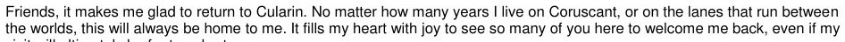
- **No single roster character (rules/setting/general)** — entry/section: Lavina Wren: "We are at war, and the worst of it is, we are at war with ourselves." Source: *05:08:03 - Long Live the Republic* (SWRPG d20 Revised Core), scan p.1
  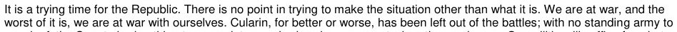
- **No single roster character (rules/setting/general)** — entry/section: Lavina Wren: "We here in Cularin fly in a small ship." Source: *05:08:03 - Long Live the Republic* (SWRPG d20 Revised Core), scan p.1
  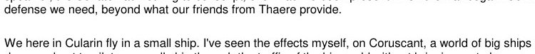
- **No single roster character (rules/setting/general)** — entry/section: Lavina Wren: "The subtlety, the ability to remain unnoticed, is both the best and the worst part of piloting a ship as small as ours." Source: *05:08:03 - Long Live the Republic* (SWRPG d20 Revised Core), scan p.1
  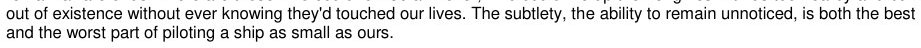
- **No single roster character (rules/setting/general)** — entry/section: Lavina Wren: "I will paraphrase what Master Windu has said: The Jedi are protectors, not soldiers." Source: *05:08:03 - Long Live the Republic* (SWRPG d20 Revised Core), scan p.1
  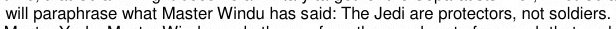

## scan p.2 (scan page 2)

Page contents: Geonosis; Thaere; arrests; loyalty; close (hand-read)

- **No single roster character (rules/setting/general)** — entry/section: Lavina Wren: "One lesson of the battle of Geonosis is that Jedi are mortal, just like the rest of us. A thousand myths, and many more living beings, died that day." Source: *05:08:03 - Long Live the Republic* (SWRPG d20 Revised Core), scan p.2
  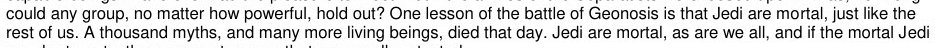
- **No single roster character (rules/setting/general)** — entry/section: Lavina Wren: "It appears that we have three fewer Separatists in the system, thanks to the Thaereian Navy. We should be . . . grateful that they are here and helping us to keep peace." Source: *05:08:03 - Long Live the Republic* (SWRPG d20 Revised Core), scan p.2
  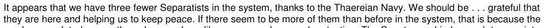
- **No single roster character (rules/setting/general)** — entry/section: Lavina Wren: "It may be that the vessel in which we find ourselves is not the vessel we might have chosen, but it's easier to fly to Coruscant in a ship we find unpleasant than it is to walk." Source: *05:08:03 - Long Live the Republic* (SWRPG d20 Revised Core), scan p.2
  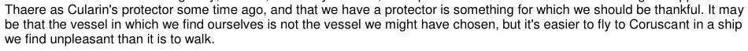
- **No single roster character (rules/setting/general)** — entry/section: Lavina Wren: "The Republic is strong. The Republic is kind and generous. The Republic works." Source: *05:08:03 - Long Live the Republic* (SWRPG d20 Revised Core), scan p.2
  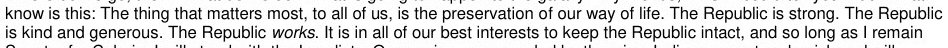
- **No single roster character (rules/setting/general)** — entry/section: Lavina Wren: "We cannot stand by and watch something that has endured for a thousand generations vanish because a handful of over-proud fools believe they can do it "better."" Source: *05:08:03 - Long Live the Republic* (SWRPG d20 Revised Core), scan p.2
  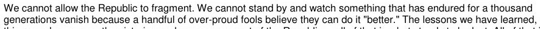
- **No single roster character (rules/setting/general)** — entry/section: Lavina Wren: "I am loyal to the Republic, to the Senate, and to Supreme Chancellor Palpatine." Source: *05:08:03 - Long Live the Republic* (SWRPG d20 Revised Core), scan p.2
  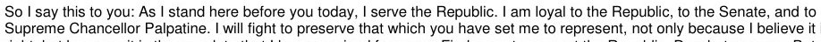
- **No single roster character (rules/setting/general)** — entry/section: Lavina Wren: "We still fly a small ship, and the galaxy is larger than any of us have imagined. Long live the Republic!" Source: *05:08:03 - Long Live the Republic* (SWRPG d20 Revised Core), scan p.2
  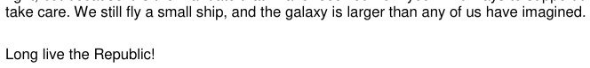
