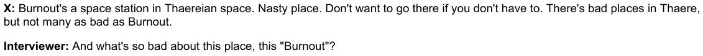
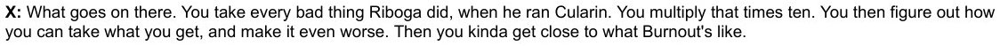
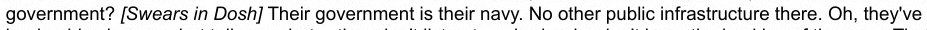
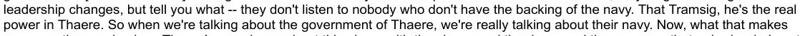
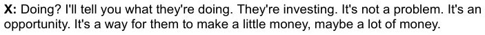
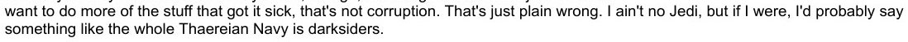
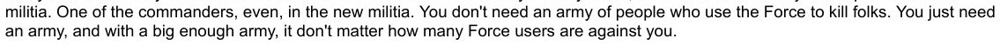
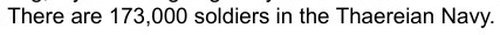
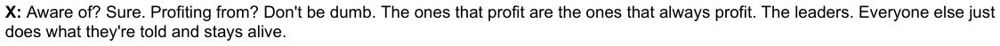
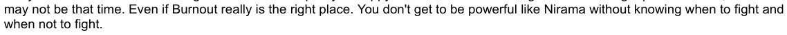

# Owner Material 037 — Star Wars D20 Drive folder (Core, Revised Core and Saga Edition): Living Force Campaign/Articles/Year 3/06:05:03 - Burnout.pdf [Star Wars Roleplaying Game Revised Core (d20, 2002)]

- **Source:** Wizards of the Coast Star Wars Roleplaying Game books, web enhancements, Living Force campaign modules and articles (2000–2010), from the owner's "Star Wars D20" Drive folder (only the three edition subfolders; "General" was not read, as instructed). Secondary source (licensed Legends reference). Scan OCR'd on the box; the scan stays box-only and is **not** published.
- **Method:** every scanned page was OCR'd and machine-screened sentence by sentence for power-relevant statements (fights, kills, defeats, Force feats, rankings, superweapons) that name a character on our roster; each kept sentence is quoted verbatim from the OCR text and has a crop of the printed passage directly under it. Pages with nothing power-relevant are still listed with what is on them.
- **Citation:** "*06:05:03 - Burnout* (SWRPG d20 Revised Core), p.X" by printed page ("scan p.X" where no printed number applies). **Weight:** Licensed RPG material: a secondary source. Narrative text sums up Legends lore; game statistics are rules for players, not canon power levels, and rank lowest.

## scan p.1 (scan page 1)

Page contents: Interview setup; X; Burnout described (hand-read)

- **No single roster character (rules/setting/general)** — entry/section: X (informant): "There's bad places in Thaere, but not many as bad as Burnout." Source: *06:05:03 - Burnout* (SWRPG d20 Revised Core), scan p.1
  
- **No single roster character (rules/setting/general)** — entry/section: X (informant): "You take every bad thing Riboga did, when he ran Cularin. You multiply that times ten. You then figure out how you can take what you get, and make it even worse. Then you kinda get close to what Burnout's like." Source: *06:05:03 - Burnout* (SWRPG d20 Revised Core), scan p.1
  

## scan p.2 (scan page 2)

Page contents: Thaere = navy; Tramsig; corruption; 173,000; threat; Nirama; box (hand-read)

- **No single roster character (rules/setting/general)** — entry/section: X (informant): "Their government is their navy. No other public infrastructure there." Source: *06:05:03 - Burnout* (SWRPG d20 Revised Core), scan p.2
  
- **No single roster character (rules/setting/general)** — entry/section: Tramsig: "That Tramsig, he's the real power in Thaere." Source: *06:05:03 - Burnout* (SWRPG d20 Revised Core), scan p.2
  
- **No single roster character (rules/setting/general)** — entry/section: X (informant): "X: Doing? I'll tell you what they're doing. They're investing. It's not a problem. It's an opportunity." Source: *06:05:03 - Burnout* (SWRPG d20 Revised Core), scan p.2
  
- **No single roster character (rules/setting/general)** — entry/section: X (informant): "I ain't no Jedi, but if I were, I'd probably say something like the whole Thaereian Navy is darksiders." Source: *06:05:03 - Burnout* (SWRPG d20 Revised Core), scan p.2
  
- **No single roster character (rules/setting/general)** — entry/section: X (informant): "You don't need an army of people who use the Force to kill folks. You just need an army, and with a big enough army, it don't matter how many Force users are against you." Source: *06:05:03 - Burnout* (SWRPG d20 Revised Core), scan p.2
  
- **No single roster character (rules/setting/general)** — entry/section: X (informant): "There are 173,000 soldiers in the Thaereian Navy." Source: *06:05:03 - Burnout* (SWRPG d20 Revised Core), scan p.2
  
- **No single roster character (rules/setting/general)** — entry/section: X (informant): "X: Aware of? Sure. Profiting from? Don't be dumb. The ones that profit are the ones that always profit. The leaders. Everyone else just does what they're told and stays alive." Source: *06:05:03 - Burnout* (SWRPG d20 Revised Core), scan p.2
  
- **No single roster character (rules/setting/general)** — entry/section: Nirama: "You don't get to be powerful like Nirama without knowing when to fight and when not to fight." Source: *06:05:03 - Burnout* (SWRPG d20 Revised Core), scan p.2
  

## scan p.3 (scan page 3)

Page contents: Closing (image) (hand-read)

