# Owner Material 037 — Star Wars D20 Drive folder (Core, Revised Core and Saga Edition): Living Force Campaign/Articles/Year 3/06:19:03 - Devan.pdf [Star Wars Roleplaying Game Revised Core (d20, 2002)]

- **Source:** Wizards of the Coast Star Wars Roleplaying Game books, web enhancements, Living Force campaign modules and articles (2000–2010), from the owner's "Star Wars D20" Drive folder (only the three edition subfolders; "General" was not read, as instructed). Secondary source (licensed Legends reference). Scan OCR'd on the box; the scan stays box-only and is **not** published.
- **Method:** every scanned page was OCR'd and machine-screened sentence by sentence for power-relevant statements (fights, kills, defeats, Force feats, rankings, superweapons) that name a character on our roster; each kept sentence is quoted verbatim from the OCR text and has a crop of the printed passage directly under it. Pages with nothing power-relevant are still listed with what is on them.
- **Citation:** "*06:19:03 - Devan* (SWRPG d20 Revised Core), p.X" by printed page ("scan p.X" where no printed number applies). **Weight:** Licensed RPG material: a secondary source. Narrative text sums up Legends lore; game statistics are rules for players, not canon power levels, and rank lowest.

## scan p.1 (scan page 1)

Page contents: Devan background; Mistress of Lightsabers; forms; quotes: Jedi role, Cularin (hand-read)

- **No single roster character (rules/setting/general)** — entry/section: Devan For'deschel: "She teaches that rushing the attack is the quickest way to fail, and that the enemy will often give you all the weaponry you need to defeat him." Source: *06:19:03 - Devan* (SWRPG d20 Revised Core), scan p.1
  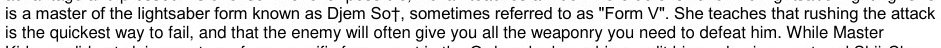
- **Mace Windu** — entry/section: Mace Windu (as quoted by Devan): "Master Windu taught me that we are protectors, not soldiers. Right now, in our galaxy, there is little difference." Source: *06:19:03 - Devan* (SWRPG d20 Revised Core), scan p.1
  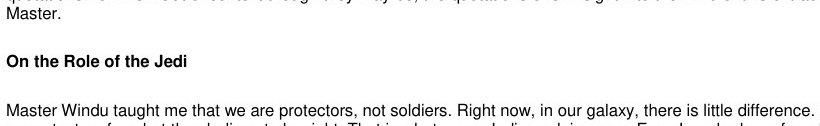
- **No single roster character (rules/setting/general)** — entry/section: Devan For'deschel: "Master Windu taught me that we are protectors, not soldiers. Right now, in our galaxy, there is little difference. Soldiers serve as protectors for what they believe to be right." Source: *06:19:03 - Devan* (SWRPG d20 Revised Core), scan p.1
  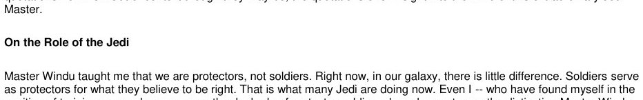
- **No single roster character (rules/setting/general)** — entry/section: Devan For'deschel: "We Jedi must do everything in our power to protect the Republic. If that means going to war, then we go to war." Source: *06:19:03 - Devan* (SWRPG d20 Revised Core), scan p.1
  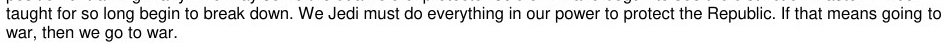
- **No single roster character (rules/setting/general)** — entry/section: Devan For'deschel: "It's like a pocket of the galaxy that exists on its own terms." Source: *06:19:03 - Devan* (SWRPG d20 Revised Core), scan p.1
  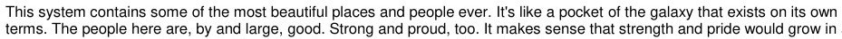
- **No single roster character (rules/setting/general)** — entry/section: Devan For'deschel: "Because for all its beauty, I think Cularin may also be one of the most dangerous places I've ever lived. So many followers of the dark side, and such dark side energy . . . The Clone Wars haven't touched here. Yet. But something has." Source: *06:19:03 - Devan* (SWRPG d20 Revised Core), scan p.1
  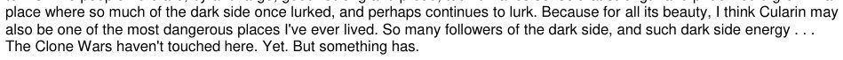

## scan p.2 (scan page 2)

Page contents: Quotes: Lanius, Master; stat block (hand-read)

- **No single roster character (rules/setting/general)** — entry/section: Devan For'deschel: "A kind and brave man. Thoroughly committed to training Jedi. Do I agree with all of his methods? I'm not sure if they're for me to agree with." Source: *06:19:03 - Devan* (SWRPG d20 Revised Core), scan p.2
  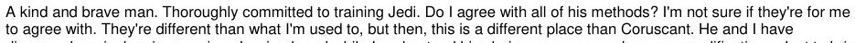
- **No single roster character (rules/setting/general)** — entry/section: Devan For'deschel: "I hadn't planned to become a Master. It was simply the most logical path that opened after my Padawan training was complete." Source: *06:19:03 - Devan* (SWRPG d20 Revised Core), scan p.2
  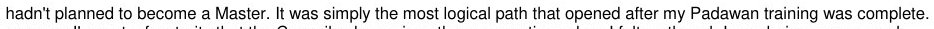
- **No single roster character (rules/setting/general)** — entry/section: Devan For'deschel: "As to being a "Master," I will admit that the term has always unnerved me. I am not a "Master" of anything. I learn and grow every day." Source: *06:19:03 - Devan* (SWRPG d20 Revised Core), scan p.2
  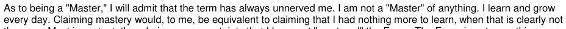
- **No single roster character (rules/setting/general)** — entry/section: Devan For'deschel: "The Force is not something any individual can master. It is part of us." Source: *06:19:03 - Devan* (SWRPG d20 Revised Core), scan p.2
  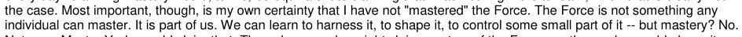
- **No single roster character (rules/setting/general)** — entry/section: Devan For'deschel: "Not even Master Yoda would claim that. The only ones who might claim mastery of the Force are those who would abuse it. And, if you ask me, they haven't even mastered the most basic thing in the galaxy -- themselves." Source: *06:19:03 - Devan* (SWRPG d20 Revised Core), scan p.2
  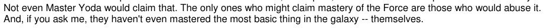

### Stat block notes (game mechanics, not feats)

- Devan For'deschel: Devan: Human Female Jedi Consular 14/Jedi Master 2; Init +5; Def 25 (29 with lightsaber ignited); VP/WP 112/12; Atk +19/+14/+9 melee (5d8-1 lightsaber), +17/+12/+7 ranged (3d8 heavy blaster pistol); SQ healing, deflect (extended), Force secret battlemind +1; SV +12/+12/+12; FP 9; DSP 0; Rep +5; Str 8, Dex 20, Con 12, Int 16, Wis 12, Cha 14; Tumble +20, Enhance Ability +22, Move Object +18, Affect Mind +17; Feats: Combat Expertise, Heroic Surge, Weapon Finesse/Focus (lightsaber); Force feats incl. Burst of Speed, Compassion, Dissipate Energy, Djem So Mastery, Knight Defense, Lightsaber Defense; teal-bladed self-built lightsaber (Source: *06:19:03 - Devan* (SWRPG d20 Revised Core), scan p.2)
