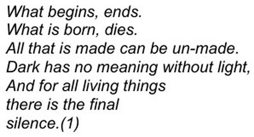
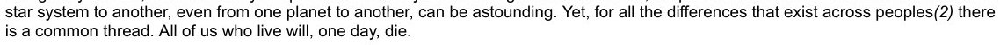
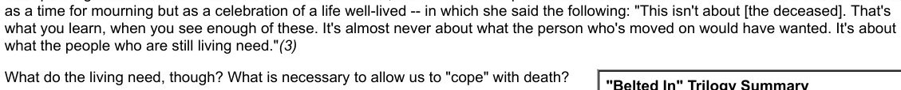
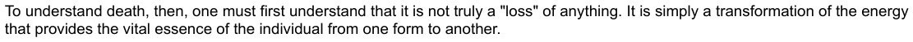
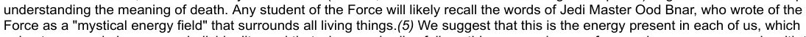
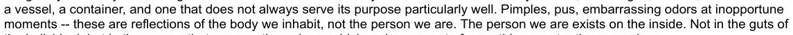
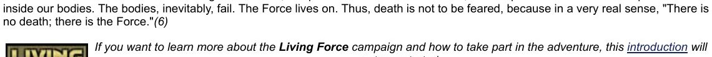

# Owner Material 037 — Star Wars D20 Drive folder (Core, Revised Core and Saga Edition): Living Force Campaign/Articles/Year 3/07:03:03 - Life's Memories.pdf [Star Wars Roleplaying Game Revised Core (d20, 2002)]

- **Source:** Wizards of the Coast Star Wars Roleplaying Game books, web enhancements, Living Force campaign modules and articles (2000–2010), from the owner's "Star Wars D20" Drive folder (only the three edition subfolders; "General" was not read, as instructed). Secondary source (licensed Legends reference). Scan OCR'd on the box; the scan stays box-only and is **not** published.
- **Method:** every scanned page was OCR'd and machine-screened sentence by sentence for power-relevant statements (fights, kills, defeats, Force feats, rankings, superweapons) that name a character on our roster; each kept sentence is quoted verbatim from the OCR text and has a crop of the printed passage directly under it. Pages with nothing power-relevant are still listed with what is on them.
- **Citation:** "*07:03:03 - Life's Memories* (SWRPG d20 Revised Core), p.X" by printed page ("scan p.X" where no printed number applies). **Weight:** Licensed RPG material: a secondary source. Narrative text sums up Legends lore; game statistics are rules for players, not canon power levels, and rank lowest.

## scan p.1 (scan page 1)

Page contents: Intro; thesis; poem; children and death; Dariana; box (hand-read)

- **No single roster character (rules/setting/general)** — entry/section: San Herrera and Nia Reston: "What begins, ends. What is born, dies. All that is made can be un-made. Dark has no meaning without light, And for all living things there is the final silence." Source: *07:03:03 - Life's Memories* (SWRPG d20 Revised Core), scan p.1
  
- **No single roster character (rules/setting/general)** — entry/section: San Herrera and Nia Reston: "Yet, for all the differences that exist across peoples(2) there is acommon thread. All of us who live will, one day, die." Source: *07:03:03 - Life's Memories* (SWRPG d20 Revised Core), scan p.1
  
- **No single roster character (rules/setting/general)** — entry/section: Dariana: ""This isn't about [the deceased]. That's what you learn, when you see enough of these. It's almost never about what the person who's moved on would have wanted. It's about what the people who are still living need."" Source: *07:03:03 - Life's Memories* (SWRPG d20 Revised Core), scan p.1
  

## scan p.2 (scan page 2)

Page contents: Energy; the Force as energy; Jedi Code; footnotes (hand-read)

- **No single roster character (rules/setting/general)** — entry/section: San Herrera and Nia Reston: "It is simply a transformation of the energy that provides the vital essence of the individual from one form to another." Source: *07:03:03 - Life's Memories* (SWRPG d20 Revised Core), scan p.2
  
- **Ood Bnar** — entry/section: Ood Bnar (cited): "Any student of the Force will likely recall the words of Jedi Master Ood Bnar, who wrote of the Force as a "mystical energy field" that surrounds all living things.(5)" Source: *07:03:03 - Life's Memories* (SWRPG d20 Revised Core), scan p.2
  
- **No single roster character (rules/setting/general)** — entry/section: San Herrera and Nia Reston: "Pimples, pus, embarrassing odors at inopportune moments -- these are reflections of the body we inhabit, not the person we are." Source: *07:03:03 - Life's Memories* (SWRPG d20 Revised Core), scan p.2
  
- **No single roster character (rules/setting/general)** — entry/section: San Herrera and Nia Reston: "The bodies, inevitably, fail. The Force lives on. Thus, death is not to be feared, because in a very real sense, "There is no death; there is the Force."(6)" Source: *07:03:03 - Life's Memories* (SWRPG d20 Revised Core), scan p.2
  
