# Owner Material 037 — Star Wars D20 Drive folder (Core, Revised Core and Saga Edition): Living Force Campaign/Articles/Year 3/07:17:03 - Trouble Follows Us.pdf [Star Wars Roleplaying Game Revised Core (d20, 2002)]

- **Source:** Wizards of the Coast Star Wars Roleplaying Game books, web enhancements, Living Force campaign modules and articles (2000–2010), from the owner's "Star Wars D20" Drive folder (only the three edition subfolders; "General" was not read, as instructed). Secondary source (licensed Legends reference). Scan OCR'd on the box; the scan stays box-only and is **not** published.
- **Method:** every scanned page was OCR'd and machine-screened sentence by sentence for power-relevant statements (fights, kills, defeats, Force feats, rankings, superweapons) that name a character on our roster; each kept sentence is quoted verbatim from the OCR text and has a crop of the printed passage directly under it. Pages with nothing power-relevant are still listed with what is on them.
- **Citation:** "*07:17:03 - Trouble Follows Us* (SWRPG d20 Revised Core), p.X" by printed page ("scan p.X" where no printed number applies). **Weight:** Licensed RPG material: a secondary source. Narrative text sums up Legends lore; game statistics are rules for players, not canon power levels, and rank lowest.

## scan p.1 (scan page 1)

Page contents: Intro; interview opens; Yara's drugged-drink excuse; Tarasin relief (hand-read)

- **No single roster character (rules/setting/general)** — entry/section: Yara Grugara: "Wave to the camera, kids!" Source: *07:17:03 - Trouble Follows Us* (SWRPG d20 Revised Core), scan p.1
  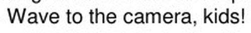
- **No single roster character (rules/setting/general)** — entry/section: Yara Grugara: "Yara: So young, to be so morbid." Source: *07:17:03 - Trouble Follows Us* (SWRPG d20 Revised Core), scan p.1
  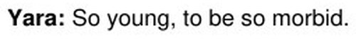
- **No single roster character (rules/setting/general)** — entry/section: Nia Reston: "They preach a lot to their own, but don't preach so much to anyone outside." Source: *07:17:03 - Trouble Follows Us* (SWRPG d20 Revised Core), scan p.1
  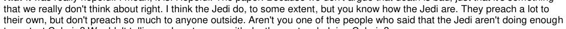
- **No single roster character (rules/setting/general)** — entry/section: Yara Grugara: "Voluntary drug tests later showed that someone had put something in Yara's drink, and my judgment was impaired." Source: *07:17:03 - Trouble Follows Us* (SWRPG d20 Revised Core), scan p.1
  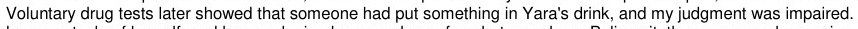
- **No single roster character (rules/setting/general)** — entry/section: Nia Reston: "They've been doing fine here for generations. We just kind of assumed that they had to have our help." Source: *07:17:03 - Trouble Follows Us* (SWRPG d20 Revised Core), scan p.1
  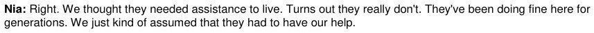

## scan p.2 (scan page 2)

Page contents: Cartel base; Uffel; hot one; item? (hand-read)

- **No single roster character (rules/setting/general)** — entry/section: Yara Grugara: "Well, let's face it. You two do seem to turn up in an awful lot of interesting places." Source: *07:17:03 - Trouble Follows Us* (SWRPG d20 Revised Core), scan p.2
  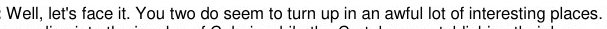
- **No single roster character (rules/setting/general)** — entry/section: Nia Reston: "She's just got loads of charisma." Source: *07:17:03 - Trouble Follows Us* (SWRPG d20 Revised Core), scan p.2
  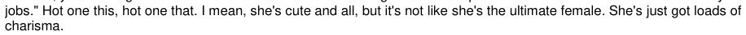
- **No single roster character (rules/setting/general)** — entry/section: San Herrera: "San: No. Nia: Yes. [They look at each other.] San: Yes. Nia: No." Source: *07:17:03 - Trouble Follows Us* (SWRPG d20 Revised Core), scan p.2
  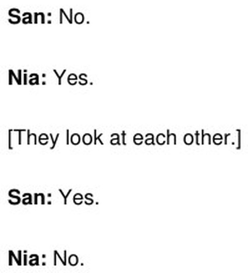

## scan p.3 (scan page 3)

Page contents: Droids and the Force; clones; Tilnes; sign-off (hand-read)

- **No single roster character (rules/setting/general)** — entry/section: Yara Grugara: "Yara: So, what happens when a droid dies?" Source: *07:17:03 - Trouble Follows Us* (SWRPG d20 Revised Core), scan p.3
  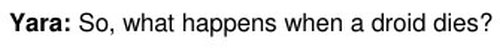
- **No single roster character (rules/setting/general)** — entry/section: San Herrera: "San: But they're machines. There's no Force in them." Source: *07:17:03 - Trouble Follows Us* (SWRPG d20 Revised Core), scan p.3
  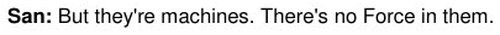
- **No single roster character (rules/setting/general)** — entry/section: Nia Reston: "By that logic, clones aren't alive, since they're made in vats. So there's no Force in clones?" Source: *07:17:03 - Trouble Follows Us* (SWRPG d20 Revised Core), scan p.3
  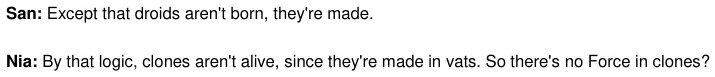
- **No single roster character (rules/setting/general)** — entry/section: San Herrera: "I mean, death. Since it seems to show up when we're around." Source: *07:17:03 - Trouble Follows Us* (SWRPG d20 Revised Core), scan p.3
  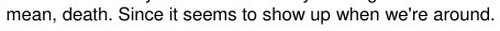
- **No single roster character (rules/setting/general)** — entry/section: Yara Grugara: "Yara: Trouble follows you, yes? San: I suppose it does. We'll let you know if we write that droid piece." Source: *07:17:03 - Trouble Follows Us* (SWRPG d20 Revised Core), scan p.3
  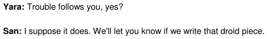

## scan p.4 (scan page 4)

Page contents: LF intro line only (hand-read)

