# Owner Material 037 — Star Wars D20 Drive folder (Core, Revised Core and Saga Edition): Living Force Campaign/Articles/Year 3/08:07:03 - The Darkstaff.pdf [Star Wars Roleplaying Game Revised Core (d20, 2002)]

- **Source:** Wizards of the Coast Star Wars Roleplaying Game books, web enhancements, Living Force campaign modules and articles (2000–2010), from the owner's "Star Wars D20" Drive folder (only the three edition subfolders; "General" was not read, as instructed). Secondary source (licensed Legends reference). Scan OCR'd on the box; the scan stays box-only and is **not** published.
- **Method:** every scanned page was OCR'd and machine-screened sentence by sentence for power-relevant statements (fights, kills, defeats, Force feats, rankings, superweapons) that name a character on our roster; each kept sentence is quoted verbatim from the OCR text and has a crop of the printed passage directly under it. Pages with nothing power-relevant are still listed with what is on them.
- **Citation:** "*08:07:03 - The Darkstaff* (SWRPG d20 Revised Core), p.X" by printed page ("scan p.X" where no printed number applies). **Weight:** Licensed RPG material: a secondary source. Narrative text sums up Legends lore; game statistics are rules for players, not canon power levels, and rank lowest.

## scan p.1 (scan page 1)

Page contents: Recap; journals found; Rivan excerpt: natives, darkness, Almas, darkstaff dreams; box (hand-read)

- **Darth Rivan** — entry/section: Darth Rivan: "Darkness is a friend, an ally. Darkness allows us to understand others, to see what they value when they believe no one else is looking." Source: *08:07:03 - The Darkstaff* (SWRPG d20 Revised Core), scan p.1
  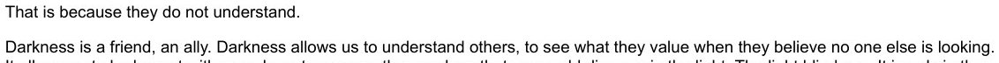
- **Darth Rivan** — entry/section: Darth Rivan: "The light blinds us. It is only in the dark that we see clearly, and there is a great dark hidden among these worlds." Source: *08:07:03 - The Darkstaff* (SWRPG d20 Revised Core), scan p.1
  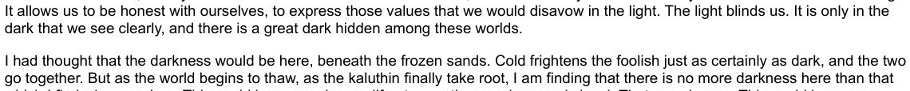
- **Darth Rivan** — entry/section: Darth Rivan: "I do not want it for myself. I want to destroy it." Source: *08:07:03 - The Darkstaff* (SWRPG d20 Revised Core), scan p.1
  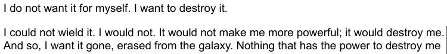
- **Darth Rivan** — entry/section: Darth Rivan: "Nothing that has the power to destroy me should be allowed to continue to exist, no matter how sweet the promises it makes, no matter how dark the night would be if I held it. It must be destroyed." Source: *08:07:03 - The Darkstaff* (SWRPG d20 Revised Core), scan p.1
  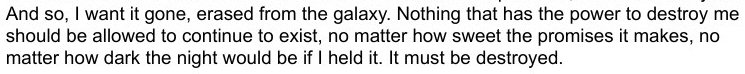
- **Darth Rivan** — entry/section: Darth Rivan: "Light moves around it but does not come into its grasp. It doesn't want the light. It wants the Force." Source: *08:07:03 - The Darkstaff* (SWRPG d20 Revised Core), scan p.1
  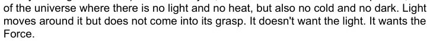

## scan p.2 (scan page 2)

Page contents: Darkstaff thoughts; holocron; 'the thing wants'; scream; resolve (hand-read)

- **Darth Rivan** — entry/section: Darth Rivan: "But I know such thoughts are not my own. They are the darkstaff's thoughts. It would use me to drain others, and then it would drain me." Source: *08:07:03 - The Darkstaff* (SWRPG d20 Revised Core), scan p.2
  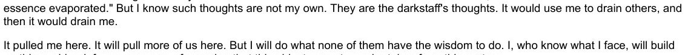
- **Darth Rivan** — entry/section: Darth Rivan: "It pulled me here. It will pull more of us here." Source: *08:07:03 - The Darkstaff* (SWRPG d20 Revised Core), scan p.2
  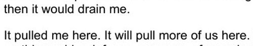
- **Darth Rivan** — entry/section: Darth Rivan: "The Force is our tool, after all. It is what makes us powerful, what allows us to stand above those who would put us down." Source: *08:07:03 - The Darkstaff* (SWRPG d20 Revised Core), scan p.2
  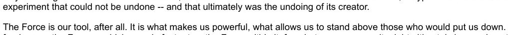
- **Darth Rivan** — entry/section: Darth Rivan: "The thing wants. Ambition is dangerous enough in a living creature. In an object, a creation with nothing to lose, it can be catastrophic." Source: *08:07:03 - The Darkstaff* (SWRPG d20 Revised Core), scan p.2
  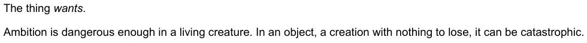
- **Darth Rivan** — entry/section: Darth Rivan: "Part of the darkness in this system is the afterimage of a scream. It's comforting. Most places, you cannot feel death." Source: *08:07:03 - The Darkstaff* (SWRPG d20 Revised Core), scan p.2
  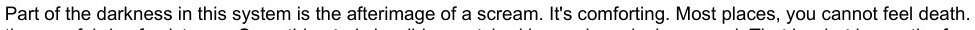
- **Darth Rivan** — entry/section: Darth Rivan: "It was held and given power, and then asked to provide something in return. It did. It provided death." Source: *08:07:03 - The Darkstaff* (SWRPG d20 Revised Core), scan p.2
  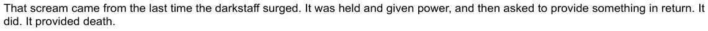
- **Darth Rivan** — entry/section: Darth Rivan: "I must. If I am to live forever, there is no other way." Source: *08:07:03 - The Darkstaff* (SWRPG d20 Revised Core), scan p.2
  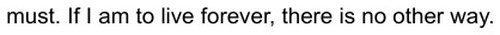
