# Owner Material 037 — Star Wars D20 Drive folder (Core, Revised Core and Saga Edition): Living Force Campaign/Articles/Year 3/08:21:03 - Thurm Loogg Speaks.pdf [Star Wars Roleplaying Game Revised Core (d20, 2002)]

- **Source:** Wizards of the Coast Star Wars Roleplaying Game books, web enhancements, Living Force campaign modules and articles (2000–2010), from the owner's "Star Wars D20" Drive folder (only the three edition subfolders; "General" was not read, as instructed). Secondary source (licensed Legends reference). Scan OCR'd on the box; the scan stays box-only and is **not** published.
- **Method:** every scanned page was OCR'd and machine-screened sentence by sentence for power-relevant statements (fights, kills, defeats, Force feats, rankings, superweapons) that name a character on our roster; each kept sentence is quoted verbatim from the OCR text and has a crop of the printed passage directly under it. Pages with nothing power-relevant are still listed with what is on them.
- **Citation:** "*08:21:03 - Thurm Loogg Speaks* (SWRPG d20 Revised Core), p.X" by printed page ("scan p.X" where no printed number applies). **Weight:** Licensed RPG material: a secondary source. Narrative text sums up Legends lore; game statistics are rules for players, not canon power levels, and rank lowest.

## scan p.1 (scan page 1)

Page contents: Loogg background; broadcast: breach, never-would list, Caarimon, contracts, effigy (hand-read)

- **No single roster character (rules/setting/general)** — entry/section: Thurm Loogg: "Hello, Cularin! It is I, the beneficent Thurm Loogg, representative of the omnibenevolent Metatheran Cartel, and I am here to speak to you." Source: *08:21:03 - Thurm Loogg Speaks* (SWRPG d20 Revised Core), scan p.1
  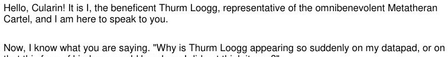
- **No single roster character (rules/setting/general)** — entry/section: Thurm Loogg: "Take heart, Cularin, for the Cartel is everywhere!" Source: *08:21:03 - Thurm Loogg Speaks* (SWRPG d20 Revised Core), scan p.1
  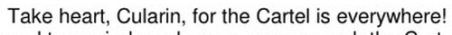
- **No single roster character (rules/setting/general)** — entry/section: Thurm Loogg: "That is right, we love you enough to exploit weaknesses in your defenses!" Source: *08:21:03 - Thurm Loogg Speaks* (SWRPG d20 Revised Core), scan p.1
  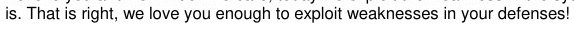
- **No single roster character (rules/setting/general)** — entry/section: Thurm Loogg: "It would be rude!" Source: *08:21:03 - Thurm Loogg Speaks* (SWRPG d20 Revised Core), scan p.1
  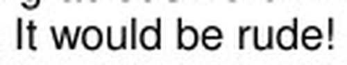
- **No single roster character (rules/setting/general)** — entry/section: Thurm Loogg: "It is a mark of your affection for me, I know, and it is something that I return with all my hearts." Source: *08:21:03 - Thurm Loogg Speaks* (SWRPG d20 Revised Core), scan p.1
  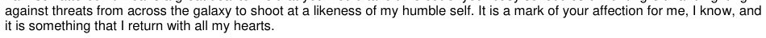

## scan p.2 (scan page 2)

Page contents: Can't shoot; Sith; Dooku; gundarks; Thaere bribes; cut off (hand-read)

- **No single roster character (rules/setting/general)** — entry/section: Thurm Loogg: "I would never want to shoot at you - I cannot shoot at all, so it would do no good!" Source: *08:21:03 - Thurm Loogg Speaks* (SWRPG d20 Revised Core), scan p.2
  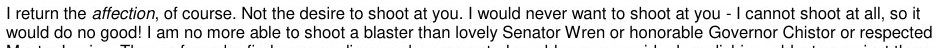
- **No single roster character (rules/setting/general)** — entry/section: Thurm Loogg: "Oh, and may I mention that there has never been a Caarite Sith Lord?" Source: *08:21:03 - Thurm Loogg Speaks* (SWRPG d20 Revised Core), scan p.2
  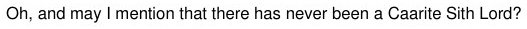
- **No single roster character (rules/setting/general)** — entry/section: Thurm Loogg: "Evil Count Dooku has split the galaxy. He is a bad man!" Source: *08:21:03 - Thurm Loogg Speaks* (SWRPG d20 Revised Core), scan p.2
  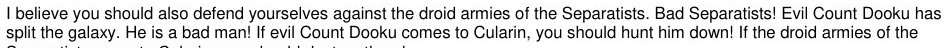
- **No single roster character (rules/setting/general)** — entry/section: Thurm Loogg: "There are things you are very bad at shooting. Trees. Rocks. Small furry creatures." Source: *08:21:03 - Thurm Loogg Speaks* (SWRPG d20 Revised Core), scan p.2
  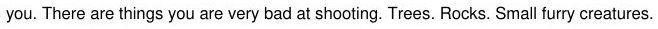
- **No single roster character (rules/setting/general)** — entry/section: Thurm Loogg: "Separatists are bad! Down with Separatists! Clones are our friends. The Cartel loves clones!" Source: *08:21:03 - Thurm Loogg Speaks* (SWRPG d20 Revised Core), scan p.2
  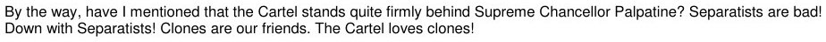
- **No single roster character (rules/setting/general)** — entry/section: Thurm Loogg: "I feel obliged to point out that the Cartel does not now, nor has it ever, trafficked in gundarks." Source: *08:21:03 - Thurm Loogg Speaks* (SWRPG d20 Revised Core), scan p.2
  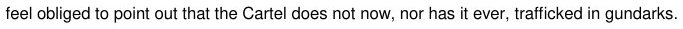
- **No single roster character (rules/setting/general)** — entry/section: Thurm Loogg: "We must move our goods through their perimeter, but we do so just as any other legitimate business does. With bribes and smuggling." Source: *08:21:03 - Thurm Loogg Speaks* (SWRPG d20 Revised Core), scan p.2
  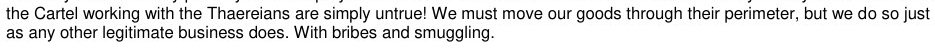
- **No single roster character (rules/setting/general)** — entry/section: Thurm Loogg: "Just one poor, misbegotten individual driven mad by too much time in hyperspace." Source: *08:21:03 - Thurm Loogg Speaks* (SWRPG d20 Revised Core), scan p.2
  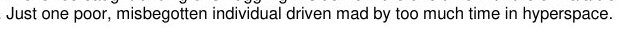
- **No single roster character (rules/setting/general)** — entry/section: Thurm Loogg: "So, I wish you good evening. May the For--" Source: *08:21:03 - Thurm Loogg Speaks* (SWRPG d20 Revised Core), scan p.2
  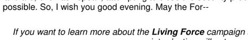
