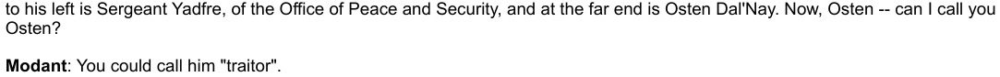
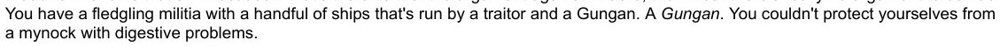
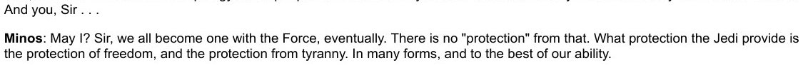
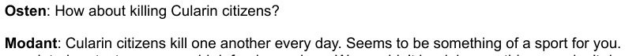
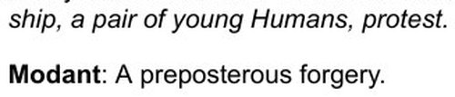
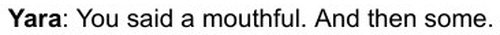
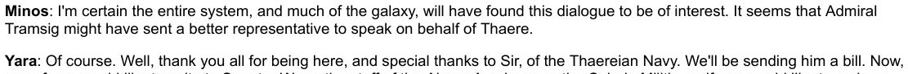

# Owner Material 037 — Star Wars D20 Drive folder (Core, Revised Core and Saga Edition): Living Force Campaign/Articles/Year 3/09:04:03 - Jurisdiction.pdf [Star Wars Roleplaying Game Revised Core (d20, 2002)]

- **Source:** Wizards of the Coast Star Wars Roleplaying Game books, web enhancements, Living Force campaign modules and articles (2000–2010), from the owner's "Star Wars D20" Drive folder (only the three edition subfolders; "General" was not read, as instructed). Secondary source (licensed Legends reference). Scan OCR'd on the box; the scan stays box-only and is **not** published.
- **Method:** every scanned page was OCR'd and machine-screened sentence by sentence for power-relevant statements (fights, kills, defeats, Force feats, rankings, superweapons) that name a character on our roster; each kept sentence is quoted verbatim from the OCR text and has a crop of the printed passage directly under it. Pages with nothing power-relevant are still listed with what is on them.
- **Citation:** "*09:04:03 - Jurisdiction* (SWRPG d20 Revised Core), p.X" by printed page ("scan p.X" where no printed number applies). **Weight:** Licensed RPG material: a secondary source. Narrative text sums up Legends lore; game statistics are rules for players, not canon power levels, and rank lowest.

## scan p.1 (scan page 1)

Page contents: Intro; panel list; seating; Modant 'Sir' (hand-read)

- **No single roster character (rules/setting/general)** — entry/section: Hyx Modant: "Colonel Modant: We can end the discussion before it even starts, young woman." Source: *09:04:03 - Jurisdiction* (SWRPG d20 Revised Core), scan p.1
  
- **No single roster character (rules/setting/general)** — entry/section: Yara Grugara: "Lackey, toady, errand-boy -- any preference?" Source: *09:04:03 - Jurisdiction* (SWRPG d20 Revised Core), scan p.1
  
- **No single roster character (rules/setting/general)** — entry/section: Hyx Modant: "Modant: Call me "Sir."" Source: *09:04:03 - Jurisdiction* (SWRPG d20 Revised Core), scan p.1
  
- **No single roster character (rules/setting/general)** — entry/section: Hyx Modant: "Modant: You could call him "traitor"." Source: *09:04:03 - Jurisdiction* (SWRPG d20 Revised Core), scan p.1
  

## scan p.2 (scan page 2)

Page contents: Osten; Modant; Yadfre; Minos; Yara apology; Sa'arli; box (crop) (hand-read)

- **No single roster character (rules/setting/general)** — entry/section: Osten Dal'Nay: "Thaere's presence is no longer needed. We have our own militia. We can take care of ourselves." Source: *09:04:03 - Jurisdiction* (SWRPG d20 Revised Core), scan p.2
  
- **No single roster character (rules/setting/general)** — entry/section: Hyx Modant: "You have a fledgling militia with a handful of ships that's run by a traitor and a Gungan. A Gungan. You couldn't protect yourselves from a mynock with digestive problems." Source: *09:04:03 - Jurisdiction* (SWRPG d20 Revised Core), scan p.2
  
- **No single roster character (rules/setting/general)** — entry/section: Minos: "Minos: Just Minos, thank you. One "Sir" at the table is enough." Source: *09:04:03 - Jurisdiction* (SWRPG d20 Revised Core), scan p.2
  
- **No single roster character (rules/setting/general)** — entry/section: Minos: "The Jedi do not exist to fight wars. We can help to keep the peace, but ultimately, we are a small part of the system." Source: *09:04:03 - Jurisdiction* (SWRPG d20 Revised Core), scan p.2
  
- **No single roster character (rules/setting/general)** — entry/section: Minos: "Sir, we all become one with the Force, eventually. There is no "protection" from that. What protection the Jedi provide is the protection of freedom, and the protection from tyranny." Source: *09:04:03 - Jurisdiction* (SWRPG d20 Revised Core), scan p.2
  
- **No single roster character (rules/setting/general)** — entry/section: Osten Dal'Nay: "Osten: Only if the people agree with the Senator. She could be wrong, you know." Source: *09:04:03 - Jurisdiction* (SWRPG d20 Revised Core), scan p.2
  

## scan p.3 (scan page 3)

Page contents: Revocation rules; slavery/killing; name-calling; Modant rises (hand-read)

- **No single roster character (rules/setting/general)** — entry/section: Hyx Modant: "Cularin citizens kill one another every day. Seems to be something of a sport for you." Source: *09:04:03 - Jurisdiction* (SWRPG d20 Revised Core), scan p.3
  
- **No single roster character (rules/setting/general)** — entry/section: Sa'arli: "Sa'arli: Would you two please take your egos and go outside, if you can't be quiet?" Source: *09:04:03 - Jurisdiction* (SWRPG d20 Revised Core), scan p.3
  
- **No single roster character (rules/setting/general)** — entry/section: Osten Dal'Nay: "Osten: Evil monkey-lizards whose parents bred with banthas?" Source: *09:04:03 - Jurisdiction* (SWRPG d20 Revised Core), scan p.3
  
- **No single roster character (rules/setting/general)** — entry/section: Hyx Modant: "Modant: I've had enough of this nerf-herding." Source: *09:04:03 - Jurisdiction* (SWRPG d20 Revised Core), scan p.3
  

## scan p.4 (scan page 4)

Page contents: Footage; Modant shoots screen; final comments (hand-read)

- **No single roster character (rules/setting/general)** — entry/section: Hyx Modant: "Modant: A preposterous forgery." Source: *09:04:03 - Jurisdiction* (SWRPG d20 Revised Core), scan p.4
  
- **No single roster character (rules/setting/general)** — entry/section: Osten Dal'Nay: "Osten: "Thaere: If we don't like what we see, we shoot it."" Source: *09:04:03 - Jurisdiction* (SWRPG d20 Revised Core), scan p.4
  
- **No single roster character (rules/setting/general)** — entry/section: Yara Grugara: "Yara: You said a mouthful. And then some." Source: *09:04:03 - Jurisdiction* (SWRPG d20 Revised Core), scan p.4
  
- **No single roster character (rules/setting/general)** — entry/section: Minos: "It seems that Admiral Tramsig might have sent a better representative to speak on behalf of Thaere." Source: *09:04:03 - Jurisdiction* (SWRPG d20 Revised Core), scan p.4
  
- **No single roster character (rules/setting/general)** — entry/section: Yara Grugara: "Yara: And if you'd like to let Colonel Modant know what you thought of him, his private comlink number is --" Source: *09:04:03 - Jurisdiction* (SWRPG d20 Revised Core), scan p.4
  
