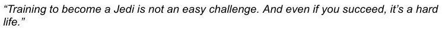
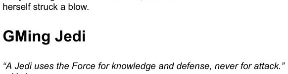

# Owner Material 037 — Star Wars D20 Drive folder (Core, Revised Core and Saga Edition): Living Force Campaign/Articles/Year 3/09:11:03 - You Are Not a Jedi Yet.pdf [Star Wars Roleplaying Game Revised Core (d20, 2002)]

- **Source:** Wizards of the Coast Star Wars Roleplaying Game books, web enhancements, Living Force campaign modules and articles (2000–2010), from the owner's "Star Wars D20" Drive folder (only the three edition subfolders; "General" was not read, as instructed). Secondary source (licensed Legends reference). Scan OCR'd on the box; the scan stays box-only and is **not** published.
- **Method:** every scanned page was OCR'd and machine-screened sentence by sentence for power-relevant statements (fights, kills, defeats, Force feats, rankings, superweapons) that name a character on our roster; each kept sentence is quoted verbatim from the OCR text and has a crop of the printed passage directly under it. Pages with nothing power-relevant are still listed with what is on them.
- **Citation:** "*09:11:03 - You Are Not a Jedi Yet* (SWRPG d20 Revised Core), p.X" by printed page ("scan p.X" where no printed number applies). **Weight:** Licensed RPG material: a secondary source. Narrative text sums up Legends lore; game statistics are rules for players, not canon power levels, and rank lowest.

## scan p.1 (scan page 1)

Page contents: Intro; Role of Jedi; Leading and Following; Areas of Expertise (hand-read)

- **No single roster character (rules/setting/general)** — entry/section: Qui-Gon Jinn (epigraph): ""Training to become a Jedi is not an easy challenge. And even if you succeed, it's a hard life." —Qui-Gon Jinn" Source: *09:11:03 - You Are Not a Jedi Yet* (SWRPG d20 Revised Core), scan p.1
  

## scan p.2 (scan page 2)

Page contents: Expertise cont; Responsibility and Consequences; Using the Force; FP and DSP; Jedi in Combat (hand-read)

## scan p.3 (scan page 3)

Page contents: Jedi Combat Tactics; GMing Jedi with Yoda epigraph (hand-read)

- **Yoda** — entry/section: Yoda (epigraph): ""A Jedi uses the Force for knowledge and defense, never for attack." —Yoda" Source: *09:11:03 - You Are Not a Jedi Yet* (SWRPG d20 Revised Core), scan p.3
  

## scan p.4 (scan page 4)

Page contents: Giving Out DSPs (three strikes); Assigning Consequences (Living Force, Lanius Qel-Bertuk, Almas Academy) (hand-read)

