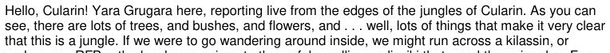
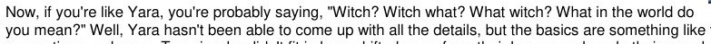
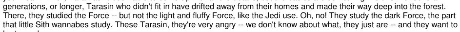
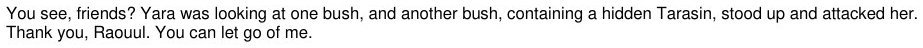
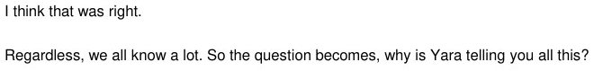
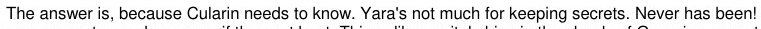
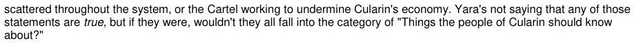
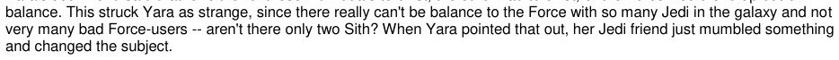
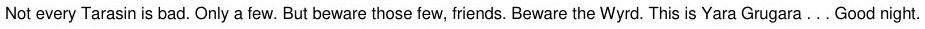

# Owner Material 037 — Star Wars D20 Drive folder (Core, Revised Core and Saga Edition): Living Force Campaign/Articles/Year 3/09:18:03 - News of the Wyrd.pdf [Star Wars Roleplaying Game Revised Core (d20, 2002)]

- **Source:** Wizards of the Coast Star Wars Roleplaying Game books, web enhancements, Living Force campaign modules and articles (2000–2010), from the owner's "Star Wars D20" Drive folder (only the three edition subfolders; "General" was not read, as instructed). Secondary source (licensed Legends reference). Scan OCR'd on the box; the scan stays box-only and is **not** published.
- **Method:** every scanned page was OCR'd and machine-screened sentence by sentence for power-relevant statements (fights, kills, defeats, Force feats, rankings, superweapons) that name a character on our roster; each kept sentence is quoted verbatim from the OCR text and has a crop of the printed passage directly under it. Pages with nothing power-relevant are still listed with what is on them.
- **Citation:** "*09:18:03 - News of the Wyrd* (SWRPG d20 Revised Core), p.X" by printed page ("scan p.X" where no printed number applies). **Weight:** Licensed RPG material: a secondary source. Narrative text sums up Legends lore; game statistics are rules for players, not canon power levels, and rank lowest.

## scan p.1 (scan page 1)

Page contents: Yara intro; Wyrd as Force witches; bush staging with Raouul; why Yara tells (hand-read)

- **No single roster character (rules/setting/general)** — entry/section: Yara Grugara: "Hello, Cularin! Yara Grugara here, reporting live from the edges of the jungles of Cularin. As you can see, there are lots of trees, and bushes, and flowers, and. . . well, lots of things that make it very clear that this is a jungle." Source: *09:18:03 - News of the Wyrd* (SWRPG d20 Revised Core), scan p.1
  
- **No single roster character (rules/setting/general)** — entry/section: Yara Grugara: "Now, if you're like Yara, you're probably saying, "Witch? Witch what? What witch? What in the world do you mean?"" Source: *09:18:03 - News of the Wyrd* (SWRPG d20 Revised Core), scan p.1
  
- **No single roster character (rules/setting/general)** — entry/section: Yara Grugara: "There, they studied the Force -- but not the light and fluffy Force, like the Jedi use. Oh, no! They study the dark Force, the part that little Sith wannabes study." Source: *09:18:03 - News of the Wyrd* (SWRPG d20 Revised Core), scan p.1
  
- **No single roster character (rules/setting/general)** — entry/section: Yara Grugara: "All right, I'm shaking it now . . . I'm shaking it some more . . . Now I'm shaking it even more..." Source: *09:18:03 - News of the Wyrd* (SWRPG d20 Revised Core), scan p.1
  
- **No single roster character (rules/setting/general)** — entry/section: Yara Grugara: "You see, friends? Yara was looking at one bush, and another bush, containing a hidden Tarasin, stood up and attacked her. Thank you, Raouul. You can let go of me." Source: *09:18:03 - News of the Wyrd* (SWRPG d20 Revised Core), scan p.1
  
- **No single roster character (rules/setting/general)** — entry/section: Yara Grugara: "I think that was right. Regardless, we all know a lot. So the question becomes, why is Yara telling you all this?" Source: *09:18:03 - News of the Wyrd* (SWRPG d20 Revised Core), scan p.1
  
- **No single roster character (rules/setting/general)** — entry/section: Yara Grugara: "The answer is, because Cularin needs to know. Yara's not much for keeping secrets. Never has been!" Source: *09:18:03 - News of the Wyrd* (SWRPG d20 Revised Core), scan p.1
  

## scan p.2 (scan page 2)

Page contents: Secrets; Liriana and Mother Dariana; balance; Wyrd attacks; montage; sign-off; Kua stats; Amasi start (hand-read)

- **No single roster character (rules/setting/general)** — entry/section: Yara Grugara: "Yara's not saying that any of those statements are true, but if they were, wouldn't they all fall into the category of "Things the people of Cularin should know about?"" Source: *09:18:03 - News of the Wyrd* (SWRPG d20 Revised Core), scan p.2
  
- **No single roster character (rules/setting/general)** — entry/section: Yara Grugara: "This struck Yara as strange, since there really can't be balance to the Force with so many Jedi in the galaxy and not very many bad Force-users -- aren't there only two Sith? When Yara pointed that out, her Jedi friend just mumbled something and changed the subject." Source: *09:18:03 - News of the Wyrd* (SWRPG d20 Revised Core), scan p.2
  
- **No single roster character (rules/setting/general)** — entry/section: Yara Grugara: "Not every Tarasin is bad. Only a few. But beware those few, friends. Beware the Wyrd. This is Yara Grugara . . . Good night." Source: *09:18:03 - News of the Wyrd* (SWRPG d20 Revised Core), scan p.2
  

### Stat block notes (game mechanics, not feats)

- Kua: Tainted Tarasin Female Force Adept 3/Dark Force Witch 2; Defense 20; VP/WP 30/12; DSP 8; Challenge Code B; Force Feats: Alter, Hatred, Sense. (Source: *09:18:03 - News of the Wyrd* (SWRPG d20 Revised Core), scan p.2)
- Amasi: Dark Side Tarasin Female Force Adept 5/Dark Force Witch 6; Defense 21; VP/WP 64/10; DSP 15; Challenge Code D; Force Feats: Alter, Control, Hatred, Mind Trick, Sense, Summon Storm. (Source: *09:18:03 - News of the Wyrd* (SWRPG d20 Revised Core), scan p.2)

## scan p.3 (scan page 3)

Page contents: Amasi Force skills and feats; Living Force intro link (hand-read)

