# Owner Material 037 — Star Wars D20 Drive folder (Core, Revised Core and Saga Edition): Living Force Campaign/Articles/Year 3/10:02:03 - Cularin at Night.pdf [Star Wars Roleplaying Game Revised Core (d20, 2002)]

- **Source:** Wizards of the Coast Star Wars Roleplaying Game books, web enhancements, Living Force campaign modules and articles (2000–2010), from the owner's "Star Wars D20" Drive folder (only the three edition subfolders; "General" was not read, as instructed). Secondary source (licensed Legends reference). Scan OCR'd on the box; the scan stays box-only and is **not** published.
- **Method:** every scanned page was OCR'd and machine-screened sentence by sentence for power-relevant statements (fights, kills, defeats, Force feats, rankings, superweapons) that name a character on our roster; each kept sentence is quoted verbatim from the OCR text and has a crop of the printed passage directly under it. Pages with nothing power-relevant are still listed with what is on them.
- **Citation:** "*10:02:03 - Cularin at Night* (SWRPG d20 Revised Core), p.X" by printed page ("scan p.X" where no printed number applies). **Weight:** Licensed RPG material: a secondary source. Narrative text sums up Legends lore; game statistics are rules for players, not canon power levels, and rank lowest.

## scan p.1 (scan page 1)

Page contents: Intro; graffiti poem; informant on Ezil; Thaere patrols; disappeared; Nim'Ri; sweeps; trilogy box (hand-read)

- **No single roster character (rules/setting/general)** — entry/section: Graffiti (Gadrin warehouse): "These streets were fair / And full of life; / These streets were kind / And made for dreams. / These streets are dark / And promise strife; / Cularin's moved / Beyond our means. -- Graffiti found on the outer wall of a warehouse in Gadrin" Source: *10:02:03 - Cularin at Night* (SWRPG d20 Revised Core), scan p.1
  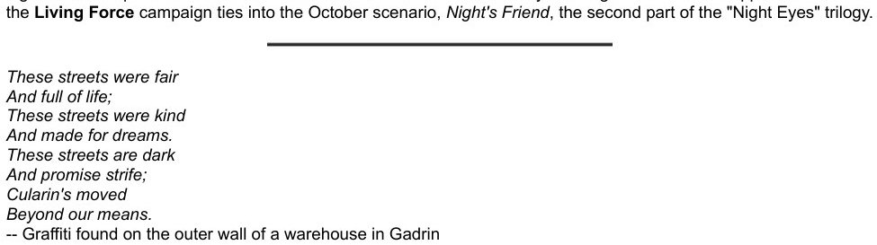
- **No single roster character (rules/setting/general)** — entry/section: Anonymous informant: "He slept through half the things what happened around Cularin, and the most important ones - the ones that would scare you stupid, leave you drooling like a Kowakian monkey-lizard on spice - he never knew about at all. 'Cause they happened at night. That's the way of things." Source: *10:02:03 - Cularin at Night* (SWRPG d20 Revised Core), scan p.1
  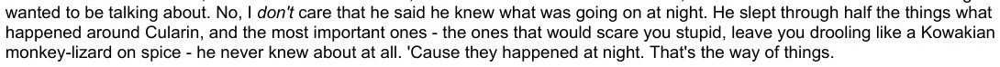
- **No single roster character (rules/setting/general)** — entry/section: Anonymous informant: "The scariest thing on Cularin's not Tarasin. Most of them are harmless. Just foolish types, not actually doing anything to hurt people. More scare than substance." Source: *10:02:03 - Cularin at Night* (SWRPG d20 Revised Core), scan p.1
  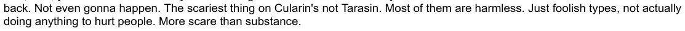
- **No single roster character (rules/setting/general)** — entry/section: Anonymous informant: "But at night, they keep the guns and ditch the uniforms." Source: *10:02:03 - Cularin at Night* (SWRPG d20 Revised Core), scan p.1
  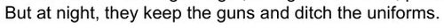
- **No single roster character (rules/setting/general)** — entry/section: Anonymous informant: "This ain't like the time when Nim'Ri and Gerta and them took off for the hills. This is people being taken." Source: *10:02:03 - Cularin at Night* (SWRPG d20 Revised Core), scan p.1
  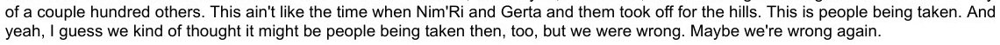

## scan p.2 (scan page 2)

Page contents: Twitch contest; arrest droid; crime down; Senator Wren and Reidi Artom; forms; Jex; sign-off; footer (hand-read)

- **No single roster character (rules/setting/general)** — entry/section: Anonymous informant: "Every time the droid picked someone up, it'd say, "You are under arrest. You are being detained." Then it'd drop them into its back-end, usually head first." Source: *10:02:03 - Cularin at Night* (SWRPG d20 Revised Core), scan p.2
  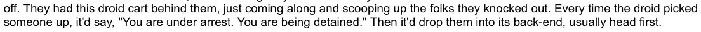
- **No single roster character (rules/setting/general)** — entry/section: Anonymous informant: "You don't take a place that your great-grandmother found and named and brought the galaxy to, and then flush it. Wren's a politician. No better or worse than any of the rest of them. Which is to say, she's pretty bad, if you ask me." Source: *10:02:03 - Cularin at Night* (SWRPG d20 Revised Core), scan p.2
  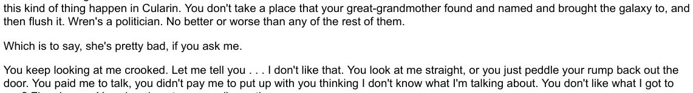
- **No single roster character (rules/setting/general)** — entry/section: Anonymous informant: "Case is unsolvable. Sorry, we can't help you." Source: *10:02:03 - Cularin at Night* (SWRPG d20 Revised Core), scan p.2
  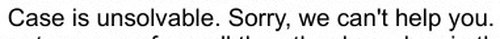
- **No single roster character (rules/setting/general)** — entry/section: Anonymous informant: "We're here to protect you, not to make search parties. People leave planets all the time." Source: *10:02:03 - Cularin at Night* (SWRPG d20 Revised Core), scan p.2
  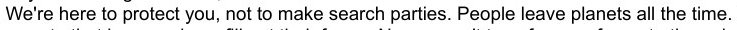
- **No single roster character (rules/setting/general)** — entry/section: Anonymous informant: "But 24 hours after he finished the forms they commed him and said, "Your brother isn't here." How'd they know that if they didn't do anything? Huh?" Source: *10:02:03 - Cularin at Night* (SWRPG d20 Revised Core), scan p.2
  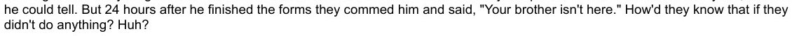
- **No single roster character (rules/setting/general)** — entry/section: Anonymous informant: "So you just leave, and I'll leave, and we can both walk careful. Cause there's bad things going on, and the worst of it's at night." Source: *10:02:03 - Cularin at Night* (SWRPG d20 Revised Core), scan p.2
  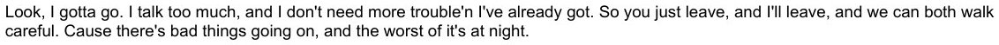
