# Owner Material 037 — Star Wars D20 Drive folder (Core, Revised Core and Saga Edition): Living Force Campaign/Articles/Year 3/10:23:03 - Conversations with Lanius.pdf [Star Wars Roleplaying Game Revised Core (d20, 2002)]

- **Source:** Wizards of the Coast Star Wars Roleplaying Game books, web enhancements, Living Force campaign modules and articles (2000–2010), from the owner's "Star Wars D20" Drive folder (only the three edition subfolders; "General" was not read, as instructed). Secondary source (licensed Legends reference). Scan OCR'd on the box; the scan stays box-only and is **not** published.
- **Method:** every scanned page was OCR'd and machine-screened sentence by sentence for power-relevant statements (fights, kills, defeats, Force feats, rankings, superweapons) that name a character on our roster; each kept sentence is quoted verbatim from the OCR text and has a crop of the printed passage directly under it. Pages with nothing power-relevant are still listed with what is on them.
- **Citation:** "*10:23:03 - Conversations with Lanius* (SWRPG d20 Revised Core), p.X" by printed page ("scan p.X" where no printed number applies). **Weight:** Licensed RPG material: a secondary source. Narrative text sums up Legends lore; game statistics are rules for players, not canon power levels, and rank lowest.

## scan p.1 (scan page 1)

Page contents: Intro; criticism; Yara's apology; Yara enters; 'Lan'; third person; detachment (hand-read)

- **No single roster character (rules/setting/general)** — entry/section: Lanius Qel-Bertuk: "Criticism? There's always criticism. We do too much, we do too little, we support the wrong people, we don't support anyone at all. Was there a particular bit of criticism you had in mind?" Source: *10:23:03 - Conversations with Lanius* (SWRPG d20 Revised Core), scan p.1
  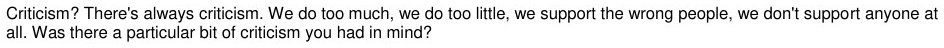
- **No single roster character (rules/setting/general)** — entry/section: Lanius Qel-Bertuk: "There's nothing to apologize for. Perhaps she made a mistake, but no one is expected to be perfect." Source: *10:23:03 - Conversations with Lanius* (SWRPG d20 Revised Core), scan p.1
  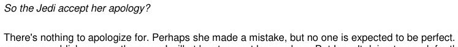
- **No single roster character (rules/setting/general)** — entry/section: Yara Grugara: "YG: Master Lanius - that's quite a mouthful, can I call you Lan?" Source: *10:23:03 - Conversations with Lanius* (SWRPG d20 Revised Core), scan p.1
  
- **No single roster character (rules/setting/general)** — entry/section: Lanius Qel-Bertuk: "LQB: If I said "No," would it stop you?" Source: *10:23:03 - Conversations with Lanius* (SWRPG d20 Revised Core), scan p.1
  
- **No single roster character (rules/setting/general)** — entry/section: Lanius Qel-Bertuk: "LQB: I can only speak for myself, Ms. Grugara. For me, no apology is necessary. And for me, I also don't know what you were thinking. For a time, I had begun to wonder if someone had replaced you with a clone, or a particularly unctuous droid." Source: *10:23:03 - Conversations with Lanius* (SWRPG d20 Revised Core), scan p.1
  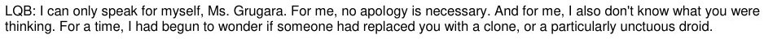
- **No single roster character (rules/setting/general)** — entry/section: Yara Grugara: "YG: No, that was all Yara." Source: *10:23:03 - Conversations with Lanius* (SWRPG d20 Revised Core), scan p.1
  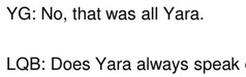
- **No single roster character (rules/setting/general)** — entry/section: Lanius Qel-Bertuk: "I recently gave an interview about attachment and its perils, but now I find myself wondering about the perils of detachment." Source: *10:23:03 - Conversations with Lanius* (SWRPG d20 Revised Core), scan p.1
  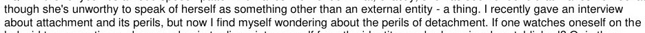

## scan p.2 (scan page 2)

Page contents: Third person; new faculty; Sith rule of two; Thaere and Minos Fel'Kona; no policy; no evidence (hand-read)

- **No single roster character (rules/setting/general)** — entry/section: Lanius Qel-Bertuk: "LQB: Even with a war going on, it's easier to find Jedi to fill roles in the Academy than it is to find Sith. There are, after all, only two of them." Source: *10:23:03 - Conversations with Lanius* (SWRPG d20 Revised Core), scan p.2
  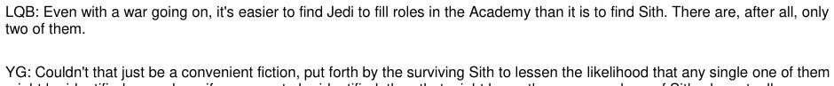
- **No single roster character (rules/setting/general)** — entry/section: Lanius Qel-Bertuk: "The dark side is greedy and jealous, and it inspires those who follow it to kill their fellows in order to gain and maintain power. The "rule of two" is a necessity for an order such as theirs to survive." Source: *10:23:03 - Conversations with Lanius* (SWRPG d20 Revised Core), scan p.2
  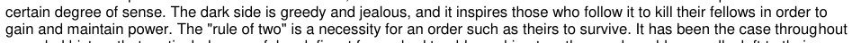
- **No single roster character (rules/setting/general)** — entry/section: Lanius Qel-Bertuk: "LQB: There is no policy. There is the Force. [He chuckles.]" Source: *10:23:03 - Conversations with Lanius* (SWRPG d20 Revised Core), scan p.2
  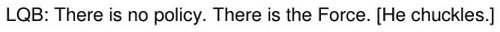
- **No single roster character (rules/setting/general)** — entry/section: Yara Grugara: "YG: Jedi humor. Cute. What about Thaere?" Source: *10:23:03 - Conversations with Lanius* (SWRPG d20 Revised Core), scan p.2
  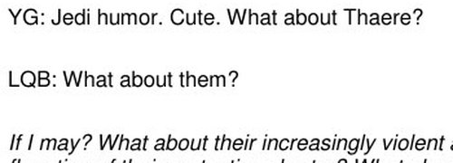
- **No single roster character (rules/setting/general)** — entry/section: Lanius Qel-Bertuk: "Thaere was appointed protector of Cularin by the Senate, and until such time as the Senate removes Thaere from its position, the Jedi are bound to serve the Senate's will." Source: *10:23:03 - Conversations with Lanius* (SWRPG d20 Revised Core), scan p.2
  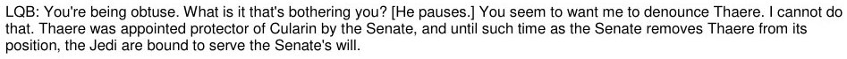
- **No single roster character (rules/setting/general)** — entry/section: Lanius Qel-Bertuk: "I've said there is no evidence, and without evidence there can be no "problem."" Source: *10:23:03 - Conversations with Lanius* (SWRPG d20 Revised Core), scan p.2
  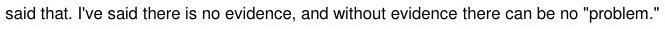

## scan p.3 (scan page 3)

Page contents: Statements; why journalist; Force doo-dads; Lanius speech on meaning; frailty (hand-read)

- **No single roster character (rules/setting/general)** — entry/section: Lanius Qel-Bertuk: "LQB: I'm sure I'll make a great many statements in my lifetime. That was one, right there. And that was another." Source: *10:23:03 - Conversations with Lanius* (SWRPG d20 Revised Core), scan p.3
  
- **No single roster character (rules/setting/general)** — entry/section: Lanius Qel-Bertuk: "Ms. Grugara, while you seem to have come a long way as a journalist, you do have a tendency to push too hard and listen for the answers that will be most useful, instead of the answers that are actually given." Source: *10:23:03 - Conversations with Lanius* (SWRPG d20 Revised Core), scan p.3
  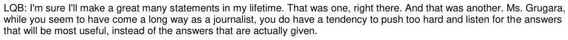
- **No single roster character (rules/setting/general)** — entry/section: Yara Grugara: "YG: No, that's fine. I want to be a journalist so I can help people." Source: *10:23:03 - Conversations with Lanius* (SWRPG d20 Revised Core), scan p.3
  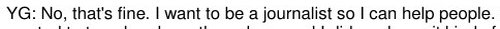
- **No single roster character (rules/setting/general)** — entry/section: Lanius Qel-Bertuk: "Is it not enough to just be who you are?" Source: *10:23:03 - Conversations with Lanius* (SWRPG d20 Revised Core), scan p.3
  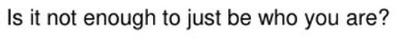
- **No single roster character (rules/setting/general)** — entry/section: Yara Grugara: "YG: Um, hello? The rest of the protectors of the galaxy are waving to you from the temple on Coruscant. Jedi are inherently important, because of all the Force doo-dads you can do." Source: *10:23:03 - Conversations with Lanius* (SWRPG d20 Revised Core), scan p.3
  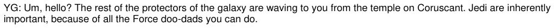
- **No single roster character (rules/setting/general)** — entry/section: Lanius Qel-Bertuk: "LQB: "Force doo-dads"?" Source: *10:23:03 - Conversations with Lanius* (SWRPG d20 Revised Core), scan p.3
  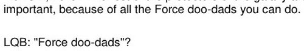
- **No single roster character (rules/setting/general)** — entry/section: Yara Grugara: "YG: Face it, Lan. You and the Jedi have lots more power than the rest of us, and it's hard to be "normal" in the galaxy." Source: *10:23:03 - Conversations with Lanius* (SWRPG d20 Revised Core), scan p.3
  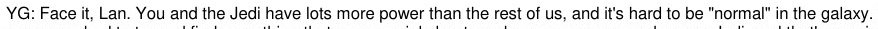
- **No single roster character (rules/setting/general)** — entry/section: Lanius Qel-Bertuk: "Every person in the galaxy, every living thing, is part of the living Force. It is an essential part of each of us, and it just happens that Jedi, and a few others, are able to feel the Force and to use - and be used by - it." Source: *10:23:03 - Conversations with Lanius* (SWRPG d20 Revised Core), scan p.3
  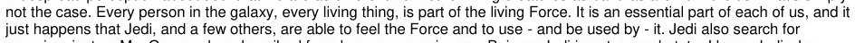
- **No single roster character (rules/setting/general)** — entry/section: Lanius Qel-Bertuk: "Being a Jedi is not an end-state." Source: *10:23:03 - Conversations with Lanius* (SWRPG d20 Revised Core), scan p.3
  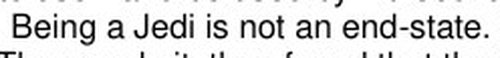
- **No single roster character (rules/setting/general)** — entry/section: Lanius Qel-Bertuk: "If you achieve a goal - whether it's being a Jedi or being a journalist - and then do nothing after, you are wasting your life. Jedi are not static." Source: *10:23:03 - Conversations with Lanius* (SWRPG d20 Revised Core), scan p.3
  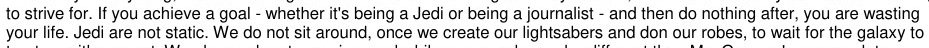
- **No single roster character (rules/setting/general)** — entry/section: Lanius Qel-Bertuk: "Because the will of the Force may be that Ms. Grugara helps people." Source: *10:23:03 - Conversations with Lanius* (SWRPG d20 Revised Core), scan p.3
  
- **No single roster character (rules/setting/general)** — entry/section: Lanius Qel-Bertuk: "Each of us - Jedi and non-Jedi - can only be one person, and part of being that person is the search for our unique identity." Source: *10:23:03 - Conversations with Lanius* (SWRPG d20 Revised Core), scan p.3
  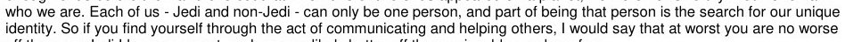
- **No single roster character (rules/setting/general)** — entry/section: Lanius Qel-Bertuk: "LQB: It's not frailty. We would shatter much more easily if we believed ourselves invincible, and, if we presented ourselves as invincible, it would galvanize our enemies all the more when a Jedi fell." Source: *10:23:03 - Conversations with Lanius* (SWRPG d20 Revised Core), scan p.3
  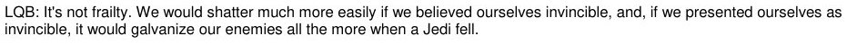

## scan p.4 (scan page 4)

Page contents: Date question; close (hand-read)

- **No single roster character (rules/setting/general)** — entry/section: Yara Grugara: "YG: Lan, are you allowed to date?" Source: *10:23:03 - Conversations with Lanius* (SWRPG d20 Revised Core), scan p.4
  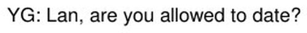
- **No single roster character (rules/setting/general)** — entry/section: Lanius Qel-Bertuk: "LQB: Excuse me?" Source: *10:23:03 - Conversations with Lanius* (SWRPG d20 Revised Core), scan p.4
  
