# Owner Material 037 — Star Wars D20 Drive folder (Core, Revised Core and Saga Edition): Living Force Campaign/Articles/Year 3/11:06:03 - Thaere is Not Your Friend.pdf [Star Wars Roleplaying Game Revised Core (d20, 2002)]

- **Source:** Wizards of the Coast Star Wars Roleplaying Game books, web enhancements, Living Force campaign modules and articles (2000–2010), from the owner's "Star Wars D20" Drive folder (only the three edition subfolders; "General" was not read, as instructed). Secondary source (licensed Legends reference). Scan OCR'd on the box; the scan stays box-only and is **not** published.
- **Method:** every scanned page was OCR'd and machine-screened sentence by sentence for power-relevant statements (fights, kills, defeats, Force feats, rankings, superweapons) that name a character on our roster; each kept sentence is quoted verbatim from the OCR text and has a crop of the printed passage directly under it. Pages with nothing power-relevant are still listed with what is on them.
- **Citation:** "*11:06:03 - Thaere is Not Your Friend* (SWRPG d20 Revised Core), p.X" by printed page ("scan p.X" where no printed number applies). **Weight:** Licensed RPG material: a secondary source. Narrative text sums up Legends lore; game statistics are rules for players, not canon power levels, and rank lowest.

## scan p.1 (scan page 1)

Page contents: Intro; TINYF; Ryk Osentay; Melanda Forswoth; Guest 1 'evil overlord' with stick (hand-read)

- **No single roster character (rules/setting/general)** — entry/section: Ryk Osentay: "Hello. This is Ryk Osentay, reporting for "Eye on Cularin." It's impossible to live in Cularin this week and not have seen the tiny-F, as it's come to be called -- the five letters T-I-N-Y-F that have shown up almost everywhere." Source: *11:06:03 - Thaere is Not Your Friend* (SWRPG d20 Revised Core), scan p.1
  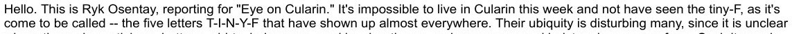
- **No single roster character (rules/setting/general)** — entry/section: Ryk Osentay: "Could something allow us to see the truth behind Thaere's actions -- if there is some truth other than what they claim, of course, which this reporter would never, ever suggest?" Source: *11:06:03 - Thaere is Not Your Friend* (SWRPG d20 Revised Core), scan p.1
  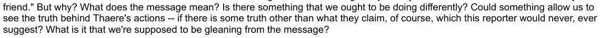
- **No single roster character (rules/setting/general)** — entry/section: Anonymous guest (Eye on Cularin): "Guest: Yes. I know much. You know little. Nerf-herding follower of bantha tracks. Shaggy beast of wampalike intellect." Source: *11:06:03 - Thaere is Not Your Friend* (SWRPG d20 Revised Core), scan p.1
  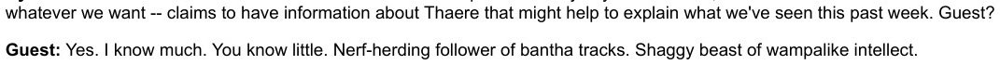
- **No single roster character (rules/setting/general)** — entry/section: Anonymous guest (Eye on Cularin): "Guest: Fool! I am evil overlord! You bow down to me!" Source: *11:06:03 - Thaere is Not Your Friend* (SWRPG d20 Revised Core), scan p.1
  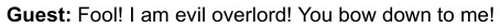
- **No single roster character (rules/setting/general)** — entry/section: Anonymous guest (Eye on Cularin): "Guest: Fear my lightsaber!" Source: *11:06:03 - Thaere is Not Your Friend* (SWRPG d20 Revised Core), scan p.1
  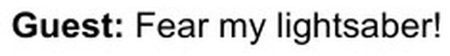
- **No single roster character (rules/setting/general)** — entry/section: Ryk Osentay: "Ryk: Um... That's a stick." Source: *11:06:03 - Thaere is Not Your Friend* (SWRPG d20 Revised Core), scan p.1
  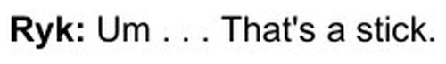
- **No single roster character (rules/setting/general)** — entry/section: Anonymous guest (Eye on Cularin): "Guest: Die, coward scum of not-Sith!" Source: *11:06:03 - Thaere is Not Your Friend* (SWRPG d20 Revised Core), scan p.1
  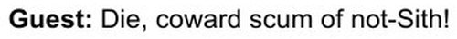

## scan p.2 (scan page 2)

Page contents: Guest 1 stunned; Guest 2 surveillance; IBC 200 million; account back-doors; producers; trilogy box (hand-read)

- **No single roster character (rules/setting/general)** — entry/section: Ryk Osentay: "Ryk: Guards? Hello, guards?" Source: *11:06:03 - Thaere is Not Your Friend* (SWRPG d20 Revised Core), scan p.2
  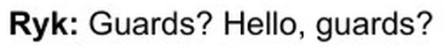
- **No single roster character (rules/setting/general)** — entry/section: Ryk Osentay: "Ryk: And I've been told that this one isn't carrying any large sticks with which to attack me. Welcome, guest." Source: *11:06:03 - Thaere is Not Your Friend* (SWRPG d20 Revised Core), scan p.2
  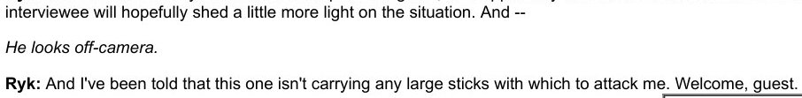
- **No single roster character (rules/setting/general)** — entry/section: Gerta Haman: "Guest 2: By being smarter than you." Source: *11:06:03 - Thaere is Not Your Friend* (SWRPG d20 Revised Core), scan p.2
  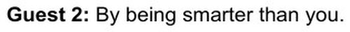
- **No single roster character (rules/setting/general)** — entry/section: Gerta Haman: "Guest 2: Largely genetic, I assure you." Source: *11:06:03 - Thaere is Not Your Friend* (SWRPG d20 Revised Core), scan p.2
  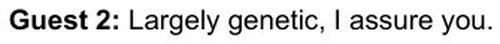
- **No single roster character (rules/setting/general)** — entry/section: Gerta Haman: "Guest 2: Oh, not much. Just a little matter of a transfer of 200 million credits from IBC accounts to the Thaereian Navy over the last six months." Source: *11:06:03 - Thaere is Not Your Friend* (SWRPG d20 Revised Core), scan p.2
  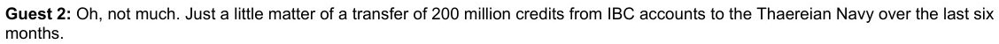
- **No single roster character (rules/setting/general)** — entry/section: Gerta Haman: "Two hundred million fills a lot more pockets than just those of the fighter jockeys, let me tell you." Source: *11:06:03 - Thaere is Not Your Friend* (SWRPG d20 Revised Core), scan p.2
  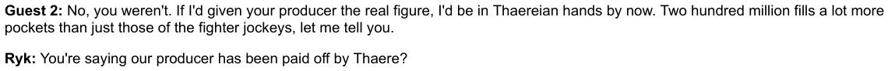
- **No single roster character (rules/setting/general)** — entry/section: Gerta Haman: "A little here, a little there . . . idiots in this system will take money from anyone." Source: *11:06:03 - Thaere is Not Your Friend* (SWRPG d20 Revised Core), scan p.2
  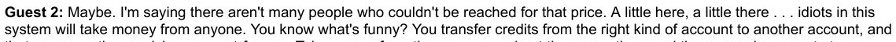
- **No single roster character (rules/setting/general)** — entry/section: Gerta Haman: "So getting paid a little by the wrong people can make you vulnerable as long as you're using the same account structure." Source: *11:06:03 - Thaere is Not Your Friend* (SWRPG d20 Revised Core), scan p.2
  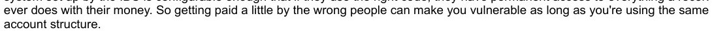

## scan p.3 (scan page 3)

Page contents: Separatists; Wren manipulated; Gerta Haman unmasked and beaten; ship explodes with Ish-Bel Tur (hand-read)

- **No single roster character (rules/setting/general)** — entry/section: Gerta Haman: "Guest 2: I'm smarter than you, Ryk, but you aren't that dumb. Thaere isn't loyal to the Republic. They're working with the Separatists. For all we know, they have been all along." Source: *11:06:03 - Thaere is Not Your Friend* (SWRPG d20 Revised Core), scan p.3
  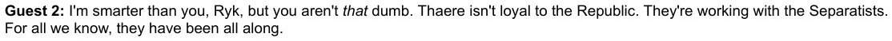
- **No single roster character (rules/setting/general)** — entry/section: Gerta Haman: "Guest 2: We don't think so. She's being manipulated, like everyone else." Source: *11:06:03 - Thaere is Not Your Friend* (SWRPG d20 Revised Core), scan p.3
  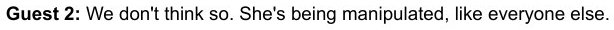
- **No single roster character (rules/setting/general)** — entry/section: Gerta Haman: "Gerta: Thaere is not your friend, Cularin! Not your --" Source: *11:06:03 - Thaere is Not Your Friend* (SWRPG d20 Revised Core), scan p.3
  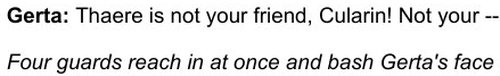
- **No single roster character (rules/setting/general)** — entry/section: Ryk Osentay: "Ryk (having difficulty speaking): It hardly feels like that was only yesterday, Yara." Source: *11:06:03 - Thaere is Not Your Friend* (SWRPG d20 Revised Core), scan p.3
  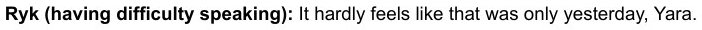
