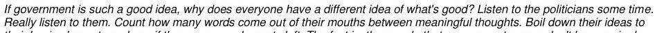
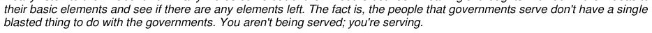
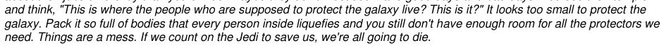
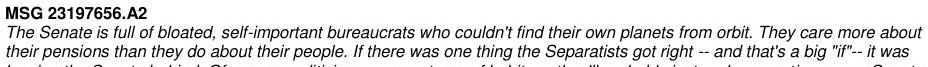
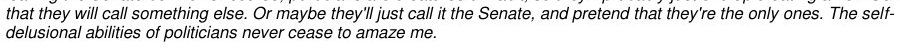
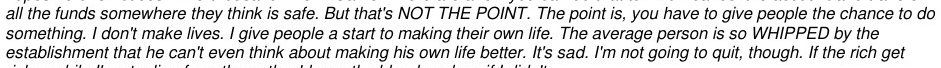
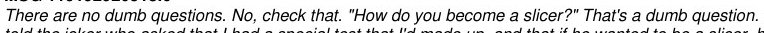
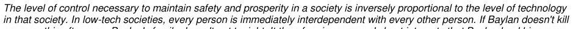
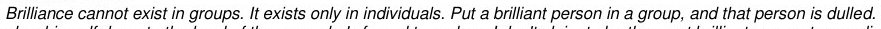

# Owner Material 037 — Star Wars D20 Drive folder (Core, Revised Core and Saga Edition): Living Force Campaign/Articles/Year 3/11:20:03 - Who is Baylan?.pdf [Star Wars Roleplaying Game Revised Core (d20, 2002)]

- **Source:** Wizards of the Coast Star Wars Roleplaying Game books, web enhancements, Living Force campaign modules and articles (2000–2010), from the owner's "Star Wars D20" Drive folder (only the three edition subfolders; "General" was not read, as instructed). Secondary source (licensed Legends reference). Scan OCR'd on the box; the scan stays box-only and is **not** published.
- **Method:** every scanned page was OCR'd and machine-screened sentence by sentence for power-relevant statements (fights, kills, defeats, Force feats, rankings, superweapons) that name a character on our roster; each kept sentence is quoted verbatim from the OCR text and has a crop of the printed passage directly under it. Pages with nothing power-relevant are still listed with what is on them.
- **Citation:** "*11:20:03 - Who is Baylan?* (SWRPG d20 Revised Core), p.X" by printed page ("scan p.X" where no printed number applies). **Weight:** Licensed RPG material: a secondary source. Narrative text sums up Legends lore; game statistics are rules for players, not canon power levels, and rank lowest.

## scan p.1 (scan page 1)

Page contents: Slicers; Baylan's motives; quotations on government, Jedi Temple, Senate (MSG 23197656.A2), DeSKo, whining (MSG 882A995) (hand-read)

- **No single roster character (rules/setting/general)** — entry/section: Baylan: "If government is such a good idea, why does everyone have a different idea of what's good? Listen to the politicians some time. Really listen to them." Source: *11:20:03 - Who is Baylan?* (SWRPG d20 Revised Core), scan p.1
  
- **No single roster character (rules/setting/general)** — entry/section: Baylan: "The fact is, the people that governments serve don't have a single blasted thing to do with the governments. You aren't being served; you're serving." Source: *11:20:03 - Who is Baylan?* (SWRPG d20 Revised Core), scan p.1
  
- **No single roster character (rules/setting/general)** — entry/section: Baylan: "It looks too small to protect the galaxy. Pack it so full of bodies that every person inside liquefies and you still don't have enough room for all the protectors we need. Things are a mess. If we count on the Jedi to save us, we're all going to die." Source: *11:20:03 - Who is Baylan?* (SWRPG d20 Revised Core), scan p.1
  
- **No single roster character (rules/setting/general)** — entry/section: Baylan: "MSG 23197656.A2 The Senate is full of bloated, self-important bureaucrats who couldn't find their own planets from orbit. They care more about their pensions than they do about their people." Source: *11:20:03 - Who is Baylan?* (SWRPG d20 Revised Core), scan p.1
  
- **No single roster character (rules/setting/general)** — entry/section: Baylan: "The selfdelusional abilities of politicians never cease to amaze me." Source: *11:20:03 - Who is Baylan?* (SWRPG d20 Revised Core), scan p.1
  
- **No single roster character (rules/setting/general)** — entry/section: Baylan: "The point is, you have to give people the chance to do something. I don't make lives. I give people a start to making their own life." Source: *11:20:03 - Who is Baylan?* (SWRPG d20 Revised Core), scan p.1
  
- **No single roster character (rules/setting/general)** — entry/section: Baylan: "If the rich get richer while I'm stealing from them, they'd own the bloody galaxy if I didn't." Source: *11:20:03 - Who is Baylan?* (SWRPG d20 Revised Core), scan p.1
  
- **No single roster character (rules/setting/general)** — entry/section: Baylan: "MSG 882A995 If you whine long enough, someone will eventually hear you. If you keep whining after you're heard, someone will eventually shoot you." Source: *11:20:03 - Who is Baylan?* (SWRPG d20 Revised Core), scan p.1
  

## scan p.2 (scan page 2)

Page contents: Quotations on dumb questions, technology, brilliance; Baylan stats; Binary Influence feat; Slicer Lore (hand-read)

- **No single roster character (rules/setting/general)** — entry/section: Baylan: "There are no dumb questions. No, check that. "How do you become a slicer?" That's a dumb question." Source: *11:20:03 - Who is Baylan?* (SWRPG d20 Revised Core), scan p.2
  
- **No single roster character (rules/setting/general)** — entry/section: Baylan: "The level of control necessary to maintain safety and prosperity in a society is inversely proportional to the level of technology in that society." Source: *11:20:03 - Who is Baylan?* (SWRPG d20 Revised Core), scan p.2
  
- **No single roster character (rules/setting/general)** — entry/section: Baylan: "Brilliance cannot exist in groups. It exists only in individuals. Put a brilliant person in a group, and that person is dulled." Source: *11:20:03 - Who is Baylan?* (SWRPG d20 Revised Core), scan p.2
  

### Stat block notes (game mechanics, not feats)

- Baylan: Human Male Scoundrel 8/Outlaw Slicer 10; Defense 20; VP/WP 56/11; Int 24; FP 3; DSP 0; Rep +5; Computer Use +33; protocol droid (Q-410); Feats: Binary Influence, Fame, Gearhead, Heroic Surge (4/day), Iron Will, Kit-Bashing, Perfect Memory, Skill Emphasis (Computer Use), Skill Emphasis (Knowledge [Technology]), Skill Emphasis (Repair), Street Smart, Toughness, Trustworthy, Weapon Proficiency (simple weapons, blaster pistols). (Source: *11:20:03 - Who is Baylan?* (SWRPG d20 Revised Core), scan p.2)
- Feat: Binary Influence: Prerequisites: Intelligence 17, Read/Write Binary, Craft (Droids) 8 ranks, Computer Use 12 ranks. Benefit: You gain a +2 bonus to Bluff, Diplomacy, and Sense Motive checks when dealing with droids. In addition, you gain a +3 bonus when conducting complex searches, altering programs, and breaking computer security. (Source: *11:20:03 - Who is Baylan?* (SWRPG d20 Revised Core), scan p.2)

## scan p.3 (scan page 3)

Page contents: Slicer Lore cont; Living Force link; footnote on the rant (hand-read)

