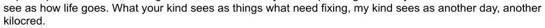
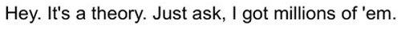
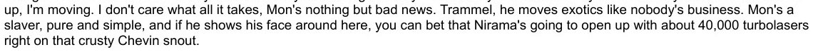
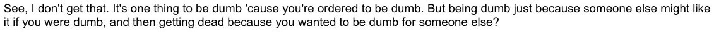
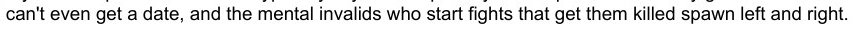
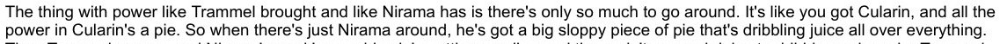
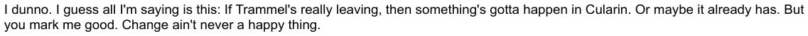

# Owner Material 037 — Star Wars D20 Drive folder (Core, Revised Core and Saga Edition): Living Force Campaign/Articles/Year 3/12:04:03 - Trammel's Move.pdf [Star Wars Roleplaying Game Revised Core (d20, 2002)]

- **Source:** Wizards of the Coast Star Wars Roleplaying Game books, web enhancements, Living Force campaign modules and articles (2000–2010), from the owner's "Star Wars D20" Drive folder (only the three edition subfolders; "General" was not read, as instructed). Secondary source (licensed Legends reference). Scan OCR'd on the box; the scan stays box-only and is **not** published.
- **Method:** every scanned page was OCR'd and machine-screened sentence by sentence for power-relevant statements (fights, kills, defeats, Force feats, rankings, superweapons) that name a character on our roster; each kept sentence is quoted verbatim from the OCR text and has a crop of the printed passage directly under it. Pages with nothing power-relevant are still listed with what is on them.
- **Citation:** "*12:04:03 - Trammel's Move* (SWRPG d20 Revised Core), p.X" by printed page ("scan p.X" where no printed number applies). **Weight:** Licensed RPG material: a secondary source. Narrative text sums up Legends lore; game statistics are rules for players, not canon power levels, and rank lowest.

## scan p.1 (scan page 1)

Page contents: Blackie intro; travel theory; Valdo and TD; Riboga; Nirama; Trammel and Phylus Mon; Blink; summary box (hand-read)

- **No single roster character (rules/setting/general)** — entry/section: Blackie: "Questions. S'always questions, and not lotsa answers." Source: *12:04:03 - Trammel's Move* (SWRPG d20 Revised Core), scan p.1
  
- **No single roster character (rules/setting/general)** — entry/section: Blackie: "What your kind sees as things what need fixing, my kind sees as another day, another kilocred." Source: *12:04:03 - Trammel's Move* (SWRPG d20 Revised Core), scan p.1
  
- **No single roster character (rules/setting/general)** — entry/section: Blackie: "Hey. It's a theory. Just ask, I got millions of 'em." Source: *12:04:03 - Trammel's Move* (SWRPG d20 Revised Core), scan p.1
  
- **No single roster character (rules/setting/general)** — entry/section: Blackie: "Mon's a slaver, pure and simple, and if he shows his face around here, you can bet that Nirama's going to open up with about 40,000 turbolasers right on that crusty Chevin snout." Source: *12:04:03 - Trammel's Move* (SWRPG d20 Revised Core), scan p.1
  

## scan p.2 (scan page 2)

Page contents: Skirmishes; spawning theory; Trammel packing up; pie metaphor; change (hand-read)

- **No single roster character (rules/setting/general)** — entry/section: Blackie: "See, I don't get that. It's one thing to be dumb 'cause you're ordered to be dumb. But being dumb just because someone else might like it if you were dumb, and then getting dead because you wanted to be dumb for someone else?" Source: *12:04:03 - Trammel's Move* (SWRPG d20 Revised Core), scan p.2
  
- **No single roster character (rules/setting/general)** — entry/section: Blackie: "I can't even get a date, and the mental invalids who start fights that get them killed spawn left and right." Source: *12:04:03 - Trammel's Move* (SWRPG d20 Revised Core), scan p.2
  
- **No single roster character (rules/setting/general)** — entry/section: Blackie: "Like I said. It's a theory. I ain't worked out all the details just yet." Source: *12:04:03 - Trammel's Move* (SWRPG d20 Revised Core), scan p.2
  
- **No single roster character (rules/setting/general)** — entry/section: Blackie: "It's like you got Cularin, and all the power in Cularin's a pie." Source: *12:04:03 - Trammel's Move* (SWRPG d20 Revised Core), scan p.2
  
- **No single roster character (rules/setting/general)** — entry/section: Blackie: "If Trammel's really leaving, then something's gotta happen in Cularin. Or maybe it already has. But you mark me good. Change ain't never a happy thing." Source: *12:04:03 - Trammel's Move* (SWRPG d20 Revised Core), scan p.2
  
