# Owner Material 037 — Star Wars D20 Drive folder (Core, Revised Core and Saga Edition): Living Force Campaign/Articles/Year 3/12:11:03 - False Horizon.pdf [Star Wars Roleplaying Game Revised Core (d20, 2002)]

- **Source:** Wizards of the Coast Star Wars Roleplaying Game books, web enhancements, Living Force campaign modules and articles (2000–2010), from the owner's "Star Wars D20" Drive folder (only the three edition subfolders; "General" was not read, as instructed). Secondary source (licensed Legends reference). Scan OCR'd on the box; the scan stays box-only and is **not** published.
- **Method:** every scanned page was OCR'd and machine-screened sentence by sentence for power-relevant statements (fights, kills, defeats, Force feats, rankings, superweapons) that name a character on our roster; each kept sentence is quoted verbatim from the OCR text and has a crop of the printed passage directly under it. Pages with nothing power-relevant are still listed with what is on them.
- **Citation:** "*12:11:03 - False Horizon* (SWRPG d20 Revised Core), p.X" by printed page ("scan p.X" where no printed number applies). **Weight:** Licensed RPG material: a secondary source. Narrative text sums up Legends lore; game statistics are rules for players, not canon power levels, and rank lowest.

## scan p.1 (scan page 1)

Page contents: Intro; Militia background; Osten and Broof transmission; Yara 'Am I on?'; Soboll perimeter (hand-read)

- **No single roster character (rules/setting/general)** — entry/section: Osten Dal'Nay: "Osten: People of Cularin, the time for action is at hand. One hour ago, Militia strike teams seized control of Thaereian bases throughout Cularin." Source: *12:11:03 - False Horizon* (SWRPG d20 Revised Core), scan p.1
  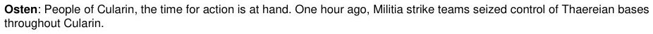
- **No single roster character (rules/setting/general)** — entry/section: Broof Yurdel: "Broof: Wesa still doin' da fightin'. Mya ground troops, deysa takin' losses, but wesa pushin' da bombad Daereians out of Cularin, or wesa dyin' in da tryin'." Source: *12:11:03 - False Horizon* (SWRPG d20 Revised Core), scan p.1
  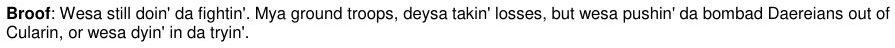
- **No single roster character (rules/setting/general)** — entry/section: Osten Dal'Nay: "We could not wait any longer to launch Operation False Horizon." Source: *12:11:03 - False Horizon* (SWRPG d20 Revised Core), scan p.1
  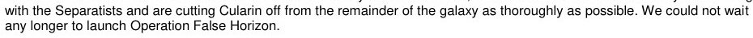
- **No single roster character (rules/setting/general)** — entry/section: Broof Yurdel: "Broof: Wesa askin' all da peoples of Cularin -- don't be helpin' bombad Daere. Protectin' da families and keepin' Cularin safe, helpin' da Militia, datsa good. Mesa dink, wesa needin' help from alla da peoples of Cularin b'fore dis bein' done." Source: *12:11:03 - False Horizon* (SWRPG d20 Revised Core), scan p.1
  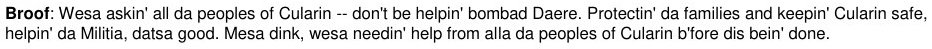
- **No single roster character (rules/setting/general)** — entry/section: Yara Grugara: "Yara: Am I on?" Source: *12:11:03 - False Horizon* (SWRPG d20 Revised Core), scan p.1
  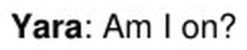

## scan p.2 (scan page 2)

Page contents: Lanius statement; Yara on CCB executives; Senator Wren recording (hand-read)

- **No single roster character (rules/setting/general)** — entry/section: Lanius Qel-Bertuk: "Lanius: The actions of the Cularin Militia were undertaken with the full knowledge and consent of the Jedi on Almas. It has become clear to us that Thaere represents a threat to the well-being of the system." Source: *12:11:03 - False Horizon* (SWRPG d20 Revised Core), scan p.2
  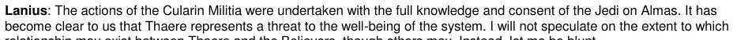
- **No single roster character (rules/setting/general)** — entry/section: Lanius Qel-Bertuk: "It may be that I waited too long, or not long enough. I will say only that I followed my best judgment. This is all any of us can do." Source: *12:11:03 - False Horizon* (SWRPG d20 Revised Core), scan p.2
  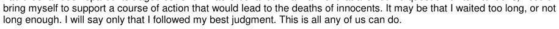
- **No single roster character (rules/setting/general)** — entry/section: Lanius Qel-Bertuk: "We will do all we can to see that peace is restored to Cularin. On that, you have my word. May the Force be with us all." Source: *12:11:03 - False Horizon* (SWRPG d20 Revised Core), scan p.2
  
- **No single roster character (rules/setting/general)** — entry/section: Yara Grugara: "Yara might be tempted, if she were less professional than she is, to note that these three individuals -who will remain nameless, for the time being --" Source: *12:11:03 - False Horizon* (SWRPG d20 Revised Core), scan p.2
  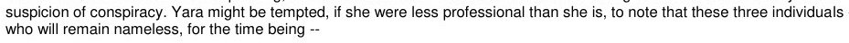
- **No single roster character (rules/setting/general)** — entry/section: Lavina Wren: "Senator Wren: Citizens of Cularin. When you elected me to represent you in the Galactic Senate, little could prepare me for what lay ahead." Source: *12:11:03 - False Horizon* (SWRPG d20 Revised Core), scan p.2
  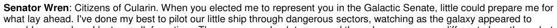
- **No single roster character (rules/setting/general)** — entry/section: Lavina Wren: "If you are viewing this recording, then I am on Coruscant, and you are at war." Source: *12:11:03 - False Horizon* (SWRPG d20 Revised Core), scan p.2
  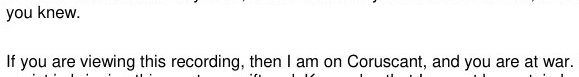
- **No single roster character (rules/setting/general)** — entry/section: Lavina Wren: "We are one small ship in a wide galaxy, and our problems are neither more nor less important, in the eyes of the Senate, than those of dozens of other ships that also find themselves adrift during this difficult time." Source: *12:11:03 - False Horizon* (SWRPG d20 Revised Core), scan p.2
  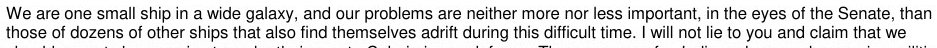

## scan p.3 (scan page 3)

Page contents: Wren cont; belt battle; 'N' insignia fighters (hand-read)

- **No single roster character (rules/setting/general)** — entry/section: Lavina Wren: "I could no more stop trying to protect my home, my beloved Cularin, than any of you." Source: *12:11:03 - False Horizon* (SWRPG d20 Revised Core), scan p.3
  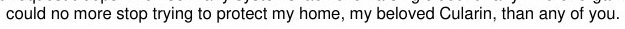
- **No single roster character (rules/setting/general)** — entry/section: Lavina Wren: "We deserve freedom, for ourselves and for the galaxy. This is what is right, and if we must fight for our freedom, so be it." Source: *12:11:03 - False Horizon* (SWRPG d20 Revised Core), scan p.3
  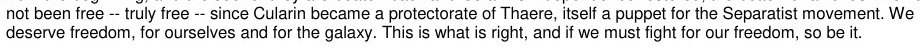
- **No single roster character (rules/setting/general)** — entry/section: Lavina Wren: "Know that I am with you in spirit, if not in body. Know that as you fight Thaereians in the streets and skies of Cularin, I am waging my own war. May the Force be with Cularin." Source: *12:11:03 - False Horizon* (SWRPG d20 Revised Core), scan p.3
  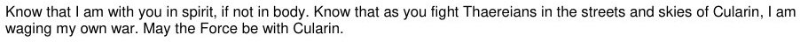
- **No single roster character (rules/setting/general)** — entry/section: Yara Grugara: "Yara: Strong words." Source: *12:11:03 - False Horizon* (SWRPG d20 Revised Core), scan p.3
  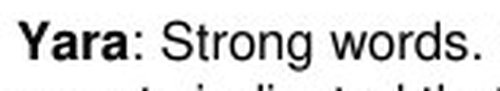
