# Owner Material 037 — Star Wars D20 Drive folder (Core, Revised Core and Saga Edition): Living Force Campaign/Articles/Year 4/01:05:04 - Destabilization.pdf [Star Wars Roleplaying Game Revised Core (d20, 2002)]

- **Source:** Wizards of the Coast Star Wars Roleplaying Game books, web enhancements, Living Force campaign modules and articles (2000–2010), from the owner's "Star Wars D20" Drive folder (only the three edition subfolders; "General" was not read, as instructed). Secondary source (licensed Legends reference). Scan OCR'd on the box; the scan stays box-only and is **not** published.
- **Method:** every scanned page was OCR'd and machine-screened sentence by sentence for power-relevant statements (fights, kills, defeats, Force feats, rankings, superweapons) that name a character on our roster; each kept sentence is quoted verbatim from the OCR text and has a crop of the printed passage directly under it. Pages with nothing power-relevant are still listed with what is on them.
- **Citation:** "*01:05:04 - Destabilization* (SWRPG d20 Revised Core), p.X" by printed page ("scan p.X" where no printed number applies). **Weight:** Licensed RPG material: a secondary source. Narrative text sums up Legends lore; game statistics are rules for players, not canon power levels, and rank lowest.

## scan p.1 (scan page 1)

Page contents: tinyf post; Tramsig memo; wampa1; myrlinator (hand-read)

- **No single roster character (rules/setting/general)** — entry/section: Tramsig: "// Our leverage on key personnel in Cularin has been lost. Further political destabilization is unlikely to take hold. Social and economic destabilization program commences immediately. You all understand the risk we are taking. Keep Jedi at a distance; they are both our fulcrum and our lever." Source: *01:05:04 - Destabilization* (SWRPG d20 Revised Core), scan p.1
  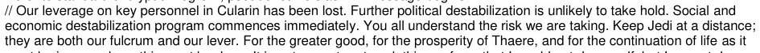
- **No single roster character (rules/setting/general)** — entry/section: Tramsig: "There will be resistance. Cularin is known for its resistance. Find the resistance and CRUSH IT. The witch will shout and stomp all over Coruscant, but I've been assured that she won't make headway that our allies don't want her to make." Source: *01:05:04 - Destabilization* (SWRPG d20 Revised Core), scan p.1
  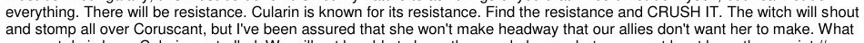
- **No single roster character (rules/setting/general)** — entry/section: Tramsig: "We will not be able to keep the people happy, but we can at least keep them quiet.//" Source: *01:05:04 - Destabilization* (SWRPG d20 Revised Core), scan p.1
  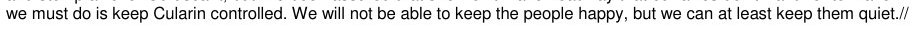
- **No single roster character (rules/setting/general)** — entry/section: Tramsig: "// We will take losses. This is inevitable. But when one commits to the cause of right, one understands that the greater good cannot and will not be achieved without sacrifice. May the Force be with you. May the Force be with us all.//" Source: *01:05:04 - Destabilization* (SWRPG d20 Revised Core), scan p.1
  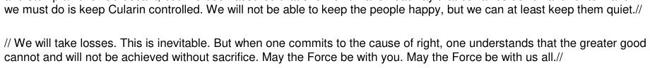
- **No single roster character (rules/setting/general)** — entry/section: myrlinator: "wampat, you slicer-dreaming dirt magnet - you couldn't slice bread with a lightsaber" Source: *01:05:04 - Destabilization* (SWRPG d20 Revised Core), scan p.1
  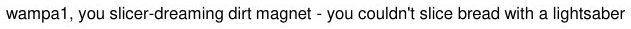

## scan p.2 (scan page 2)

Page contents: myrlinator; wampa1; tharestinx; wampa1 to Alyssa; OPS Fleffant (hand-read)

## scan p.3 (scan page 3)

Page contents: Alyssa on Fleffant; IMPEVERI; kelsoblod; tharestinx; wampa1 outs Alyssa (hand-read)

- **No single roster character (rules/setting/general)** — entry/section: Alyssa (alyssaroxu): "Fleffant? What the excrement kind of name is "Fleffant"?" Source: *01:05:04 - Destabilization* (SWRPG d20 Revised Core), scan p.3
  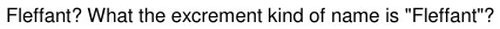
- **No single roster character (rules/setting/general)** — entry/section: Alyssa (alyssaroxu): "Not to sound flippant (or fleffant, for that matter), but if OPS thinks this little bit of intelligence is going to change anything anywhere, they're cracked." Source: *01:05:04 - Destabilization* (SWRPG d20 Revised Core), scan p.3
  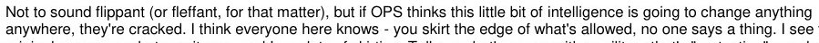
- **No single roster character (rules/setting/general)** — entry/section: Alyssa (alyssaroxu): "It sounds scary with everything that's been happening. It doesn't mean it means anything. Just playing dark side's advocate here." Source: *01:05:04 - Destabilization* (SWRPG d20 Revised Core), scan p.3
  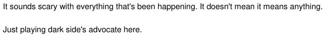
- **No single roster character (rules/setting/general)** — entry/section: tharestinx: "Dunno. I always figured everybody read these nodes, and that when I posted something the entire galaxy took it seriously and pondered the deep emotional and metaphysical manifestations of my brilliance." Source: *01:05:04 - Destabilization* (SWRPG d20 Revised Core), scan p.3
  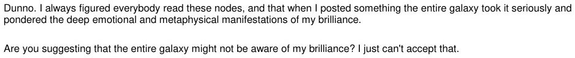

## scan p.4 (scan page 4)

Page contents: gunganimpala; Alyssa; 0.0.0 poster; mstrslcr; spoofer (hand-read)

- **No single roster character (rules/setting/general)** — entry/section: 0.0.0 poster: "My sources tell me that this is accurate. They also tell me that it was meant to be found. Thaere wants people angry. They know what that means for them." Source: *01:05:04 - Destabilization* (SWRPG d20 Revised Core), scan p.4
  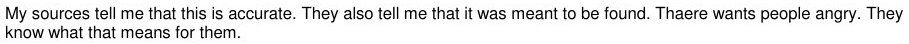
- **No single roster character (rules/setting/general)** — entry/section: mstrslcr: "Closing your eyes doesn't mean the conspiracies aren't there. Just means you don't see them. That's what people like Tramsig want." Source: *01:05:04 - Destabilization* (SWRPG d20 Revised Core), scan p.4
  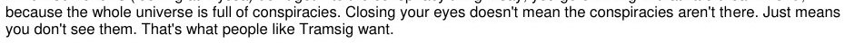
- **No single roster character (rules/setting/general)** — entry/section: 1337 (0.0.0 spoofer): "You couldn't buy a clue from a corrupt OPS hound with a pastry fetish." Source: *01:05:04 - Destabilization* (SWRPG d20 Revised Core), scan p.4
  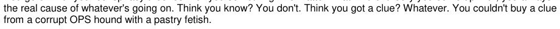

## scan p.5 (scan page 5)

Page contents: Spoofer cont; Alyssa traces Varna Biqua; aidedecamp for Wren; kelsoblod; doom poster (hand-read)

- **No single roster character (rules/setting/general)** — entry/section: 1337 (0.0.0 spoofer): "Best thing you can do is stay underground. They don't want us. They want the Jedi." Source: *01:05:04 - Destabilization* (SWRPG d20 Revised Core), scan p.5
  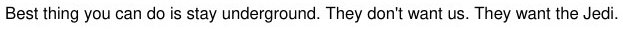
- **No single roster character (rules/setting/general)** — entry/section: Alyssa (alyssaroxu): "Now there's 2 masters - a kook in robes who's teaching because the council doesn't know where else to put him, and a scary chick with a thing for long glowing objects - and a bunch of knights and padawannabes." Source: *01:05:04 - Destabilization* (SWRPG d20 Revised Core), scan p.5
  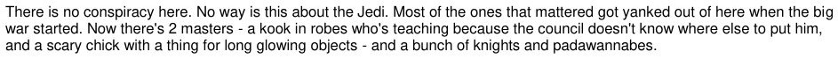
- **No single roster character (rules/setting/general)** — entry/section: Alyssa (alyssaroxu): "I'll just say it: Cularin has NO TACTICAL SIGNIFICANCE." Source: *01:05:04 - Destabilization* (SWRPG d20 Revised Core), scan p.5
  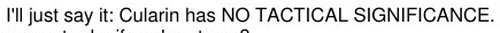
- **No single roster character (rules/setting/general)** — entry/section: aidedecamp (for Senator Wren): "She wishes to emphasize to the people of Cularin that our system remains strictly loyal to the Galactic Senate and Supreme Chancellor Palpatine." Source: *01:05:04 - Destabilization* (SWRPG d20 Revised Core), scan p.5
  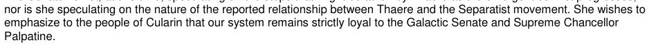

## scan p.6 (scan page 6)

Page contents: Doom cont; NJ; kelsoblod scared; wampa1; Alyssa fries node (hand-read)

- **No single roster character (rules/setting/general)** — entry/section: NJ: "Let them come. Many of us are ready to defend our homes with whatever it takes. Anyone who believes that only those who fight in wars die in wars has a lot to learn. May you live long enough to see the galaxy more clearly." Source: *01:05:04 - Destabilization* (SWRPG d20 Revised Core), scan p.6
  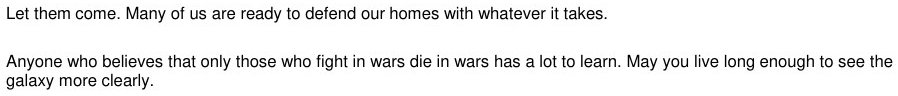
- **No single roster character (rules/setting/general)** — entry/section: kelsoblod: "If being scared makes me lame, then I'm lame. At least I'm honest about it. Not like some of you." Source: *01:05:04 - Destabilization* (SWRPG d20 Revised Core), scan p.6
  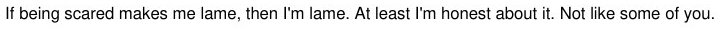
- **No single roster character (rules/setting/general)** — entry/section: Alyssa (alyssaroxu): "FYI... wampat's node just served as a transmittal station for 3 trillion copies of a picture of his mom at a swank restaurant with a hairy gundark." Source: *01:05:04 - Destabilization* (SWRPG d20 Revised Core), scan p.6
  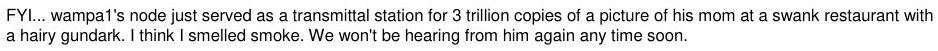

## scan p.7 (scan page 7)

Page contents: holosrv suspends forum; wampa1 image spam (hand-read)

- **No single roster character (rules/setting/general)** — entry/section: holosrv: "Cularin holonet services hereby suspends this forum until further notice. Any individuals contributing further to this discussion will be brought in for questioning. Have a pleasant day." Source: *01:05:04 - Destabilization* (SWRPG d20 Revised Core), scan p.7
  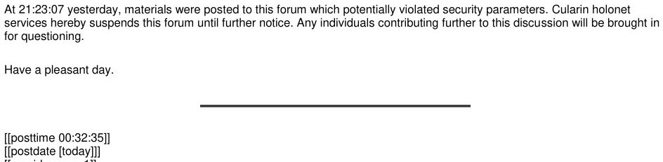
