# Owner Material 037 — Star Wars D20 Drive folder (Core, Revised Core and Saga Edition): Living Force Campaign/Articles/Year 4/01:15:04 - Reidi Artom's Expansion Manifesto.pdf [Star Wars Roleplaying Game Revised Core (d20, 2002)]

- **Source:** Wizards of the Coast Star Wars Roleplaying Game books, web enhancements, Living Force campaign modules and articles (2000–2010), from the owner's "Star Wars D20" Drive folder (only the three edition subfolders; "General" was not read, as instructed). Secondary source (licensed Legends reference). Scan OCR'd on the box; the scan stays box-only and is **not** published.
- **Method:** every scanned page was OCR'd and machine-screened sentence by sentence for power-relevant statements (fights, kills, defeats, Force feats, rankings, superweapons) that name a character on our roster; each kept sentence is quoted verbatim from the OCR text and has a crop of the printed passage directly under it. Pages with nothing power-relevant are still listed with what is on them.
- **Citation:** "*01:15:04 - Reidi Artom's Expansion Manifesto* (SWRPG d20 Revised Core), p.X" by printed page ("scan p.X" where no printed number applies). **Weight:** Licensed RPG material: a secondary source. Narrative text sums up Legends lore; game statistics are rules for players, not canon power levels, and rank lowest.

## scan p.1 (scan page 1)

Page contents: Intro; Vriisan irstat; Mother Kasslan's recited words; manifesto opening; life seen; expansion ethics (hand-read)

- **No single roster character (rules/setting/general)** — entry/section: Kasslan (Mother of the Vriisan): ""A Mother before Niroida, the Mother whose place I have attempted to fill these last thirty years, told stories of the Artom. They were not her stories to tell, any more than they are mine."" Source: *01:15:04 - Reidi Artom's Expansion Manifesto* (SWRPG d20 Revised Core), scan p.1
  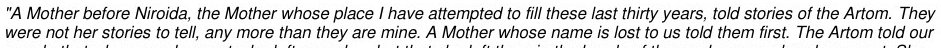
- **No single roster character (rules/setting/general)** — entry/section: Reidi Artom: ""It is right that life should expand to fill the spaces available for its completion, to find the proper means of balance. Always remember this: That all life is sacred, that all striving deserves reward, and that whenever you reach a place that is new to you, there will be those who were there before. Respect those who came before. Trust them with your life and your hope, as by accepting your coming, they are entrusting you with theirs."" Source: *01:15:04 - Reidi Artom's Expansion Manifesto* (SWRPG d20 Revised Core), scan p.1
  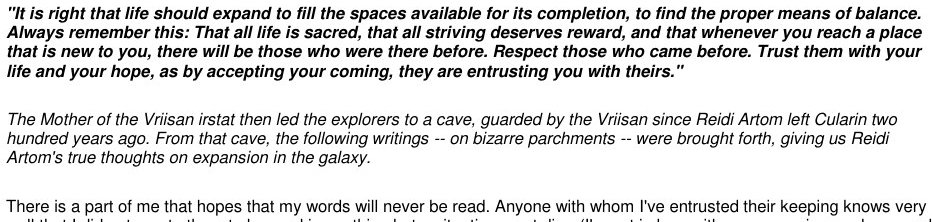
- **No single roster character (rules/setting/general)** — entry/section: Reidi Artom: "There is a part of me that hopes that my words will never be read." Source: *01:15:04 - Reidi Artom's Expansion Manifesto* (SWRPG d20 Revised Core), scan p.1
  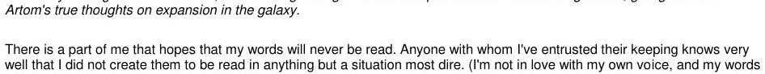
- **No single roster character (rules/setting/general)** — entry/section: Reidi Artom: "(I'm not in love with my own voice, and my words often fall short of what I want them to say. I feel the need to explain things in too-great detail, and it grows tiring after only a short time.)" Source: *01:15:04 - Reidi Artom's Expansion Manifesto* (SWRPG d20 Revised Core), scan p.1
  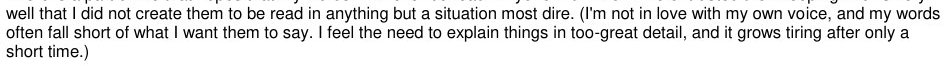
- **No single roster character (rules/setting/general)** — entry/section: Reidi Artom: "But most of all I have seen life, in a thousand thousand forms. Two legs or four or eight or a hundred, winged or walking, chittering, speaking, grunting or howling - I've seen life. Some of it scares me. All of it is beautiful." Source: *01:15:04 - Reidi Artom's Expansion Manifesto* (SWRPG d20 Revised Core), scan p.1
  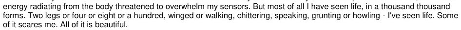
- **No single roster character (rules/setting/general)** — entry/section: Reidi Artom: "If I could find them, so could someone else. If I had found them, someone else would." Source: *01:15:04 - Reidi Artom's Expansion Manifesto* (SWRPG d20 Revised Core), scan p.1
  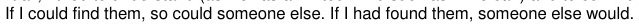
- **No single roster character (rules/setting/general)** — entry/section: Reidi Artom: "So long as there is space to be filled, the species who can travel the stars will seek to fill it. So long as there is space that can be taken, the species without scruples will attempt to take it." Source: *01:15:04 - Reidi Artom's Expansion Manifesto* (SWRPG d20 Revised Core), scan p.1
  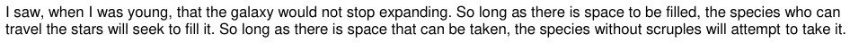
- **No single roster character (rules/setting/general)** — entry/section: Reidi Artom: "What must be remembered, always, is that no claim of territorial expansion can be justified so long as the indigenous species do not recognize the rights of others to expand into their territory." Source: *01:15:04 - Reidi Artom's Expansion Manifesto* (SWRPG d20 Revised Core), scan p.1
  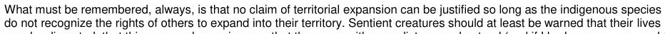

## scan p.2 (scan page 2)

Page contents: Purpose; cause and effect; xenoarchaeologist aside; habit vs fad; woods; depletion; war (hand-read)

- **No single roster character (rules/setting/general)** — entry/section: Reidi Artom: "if I am wrong, it is a delusion that I will cling to like a gundark to a fresh-killed nerf for as long as I am able." Source: *01:15:04 - Reidi Artom's Expansion Manifesto* (SWRPG d20 Revised Core), scan p.2
  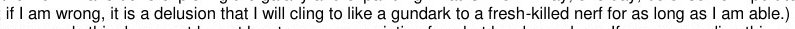
- **No single roster character (rules/setting/general)** — entry/section: Reidi Artom: "There is neither cause nor effect except that which we create. Through action or through inaction, we shape our own experiences as well as those of others with whom we interact." Source: *01:15:04 - Reidi Artom's Expansion Manifesto* (SWRPG d20 Revised Core), scan p.2
  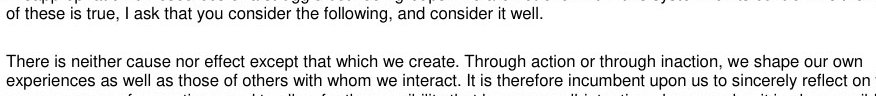
- **No single roster character (rules/setting/general)** — entry/section: Reidi Artom: "None of us have ascended to the status of infallibility. It is always possible -- and frequently likely -- that we will make mistakes." Source: *01:15:04 - Reidi Artom's Expansion Manifesto* (SWRPG d20 Revised Core), scan p.2
  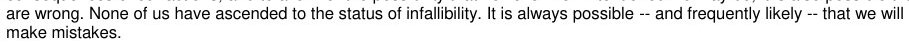
- **No single roster character (rules/setting/general)** — entry/section: Reidi Artom: "You are not now, nor were you ever, my target audience." Source: *01:15:04 - Reidi Artom's Expansion Manifesto* (SWRPG d20 Revised Core), scan p.2
  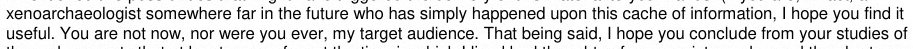
- **No single roster character (rules/setting/general)** — entry/section: Reidi Artom: "We must think not in terms of "What can we get here?" but instead, "How can we live here?" All things are interconnected. If we deplete the place where we live, even if that occurs only for a short time, we also deplete ourselves." Source: *01:15:04 - Reidi Artom's Expansion Manifesto* (SWRPG d20 Revised Core), scan p.2
  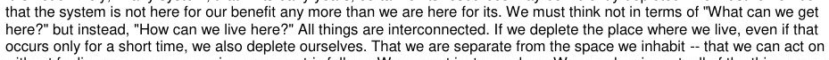
- **No single roster character (rules/setting/general)** — entry/section: Reidi Artom: "We are not just ourselves. We are also, in part, all of the things around us." Source: *01:15:04 - Reidi Artom's Expansion Manifesto* (SWRPG d20 Revised Core), scan p.2
  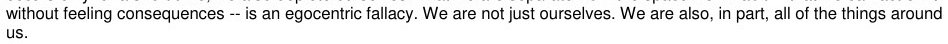
- **No single roster character (rules/setting/general)** — entry/section: Reidi Artom: "We often call this "war."" Source: *01:15:04 - Reidi Artom's Expansion Manifesto* (SWRPG d20 Revised Core), scan p.2
  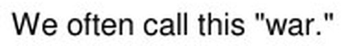
- **No single roster character (rules/setting/general)** — entry/section: Reidi Artom: "People die, the survivors live off anger and hate and a dozen other harmful emotions, and the galaxy changes, if at all, for the worse. No one wins." Source: *01:15:04 - Reidi Artom's Expansion Manifesto* (SWRPG d20 Revised Core), scan p.2
  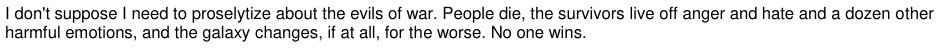
- **No single roster character (rules/setting/general)** — entry/section: Reidi Artom: "What needs to be remembered is that the right to "claim" a particular place is not a function of military power." Source: *01:15:04 - Reidi Artom's Expansion Manifesto* (SWRPG d20 Revised Core), scan p.2
  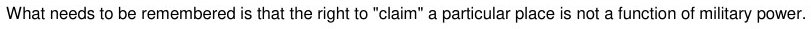

## scan p.3 (scan page 3)

Page contents: Claim and love of place; no bystanders; short version (hand-read)

- **No single roster character (rules/setting/general)** — entry/section: Reidi Artom: "Except that there are no bystanders in wars. There are only combatants and accidents." Source: *01:15:04 - Reidi Artom's Expansion Manifesto* (SWRPG d20 Revised Core), scan p.3
  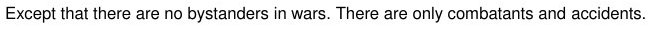
- **No single roster character (rules/setting/general)** — entry/section: Reidi Artom: "Think carefully about your path. I don't claim to be the wisest of individuals, but I've seen a lot. Beauty and sorrow, joy and pain. Expansion is good, and should be continued. But it should not do so at the expense of what has gone before." Source: *01:15:04 - Reidi Artom's Expansion Manifesto* (SWRPG d20 Revised Core), scan p.3
  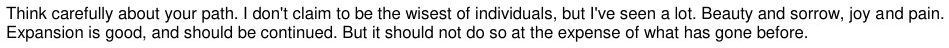
