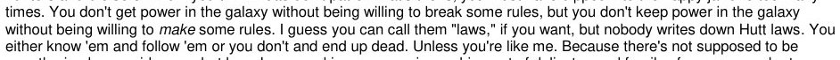
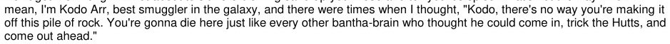
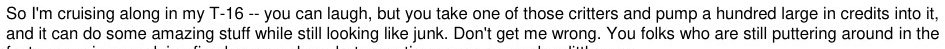
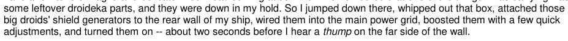
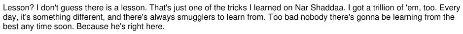

# Owner Material 037 — Star Wars D20 Drive folder (Core, Revised Core and Saga Edition): Living Force Campaign/Articles/Year 4/02:19:04 - Smuggler's Trade.pdf [Star Wars Roleplaying Game Revised Core (d20, 2002)]

- **Source:** Wizards of the Coast Star Wars Roleplaying Game books, web enhancements, Living Force campaign modules and articles (2000–2010), from the owner's "Star Wars D20" Drive folder (only the three edition subfolders; "General" was not read, as instructed). Secondary source (licensed Legends reference). Scan OCR'd on the box; the scan stays box-only and is **not** published.
- **Method:** every scanned page was OCR'd and machine-screened sentence by sentence for power-relevant statements (fights, kills, defeats, Force feats, rankings, superweapons) that name a character on our roster; each kept sentence is quoted verbatim from the OCR text and has a crop of the printed passage directly under it. Pages with nothing power-relevant are still listed with what is on them.
- **Citation:** "*02:19:04 - Smuggler's Trade* (SWRPG d20 Revised Core), p.X" by printed page ("scan p.X" where no printed number applies). **Weight:** Licensed RPG material: a secondary source. Narrative text sums up Legends lore; game statistics are rules for players, not canon power levels, and rank lowest.

## scan p.1 (scan page 1)

Page contents: Cantina scene on Tolea Biqua; Kodo Arr introduced; Nar Shaddaa, Hutt law, moonside run in a modified T-16 (hand-read)

- **No single roster character (rules/setting/general)** — entry/section: Kodo Arr: "You don't get power in the galaxy without being willing to break some rules, but you don't keep power in the galaxy without being willing to make some rules. I guess you can call them "laws," if you want, but nobody writes down Hutt laws. You either know 'em and follow 'em or you don't and end up dead." Source: *02:19:04 - Smuggler's Trade* (SWRPG d20 Revised Core), scan p.1
  
- **No single roster character (rules/setting/general)** — entry/section: Kodo Arr: "I mean, I'm Kodo Arr, best smuggler in the galaxy, and there were times when I thought, "Kodo, there's no way you're making it off this pile of rock. You're gonna die here just like every other bantha-brain who thought he could come in, trick the Hutts, and come out ahead."" Source: *02:19:04 - Smuggler's Trade* (SWRPG d20 Revised Core), scan p.1
  
- **No single roster character (rules/setting/general)** — entry/section: Kodo Arr: "So I'm cruising along in my T-16 -- you can laugh, but you take one of those critters and pump a hundred large in credits into it, and it can do some amazing stuff while still looking like junk." Source: *02:19:04 - Smuggler's Trade* (SWRPG d20 Revised Core), scan p.1
  

## scan p.2 (scan page 2)

Page contents: Nar Shaddaa traffic; speeder superstructure failing; droideka shield generators wired into the ship; LIVING FORCE ad (hand-read)

- **No single roster character (rules/setting/general)** — entry/section: Kodo Arr: "So I jumped down there, whipped out that box, attached those big droids' shield generators to the rear wall of my ship, wired them into the main power grid, boosted them with a few quick adjustments, and turned them on -- about two seconds before I hear a thump on the far side of the wall." Source: *02:19:04 - Smuggler's Trade* (SWRPG d20 Revised Core), scan p.2
  
- **No single roster character (rules/setting/general)** — entry/section: Kodo Arr: "That's just one of the tricks I learned on Nar Shaddaa. I got a trillion of 'em, too. Every day, it's something different, and there's always smugglers to learn from. Too bad nobody there's gonna be learning from the best any time soon. Because he's right here." Source: *02:19:04 - Smuggler's Trade* (SWRPG d20 Revised Core), scan p.2
  
