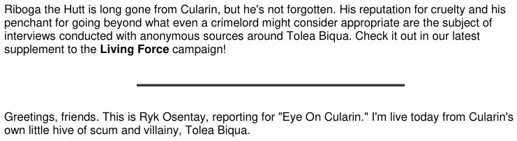
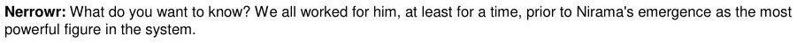
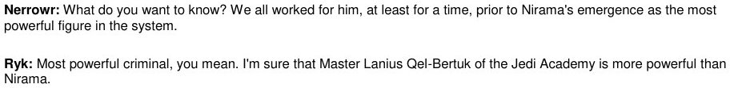
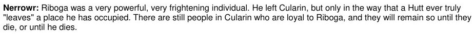

# Owner Material 037 — Star Wars D20 Drive folder (Core, Revised Core and Saga Edition): Living Force Campaign/Articles/Year 4/03:04::04 - Riboga's Legacy.pdf [Star Wars Roleplaying Game Revised Core (d20, 2002)]

- **Source:** Wizards of the Coast Star Wars Roleplaying Game books, web enhancements, Living Force campaign modules and articles (2000–2010), from the owner's "Star Wars D20" Drive folder (only the three edition subfolders; "General" was not read, as instructed). Secondary source (licensed Legends reference). Scan OCR'd on the box; the scan stays box-only and is **not** published.
- **Method:** every scanned page was OCR'd and machine-screened sentence by sentence for power-relevant statements (fights, kills, defeats, Force feats, rankings, superweapons) that name a character on our roster; each kept sentence is quoted verbatim from the OCR text and has a crop of the printed passage directly under it. Pages with nothing power-relevant are still listed with what is on them.
- **Citation:** "*03:04::04 - Riboga's Legacy* (SWRPG d20 Revised Core), p.X" by printed page ("scan p.X" where no printed number applies). **Weight:** Licensed RPG material: a secondary source. Narrative text sums up Legends lore; game statistics are rules for players, not canon power levels, and rank lowest.

## scan p.1 (scan page 1)

Page contents: Ryk Osentay's live report from Tolea Biqua; hidden security detail and turbolaser ship captions; Devaronian interview (hand-read)

- **No single roster character (rules/setting/general)** — entry/section: Riboga the Hutt: "Riboga the Hutt is long gone from Cularin, but he's not forgotten. His reputation for cruelty and his penchant for going beyond what even a crimelord might consider appropriate are the subject of interviews conducted with anonymous sources around Tolea Biqua." Source: *03:04::04 - Riboga's Legacy* (SWRPG d20 Revised Core), scan p.1
  

## scan p.2 (scan page 2)

Page contents: Devaronian mocks Ryk's fake 'Jedi Code'; Rodian trio and Wookiee Nerrowr (hand-read)

## scan p.3 (scan page 3)

Page contents: Nerrowr on Riboga and Nirama; Melanda Forswoth found; studio wrap-up with Yara (hand-read)

- **No single roster character (rules/setting/general)** — entry/section: Nerrowr (on Nirama): "What do you want to know? We all worked for him, at least for a time, prior to Nirama's emergence as the most powerful figure in the system." Source: *03:04::04 - Riboga's Legacy* (SWRPG d20 Revised Core), scan p.3
  
- **No single roster character (rules/setting/general)** — entry/section: Ryk Osentay: "Most powerful criminal, you mean. I'm sure that Master Lanius Qel-Bertuk of the Jedi Academy is more powerful than Nirama." Source: *03:04::04 - Riboga's Legacy* (SWRPG d20 Revised Core), scan p.3
  
- **No single roster character (rules/setting/general)** — entry/section: Nerrowr (on Riboga): "Riboga was a very powerful, very frightening individual. He left Cularin, but only in the way that a Hutt ever truly "leaves" a place he has occupied. There are still people in Cularin who are loyal to Riboga, and they will remain so until they die, or until he dies." Source: *03:04::04 - Riboga's Legacy* (SWRPG d20 Revised Core), scan p.3
  

## scan p.4 (scan page 4)

Page contents: Living Force ad (hand-read)

