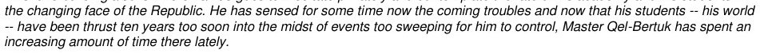
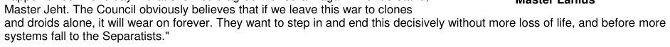
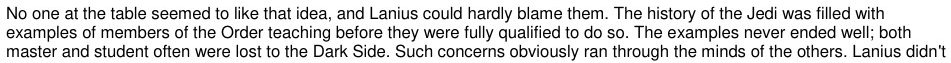

# Owner Material 037 — Star Wars D20 Drive folder (Core, Revised Core and Saga Edition): Living Force Campaign/Articles/Year 4/03:11:04 - Conflict and Mastery.pdf [Star Wars Roleplaying Game Revised Core (d20, 2002)]

- **Source:** Wizards of the Coast Star Wars Roleplaying Game books, web enhancements, Living Force campaign modules and articles (2000–2010), from the owner's "Star Wars D20" Drive folder (only the three edition subfolders; "General" was not read, as instructed). Secondary source (licensed Legends reference). Scan OCR'd on the box; the scan stays box-only and is **not** published.
- **Method:** every scanned page was OCR'd and machine-screened sentence by sentence for power-relevant statements (fights, kills, defeats, Force feats, rankings, superweapons) that name a character on our roster; each kept sentence is quoted verbatim from the OCR text and has a crop of the printed passage directly under it. Pages with nothing power-relevant are still listed with what is on them.
- **Citation:** "*03:11:04 - Conflict and Mastery* (SWRPG d20 Revised Core), p.X" by printed page ("scan p.X" where no printed number applies). **Weight:** Licensed RPG material: a secondary source. Narrative text sums up Legends lore; game statistics are rules for players, not canon power levels, and rank lowest.

## scan p.1 (scan page 1)

Page contents: Lanius's isolated meeting building; faculty meeting; Devan vs Jurahi; Kirlocca missed; Master Jeht reports the Council recall (hand-read)

- **No single roster character (rules/setting/general)** — entry/section: Lanius Qel-Bertuk: "He has sensed for some time now the coming troubles and now that his students -- his world -- have been thrust ten years too soon into the midst of events too sweeping for him to control, Master Qel-Bertuk has spent an increasing amount of time there lately." Source: *03:11:04 - Conflict and Mastery* (SWRPG d20 Revised Core), scan p.1
  

## scan p.2 (scan page 2)

Page contents: Recall details; Jedi given command of Republic forces; E1-6RA datapads; Ti-Amun Tiro storms out; class sizes expand; Darrus Jeht stays to help train (hand-read)

- **No single roster character (rules/setting/general)** — entry/section: Devan: "The Council obviously believes that if we leave this war to clones and droids alone, it will wear on forever. They want to step in and end this decisively without more loss of life, and before more systems fall to the Separatists." Source: *03:11:04 - Conflict and Mastery* (SWRPG d20 Revised Core), scan p.2
  
- **No single roster character (rules/setting/general)** — entry/section: Lanius Qel-Bertuk: "The history of the Jedi was filled with examples of members of the Order teaching before they were fully qualified to do so. The examples never ended well; both master and student often were lost to the Dark Side." Source: *03:11:04 - Conflict and Mastery* (SWRPG d20 Revised Core), scan p.2
  

## scan p.3 (scan page 3)

Page contents: Devan leaves; Living Force game effects (no Jedi Mentors, Jedi Master prestige class open); LF ad (hand-read)

