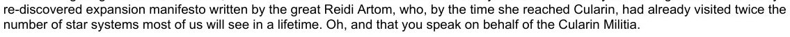
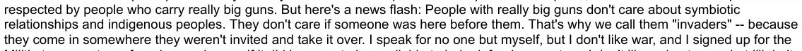

# Owner Material 037 — Star Wars D20 Drive folder (Core, Revised Core and Saga Edition): Living Force Campaign/Articles/Year 4/03:18:04 - Manifesto My Foot.pdf [Star Wars Roleplaying Game Revised Core (d20, 2002)]

- **Source:** Wizards of the Coast Star Wars Roleplaying Game books, web enhancements, Living Force campaign modules and articles (2000–2010), from the owner's "Star Wars D20" Drive folder (only the three edition subfolders; "General" was not read, as instructed). Secondary source (licensed Legends reference). Scan OCR'd on the box; the scan stays box-only and is **not** published.
- **Method:** every scanned page was OCR'd and machine-screened sentence by sentence for power-relevant statements (fights, kills, defeats, Force feats, rankings, superweapons) that name a character on our roster; each kept sentence is quoted verbatim from the OCR text and has a crop of the printed passage directly under it. Pages with nothing power-relevant are still listed with what is on them.
- **Citation:** "*03:18:04 - Manifesto My Foot* (SWRPG d20 Revised Core), p.X" by printed page ("scan p.X" where no printed number applies). **Weight:** Licensed RPG material: a secondary source. Narrative text sums up Legends lore; game statistics are rules for players, not canon power levels, and rank lowest.

## scan p.1 (scan page 1)

Page contents: Tarasin reveal Reidi Artom's cache; manifesto excerpt on war; Yara's interview set-up with Mack, Pac, Grunt (hand-read)

- **No single roster character (rules/setting/general)** — entry/section: Reidi Artom: "Reidi Artom, who, by the time she reached Cularin, had already visited twice the number of star systems most of us will see in a lifetime." Source: *03:18:04 - Manifesto My Foot* (SWRPG d20 Revised Core), scan p.1
  

## scan p.2 (scan page 2)

Page contents: Pac on war as escalated conflict; Grunt 'Thaere bad'; Mack's cantina-fight argument on winners (hand-read)

## scan p.3 (scan page 3)

Page contents: Pac calls Artom's claim theory naive; why each signed up; sign-off (hand-read)

- **No single roster character (rules/setting/general)** — entry/section: Pac (Cularin Militia private): "People with really big guns don't care about symbiotic relationships and indigenous peoples. They don't care if someone was here before them. That's why we call them "invaders" -- because they come in somewhere they weren't invited and take it over." Source: *03:18:04 - Manifesto My Foot* (SWRPG d20 Revised Core), scan p.3
  
