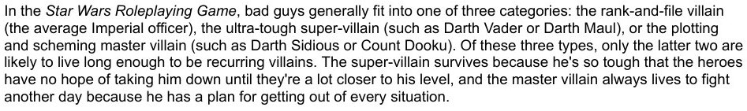
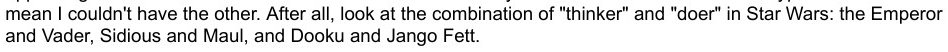
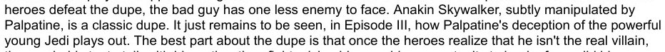
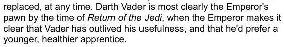
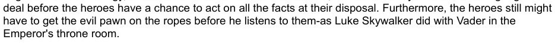

# Owner Material 037 — Star Wars D20 Drive folder (Core, Revised Core and Saga Edition): Living Force Campaign/Articles/Year 4/03:18:04 - Only a Master of Evil.pdf [Star Wars Roleplaying Game Revised Core (d20, 2002)]

- **Source:** Wizards of the Coast Star Wars Roleplaying Game books, web enhancements, Living Force campaign modules and articles (2000–2010), from the owner's "Star Wars D20" Drive folder (only the three edition subfolders; "General" was not read, as instructed). Secondary source (licensed Legends reference). Scan OCR'd on the box; the scan stays box-only and is **not** published.
- **Method:** every scanned page was OCR'd and machine-screened sentence by sentence for power-relevant statements (fights, kills, defeats, Force feats, rankings, superweapons) that name a character on our roster; each kept sentence is quoted verbatim from the OCR text and has a crop of the printed passage directly under it. Pages with nothing power-relevant are still listed with what is on them.
- **Citation:** "*03:18:04 - Only a Master of Evil* (SWRPG d20 Revised Core), p.X" by printed page ("scan p.X" where no printed number applies). **Weight:** Licensed RPG material: a secondary source. Narrative text sums up Legends lore; game statistics are rules for players, not canon power levels, and rank lowest.

## scan p.1 (scan page 1)

Page contents: Three villain categories; author's evil-benefactor anecdote; thinker/doer pairs (hand-read)

- **Darth Vader (Anakin Skywalker); Darth Maul; Palpatine (Darth Sidious); Count Dooku** — entry/section: GM article (JD Wiker): "In the Star Wars Roleplaying Game, bad guys generally fit into one of three categories: the rank-and-file villain (the average Imperial officer), the ultra-tough super-villain (such as Darth Vader or Darth Maul), or the plotting and scheming master villain (such as Darth Sidious or Count Dooku). Of these three types, only the latter two are likely to live long enough to be recurring villains. The super-villain survives because he's so tough that the heroes have no hope of taking him down until they're a lot closer to his level, and the master villain always lives to fight another day because he has a plan for getting out of every situation." Source: *03:18:04 - Only a Master of Evil* (SWRPG d20 Revised Core), scan p.1
  
- **Palpatine (Darth Sidious); Darth Vader (Anakin Skywalker); Darth Maul; Count Dooku; Jango Fett** — entry/section: GM article (JD Wiker): "After all, look at the combination of "thinker" and "doer" in Star Wars: the Emperor and Vader, Sidious and Maul, and Dooku and Jango Fett." Source: *03:18:04 - Only a Master of Evil* (SWRPG d20 Revised Core), scan p.1
  

## scan p.2 (scan page 2)

Page contents: Evil patron (Dooku example) and evil advisor (Palpatine as Sidious), with tactics (hand-read)

## scan p.3 (scan page 3)

Page contents: Outwardly evil opponent (Borsk Fey'lya), evil dupe (Anakin), evil pawn (Vader) (hand-read)

- **Darth Vader (Anakin Skywalker); Palpatine (Darth Sidious)** — entry/section: GM article (JD Wiker): "Anakin Skywalker, subtly manipulated by Palpatine, is a classic dupe. It just remains to be seen, in Episode III, how Palpatine's deception of the powerful young Jedi plays out." Source: *03:18:04 - Only a Master of Evil* (SWRPG d20 Revised Core), scan p.3
  
- **Darth Vader (Anakin Skywalker); Palpatine (Darth Sidious)** — entry/section: GM article (JD Wiker): "Darth Vader is most clearly the Emperor's pawn by the time of Return of the Jedi, when the Emperor makes it clear that Vader has outlived his usefulness, and that he'd prefer a younger, healthier apprentice." Source: *03:18:04 - Only a Master of Evil* (SWRPG d20 Revised Core), scan p.3
  

## scan p.4 (scan page 4)

Page contents: Pawn redemption (Luke and Vader); changing the villain roster with a Sith artifact; LF ad (hand-read)

- **Darth Vader (Anakin Skywalker); Luke Skywalker** — entry/section: GM article (JD Wiker): "Furthermore, the heroes still might have to get the evil pawn on the ropes before he listens to them-as Luke Skywalker did with Vader in the Emperor's throne room." Source: *03:18:04 - Only a Master of Evil* (SWRPG d20 Revised Core), scan p.4
  
