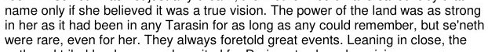
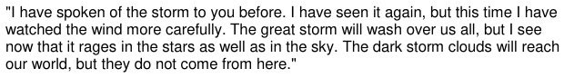

# Owner Material 037 — Star Wars D20 Drive folder (Core, Revised Core and Saga Edition): Living Force Campaign/Articles/Year 4/03:25:04 - Home of Wisdom.pdf [Star Wars Roleplaying Game Revised Core (d20, 2002)]

- **Source:** Wizards of the Coast Star Wars Roleplaying Game books, web enhancements, Living Force campaign modules and articles (2000–2010), from the owner's "Star Wars D20" Drive folder (only the three edition subfolders; "General" was not read, as instructed). Secondary source (licensed Legends reference). Scan OCR'd on the box; the scan stays box-only and is **not** published.
- **Method:** every scanned page was OCR'd and machine-screened sentence by sentence for power-relevant statements (fights, kills, defeats, Force feats, rankings, superweapons) that name a character on our roster; each kept sentence is quoted verbatim from the OCR text and has a crop of the printed passage directly under it. Pages with nothing power-relevant are still listed with what is on them.
- **Citation:** "*03:25:04 - Home of Wisdom* (SWRPG d20 Revised Core), p.X" by printed page ("scan p.X" where no printed number applies). **Weight:** Licensed RPG material: a secondary source. Narrative text sums up Legends lore; game statistics are rules for players, not canon power levels, and rank lowest.

## scan p.1 (scan page 1)

Page contents: Home of Wisdom history; irstat leaders arrive; Mother Dariana's se'neth of the storm (hand-read)

- **No single roster character (rules/setting/general)** — entry/section: Mother Dariana: "The power of the land was as strong in her as it had been in any Tarasin for as long as any could remember, but se'neth were rare, even for her. They always foretold great events." Source: *03:25:04 - Home of Wisdom* (SWRPG d20 Revised Core), scan p.1
  
- **No single roster character (rules/setting/general)** — entry/section: Mother Dariana: "I have spoken of the storm to you before. I have seen it again, but this time I have watched the wind more carefully. The great storm will wash over us all, but I see now that it rages in the stars as well as in the sky. The dark storm clouds will reach our world, but they do not come from here." Source: *03:25:04 - Home of Wisdom* (SWRPG d20 Revised Core), scan p.1
  

## scan p.2 (scan page 2)

Page contents: 'Prepare the way for everyone'; game notes on Force Apprentices and vanishing younglings; LF ad (hand-read)

