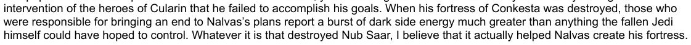
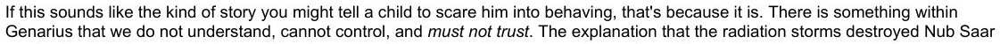
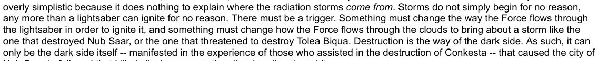
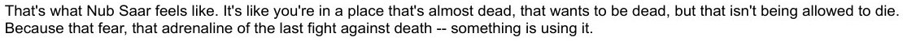

# Owner Material 037 — Star Wars D20 Drive folder (Core, Revised Core and Saga Edition): Living Force Campaign/Articles/Year 4/04:08:04 - Tales of Nub Saar.pdf [Star Wars Roleplaying Game Revised Core (d20, 2002)]

- **Source:** Wizards of the Coast Star Wars Roleplaying Game books, web enhancements, Living Force campaign modules and articles (2000–2010), from the owner's "Star Wars D20" Drive folder (only the three edition subfolders; "General" was not read, as instructed). Secondary source (licensed Legends reference). Scan OCR'd on the box; the scan stays box-only and is **not** published.
- **Method:** every scanned page was OCR'd and machine-screened sentence by sentence for power-relevant statements (fights, kills, defeats, Force feats, rankings, superweapons) that name a character on our roster; each kept sentence is quoted verbatim from the OCR text and has a crop of the printed passage directly under it. Pages with nothing power-relevant are still listed with what is on them.
- **Citation:** "*04:08:04 - Tales of Nub Saar* (SWRPG d20 Revised Core), p.X" by printed page ("scan p.X" where no printed number applies). **Weight:** Licensed RPG material: a secondary source. Narrative text sums up Legends lore; game statistics are rules for players, not canon power levels, and rank lowest.

## scan p.1 (scan page 1)

Page contents: Documentary framing; Dazen Mok left the Academy; radiation-storm explanation; Tolea Biqua comparison (hand-read)

## scan p.2 (scan page 2)

Page contents: Altitude difference 2,313 meters; dark side manifestation; Karae Nalvas's Conkesta; anonymous explorer on Nub Saar (hand-read)

- **No single roster character (rules/setting/general)** — entry/section: Karae Nalvas: "When his fortress of Conkesta was destroyed, those who were responsible for bringing an end to Nalvas's plans report a burst of dark side energy much greater than anything the fallen Jedi himself could have hoped to control. Whatever it is that destroyed Nub Saar, I believe that it actually helped Nalvas create his fortress." Source: *04:08:04 - Tales of Nub Saar* (SWRPG d20 Revised Core), scan p.2
  
- **No single roster character (rules/setting/general)** — entry/section: Dazen Mok: "There is something within Genarius that we do not understand, cannot control, and must not trust." Source: *04:08:04 - Tales of Nub Saar* (SWRPG d20 Revised Core), scan p.2
  
- **No single roster character (rules/setting/general)** — entry/section: Dazen Mok: "Storms do not simply begin for no reason, any more than a lightsaber can ignite for no reason. There must be a trigger. Something must change the way the Force flows through the lightsaber in order to ignite it, and something must change how the Force flows through the clouds to bring about a storm like the one that destroyed Nub Saar, or the one that threatened to destroy Tolea Biqua. Destruction is the way of the dark side." Source: *04:08:04 - Tales of Nub Saar* (SWRPG d20 Revised Core), scan p.2
  
- **No single roster character (rules/setting/general)** — entry/section: Anonymous explorer: "It's like you're in a place that's almost dead, that wants to be dead, but that isn't being allowed to die. Because that fear, that adrenaline of the last fight against death -- something is using it." Source: *04:08:04 - Tales of Nub Saar* (SWRPG d20 Revised Core), scan p.2
  
