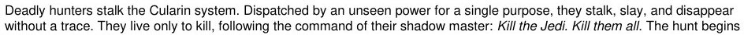
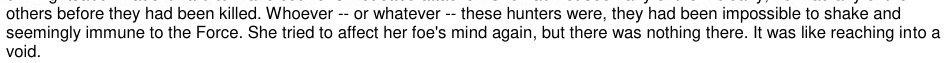
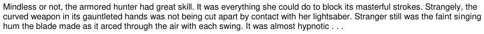
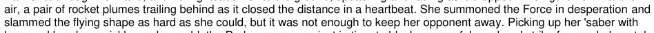

# Owner Material 037 — Star Wars D20 Drive folder (Core, Revised Core and Saga Edition): Living Force Campaign/Articles/Year 4/04:15:04 - 1 - The Hunt Begins.pdf [Star Wars Roleplaying Game Revised Core (d20, 2002)]

- **Source:** Wizards of the Coast Star Wars Roleplaying Game books, web enhancements, Living Force campaign modules and articles (2000–2010), from the owner's "Star Wars D20" Drive folder (only the three edition subfolders; "General" was not read, as instructed). Secondary source (licensed Legends reference). Scan OCR'd on the box; the scan stays box-only and is **not** published.
- **Method:** every scanned page was OCR'd and machine-screened sentence by sentence for power-relevant statements (fights, kills, defeats, Force feats, rankings, superweapons) that name a character on our roster; each kept sentence is quoted verbatim from the OCR text and has a crop of the printed passage directly under it. Pages with nothing power-relevant are still listed with what is on them.
- **Citation:** "*04:15:04 - 1 - The Hunt Begins* (SWRPG d20 Revised Core), p.X" by printed page ("scan p.X" where no printed number applies). **Weight:** Licensed RPG material: a secondary source. Narrative text sums up Legends lore; game statistics are rules for players, not canon power levels, and rank lowest.

## scan p.1 (scan page 1)

Page contents: Hunters' order 'Kill the Jedi'; Padawan escapes swoop crash, uses Farsight, blocks fire, Force-jumps rooftops (hand-read)

- **No single roster character (rules/setting/general)** — entry/section: Jedi hunters: "Dispatched by an unseen power for a single purpose, they stalk, slay, and disappear without a trace." Source: *04:15:04 - 1 - The Hunt Begins* (SWRPG d20 Revised Core), scan p.1
  

## scan p.2 (scan page 2)

Page contents: Armored rocket-borne hunter; Force-immune 'void' mind; humming blade not cut by lightsaber; Padawan killed; game notes (hand-read)

- **No single roster character (rules/setting/general)** — entry/section: Jedi hunter vs Padawan: "Whoever -- or whatever -- these hunters were, they had been impossible to shake and seemingly immune to the Force. She tried to affect her foe's mind again, but there was nothing there. It was like reaching into a void." Source: *04:15:04 - 1 - The Hunt Begins* (SWRPG d20 Revised Core), scan p.2
  
- **No single roster character (rules/setting/general)** — entry/section: Jedi hunter vs Padawan: "Mindless or not, the armored hunter had great skill. It was everything she could do to block its masterful strokes. Strangely, the curved weapon in its gauntleted hands was not being cut apart by contact with her lightsaber. Stranger still was the faint singing hum the blade made as it arced through the air with each swing." Source: *04:15:04 - 1 - The Hunt Begins* (SWRPG d20 Revised Core), scan p.2
  
- **No single roster character (rules/setting/general)** — entry/section: Padawan (unnamed): "She summoned the Force in desperation and slammed the flying shape as hard as she could, but it was not enough to keep her opponent away." Source: *04:15:04 - 1 - The Hunt Begins* (SWRPG d20 Revised Core), scan p.2
  
