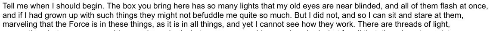
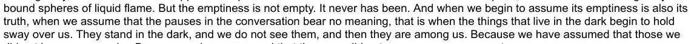

# Owner Material 037 — Star Wars D20 Drive folder (Core, Revised Core and Saga Edition): Living Force Campaign/Articles/Year 4/04:29:04 - 2 - A Mothers Memoir's Continued.pdf [Star Wars Roleplaying Game Revised Core (d20, 2002)]

- **Source:** Wizards of the Coast Star Wars Roleplaying Game books, web enhancements, Living Force campaign modules and articles (2000–2010), from the owner's "Star Wars D20" Drive folder (only the three edition subfolders; "General" was not read, as instructed). Secondary source (licensed Legends reference). Scan OCR'd on the box; the scan stays box-only and is **not** published.
- **Method:** every scanned page was OCR'd and machine-screened sentence by sentence for power-relevant statements (fights, kills, defeats, Force feats, rankings, superweapons) that name a character on our roster; each kept sentence is quoted verbatim from the OCR text and has a crop of the printed passage directly under it. Pages with nothing power-relevant are still listed with what is on them.
- **Citation:** "*04:29:04 - 2 - A Mothers Memoir's Continued* (SWRPG d20 Revised Core), p.X" by printed page ("scan p.X" where no printed number applies). **Weight:** Licensed RPG material: a secondary source. Narrative text sums up Legends lore; game statistics are rules for players, not canon power levels, and rank lowest.

## scan p.1 (scan page 1)

Page contents: Framing; Dariana on machines and the Force, the silence between words; meeting the Human Traveler at nineteen (hand-read)

- **No single roster character (rules/setting/general)** — entry/section: Mother Dariana: "Tell me when I should begin. The box you bring here has so many lights that my old eyes are near blinded, and all of them flash at once, and if I had grown up with such things they might not befuddle me quite so much. But I did not, and so I can sit and stare at them, marveling that the Force is in these things, as it is in all things, and yet I cannot see how they work." Source: *04:29:04 - 2 - A Mothers Memoir's Continued* (SWRPG d20 Revised Core), scan p.1
  

## scan p.2 (scan page 2)

Page contents: The Traveler's calm and fear; 'I am a Traveler'; lesson that emptiness is not empty (hand-read)

- **No single roster character (rules/setting/general)** — entry/section: Mother Dariana: "But the emptiness is not empty. It never has been. And when we begin to assume its emptiness is also its truth, when we assume that the pauses in the conversation bear no meaning, that is when the things that live in the dark begin to hold sway over us." Source: *04:29:04 - 2 - A Mothers Memoir's Continued* (SWRPG d20 Revised Core), scan p.2
  
