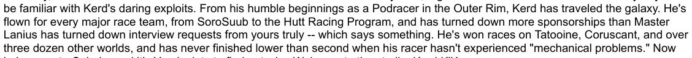
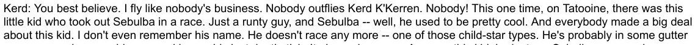
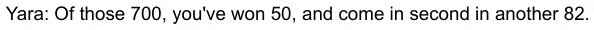

# Owner Material 037 — Star Wars D20 Drive folder (Core, Revised Core and Saga Edition): Living Force Campaign/Articles/Year 4/05:06:04 - Swoop and Dive.pdf [Star Wars Roleplaying Game Revised Core (d20, 2002)]

- **Source:** Wizards of the Coast Star Wars Roleplaying Game books, web enhancements, Living Force campaign modules and articles (2000–2010), from the owner's "Star Wars D20" Drive folder (only the three edition subfolders; "General" was not read, as instructed). Secondary source (licensed Legends reference). Scan OCR'd on the box; the scan stays box-only and is **not** published.
- **Method:** every scanned page was OCR'd and machine-screened sentence by sentence for power-relevant statements (fights, kills, defeats, Force feats, rankings, superweapons) that name a character on our roster; each kept sentence is quoted verbatim from the OCR text and has a crop of the printed passage directly under it. Pages with nothing power-relevant are still listed with what is on them.
- **Citation:** "*05:06:04 - Swoop and Dive* (SWRPG d20 Revised Core), p.X" by printed page ("scan p.X" where no printed number applies). **Weight:** Licensed RPG material: a secondary source. Narrative text sums up Legends lore; game statistics are rules for players, not canon power levels, and rank lowest.

## scan p.1 (scan page 1)

Page contents: Yara introduces Kerd K'Kerren and his record; his look; 'Welcome to Koo-larin' (hand-read)

- **No single roster character (rules/setting/general)** — entry/section: Kerd K'Kerren: "He's flown for every major race team, from SoroSuub to the Hutt Racing Program, and has turned down more sponsorships than Master Lanius has turned down interview requests from yours truly -- which says something. He's won races on Tatooine, Coruscant, and over three dozen other worlds, and has never finished lower than second when his racer hasn't experienced "mechanical problems."" Source: *05:06:04 - Swoop and Dive* (SWRPG d20 Revised Core), scan p.1
  

## scan p.2 (scan page 2)

Page contents: Why he came (Metatheran Cartel Podrace sponsorship, war); flying for the Hutts; Jabba (hand-read)

## scan p.3 (scan page 3)

Page contents: Jabba anecdote; the Tatooine kid who beat Sebulba; 700 races, 132 top-two finishes, 568 'mechanical problems' (hand-read)

- **Darth Vader (Anakin Skywalker)** — entry/section: Kerd K'Kerren (on young Anakin): "This one time, on Tatooine, there was this little kid who took out Sebulba in a race. Just a runty guy, and Sebulba -- well, he used to be pretty cool. And everybody made a big deal about this kid. I don't even remember his name. He doesn't race any more -- one of those child-star types." Source: *05:06:04 - Swoop and Dive* (SWRPG d20 Revised Core), scan p.3
  
- **No single roster character (rules/setting/general)** — entry/section: Kerd K'Kerren: "Yara: Of those 700, you've won 50, and come in second in another 82." Source: *05:06:04 - Swoop and Dive* (SWRPG d20 Revised Core), scan p.3
  

## scan p.4 (scan page 4)

Page contents: Closing: hotel address on Tolea Biqua; Yara's sign-off (read from page image) (hand-read)

