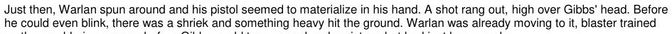
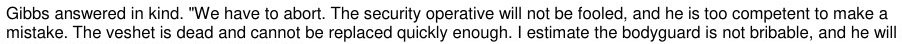

# Owner Material 037 — Star Wars D20 Drive folder (Core, Revised Core and Saga Edition): Living Force Campaign/Articles/Year 4/05:13:04 - Insecurities.pdf [Star Wars Roleplaying Game Revised Core (d20, 2002)]

- **Source:** Wizards of the Coast Star Wars Roleplaying Game books, web enhancements, Living Force campaign modules and articles (2000–2010), from the owner's "Star Wars D20" Drive folder (only the three edition subfolders; "General" was not read, as instructed). Secondary source (licensed Legends reference). Scan OCR'd on the box; the scan stays box-only and is **not** published.
- **Method:** every scanned page was OCR'd and machine-screened sentence by sentence for power-relevant statements (fights, kills, defeats, Force feats, rankings, superweapons) that name a character on our roster; each kept sentence is quoted verbatim from the OCR text and has a crop of the printed passage directly under it. Pages with nothing power-relevant are still listed with what is on them.
- **Citation:** "*05:13:04 - Insecurities* (SWRPG d20 Revised Core), p.X" by printed page ("scan p.X" where no printed number applies). **Weight:** Licensed RPG material: a secondary source. Narrative text sums up Legends lore; game statistics are rules for players, not canon power levels, and rank lowest.

## scan p.1 (scan page 1)

Page contents: Security preparations for Senator Wren; Warlan Tosk's paranoia; window, retina and thermoscanner (hand-read)

## scan p.2 (scan page 2)

Page contents: Warlan's quick-draw kills a veshet; Gibbs revealed as an assassin who aborts; prestige class notes; LF ad (hand-read)

- **No single roster character (rules/setting/general)** — entry/section: Warlan Tosk: "Just then, Warlan spun around and his pistol seemed to materialize in his hand. A shot rang out, high over Gibbs' head. Before he could even blink, there was a shriek and something heavy hit the ground." Source: *05:13:04 - Insecurities* (SWRPG d20 Revised Core), scan p.2
  
- **No single roster character (rules/setting/general)** — entry/section: Gibbs (disguised assassin): "We have to abort. The security operative will not be fooled, and he is too competent to make a mistake." Source: *05:13:04 - Insecurities* (SWRPG d20 Revised Core), scan p.2
  
