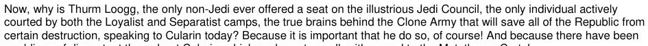

# Owner Material 037 — Star Wars D20 Drive folder (Core, Revised Core and Saga Edition): Living Force Campaign/Articles/Year 4/06:17:04 - Metatheran Promise.pdf [Star Wars Roleplaying Game Revised Core (d20, 2002)]

- **Source:** Wizards of the Coast Star Wars Roleplaying Game books, web enhancements, Living Force campaign modules and articles (2000–2010), from the owner's "Star Wars D20" Drive folder (only the three edition subfolders; "General" was not read, as instructed). Secondary source (licensed Legends reference). Scan OCR'd on the box; the scan stays box-only and is **not** published.
- **Method:** every scanned page was OCR'd and machine-screened sentence by sentence for power-relevant statements (fights, kills, defeats, Force feats, rankings, superweapons) that name a character on our roster; each kept sentence is quoted verbatim from the OCR text and has a crop of the printed passage directly under it. Pages with nothing power-relevant are still listed with what is on them.
- **Citation:** "*06:17:04 - Metatheran Promise* (SWRPG d20 Revised Core), p.X" by printed page ("scan p.X" where no printed number applies). **Weight:** Licensed RPG material: a secondary source. Narrative text sums up Legends lore; game statistics are rules for players, not canon power levels, and rank lowest.

## scan p.1 (scan page 1)

Page contents: Thurm Loogg interrupts broadcasts; fake images (rancor, Twi'lek); jabs at Cularin's leadership; Cartel software 'upgrades' that switch screens back on and explode if tampered with (hand-read)

## scan p.2 (scan page 2)

Page contents: Loogg's boasts; the ch'hala grove; 'secret bases' slip; green and red explosions; Max on the teleprompter; Cartel will stay out of the war (hand-read)

- **No single roster character (rules/setting/general)** — entry/section: Thurm Loogg: "Now, why is Thurm Loogg, the only non-Jedi ever offered a seat on the illustrious Jedi Council, the only individual actively courted by both the Loyalist and Separatist camps, the true brains behind the Clone Army that will save all of the Republic from certain destruction, speaking to Cularin today?" Source: *06:17:04 - Metatheran Promise* (SWRPG d20 Revised Core), scan p.2
  
