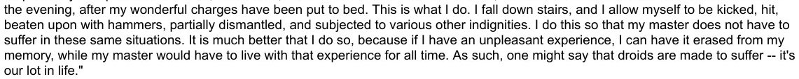

# Owner Material 037 — Star Wars D20 Drive folder (Core, Revised Core and Saga Edition): Living Force Campaign/Articles/Year 4/07:01:04 - Droid Rights.pdf [Star Wars Roleplaying Game Revised Core (d20, 2002)]

- **Source:** Wizards of the Coast Star Wars Roleplaying Game books, web enhancements, Living Force campaign modules and articles (2000–2010), from the owner's "Star Wars D20" Drive folder (only the three edition subfolders; "General" was not read, as instructed). Secondary source (licensed Legends reference). Scan OCR'd on the box; the scan stays box-only and is **not** published.
- **Method:** every scanned page was OCR'd and machine-screened sentence by sentence for power-relevant statements (fights, kills, defeats, Force feats, rankings, superweapons) that name a character on our roster; each kept sentence is quoted verbatim from the OCR text and has a crop of the printed passage directly under it. Pages with nothing power-relevant are still listed with what is on them.
- **Citation:** "*07:01:04 - Droid Rights* (SWRPG d20 Revised Core), p.X" by printed page ("scan p.X" where no printed number applies). **Weight:** Licensed RPG material: a secondary source. Narrative text sums up Legends lore; game statistics are rules for players, not canon power levels, and rank lowest.

## scan p.1 (scan page 1)

Page contents: Thesis; 'synthetic people'; history of droid servitude; protocol droid abused by children (hand-read)

- **No single roster character (rules/setting/general)** — entry/section: unnamed protocol droid: "I fall down stairs, and I allow myself to be kicked, hit, beaten upon with hammers, partially dismantled, and subjected to various other indignities. I do this so that my master does not have to suffer in these same situations. It is much better that I do so, because if I have an unpleasant experience, I can have it erased from my memory, while my master would have to live with that experience for all time. As such, one might say that droids are made to suffer -- it's our lot in life." Source: *07:01:04 - Droid Rights* (SWRPG d20 Revised Core), scan p.1
  

## scan p.2 (scan page 2)

Page contents: Memory erasure as coping; droid and clone armies; four recommendations; conclusion (hand-read)

