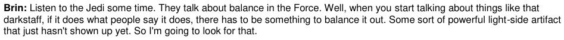

# Owner Material 037 — Star Wars D20 Drive folder (Core, Revised Core and Saga Edition): Living Force Campaign/Articles/Year 4/07:15:04 - Into the Woods.pdf [Star Wars Roleplaying Game Revised Core (d20, 2002)]

- **Source:** Wizards of the Coast Star Wars Roleplaying Game books, web enhancements, Living Force campaign modules and articles (2000–2010), from the owner's "Star Wars D20" Drive folder (only the three edition subfolders; "General" was not read, as instructed). Secondary source (licensed Legends reference). Scan OCR'd on the box; the scan stays box-only and is **not** published.
- **Method:** every scanned page was OCR'd and machine-screened sentence by sentence for power-relevant statements (fights, kills, defeats, Force feats, rankings, superweapons) that name a character on our roster; each kept sentence is quoted verbatim from the OCR text and has a crop of the printed passage directly under it. Pages with nothing power-relevant are still listed with what is on them.
- **Citation:** "*07:15:04 - Into the Woods* (SWRPG d20 Revised Core), p.X" by printed page ("scan p.X" where no printed number applies). **Weight:** Licensed RPG material: a secondary source. Narrative text sums up Legends lore; game statistics are rules for players, not canon power levels, and rank lowest.

## scan p.1 (scan page 1)

Page contents: Ryk Osentay's return; Ugnaught beating; Brin Hesk'l introduced; 'All of them!' (hand-read)

## scan p.2 (scan page 2)

Page contents: Favorite planets; secret room in Coruscant's Children's Museum; darkstaff and a balancing light-side artifact; Thaere; ship found adrift; GM notes (hand-read)

- **No single roster character (rules/setting/general)** — entry/section: Brin Hesk'l: "Listen to the Jedi some time. They talk about balance in the Force. Well, when you start talking about things like that darkstaff, if it does what people say it does, there has to be something to balance it out. Some sort of powerful light-side artifact that just hasn't shown up yet." Source: *07:15:04 - Into the Woods* (SWRPG d20 Revised Core), scan p.2
  

## scan p.3 (scan page 3)

Page contents: Brin's Codex; campaign hooks; Brin Hesk'l stat block; LF ad (hand-read)

