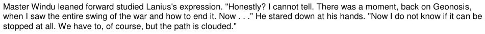
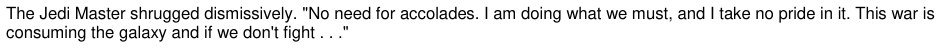
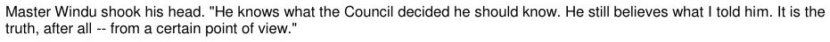
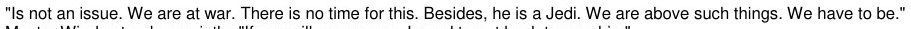

# Owner Material 037 — Star Wars D20 Drive folder (Core, Revised Core and Saga Edition): Living Force Campaign/Articles/Year 4/07:29:04 - Conversation in Shadow.pdf [Star Wars Roleplaying Game Revised Core (d20, 2002)]

- **Source:** Wizards of the Coast Star Wars Roleplaying Game books, web enhancements, Living Force campaign modules and articles (2000–2010), from the owner's "Star Wars D20" Drive folder (only the three edition subfolders; "General" was not read, as instructed). Secondary source (licensed Legends reference). Scan OCR'd on the box; the scan stays box-only and is **not** published.
- **Method:** every scanned page was OCR'd and machine-screened sentence by sentence for power-relevant statements (fights, kills, defeats, Force feats, rankings, superweapons) that name a character on our roster; each kept sentence is quoted verbatim from the OCR text and has a crop of the printed passage directly under it. Pages with nothing power-relevant are still listed with what is on them.
- **Citation:** "*07:29:04 - Conversation in Shadow* (SWRPG d20 Revised Core), p.X" by printed page ("scan p.X" where no printed number applies). **Weight:** Licensed RPG material: a secondary source. Narrative text sums up Legends lore; game statistics are rules for players, not canon power levels, and rank lowest.

## scan p.1 (scan page 1)

Page contents: Night arrival of Mace Windu; war talk (Dantooine, Geonosis); Lanius asks about Darrus Jeht, whom Mace brought into the Order (hand-read)

- **Mace Windu** — entry/section: Mace Windu: "Honestly? I cannot tell. There was a moment, back on Geonosis, when I saw the entire swing of the war and how to end it. Now . . . Now I do not know if it can be stopped at all. We have to, of course, but the path is clouded." Source: *07:29:04 - Conversation in Shadow* (SWRPG d20 Revised Core), scan p.1
  
- **Mace Windu** — entry/section: Mace Windu: "No need for accolades. I am doing what we must, and I take no pride in it. This war is consuming the galaxy and if we don't fight . . ." Source: *07:29:04 - Conversation in Shadow* (SWRPG d20 Revised Core), scan p.1
  

## scan p.2 (scan page 2)

Page contents: Academy's standing with the Council; secret about Darrus kept from him; Lanius's foreknowledge of his fate and vision of Almas; mentor-death game notes (hand-read)

- **Mace Windu** — entry/section: Mace Windu (on Darrus Jeht): "He knows what the Council decided he should know. He still believes what I told him. It is the truth, after all -- from a certain point of view." Source: *07:29:04 - Conversation in Shadow* (SWRPG d20 Revised Core), scan p.2
  
- **Mace Windu** — entry/section: Mace Windu: "Is not an issue. We are at war. There is no time for this. Besides, he is a Jedi. We are above such things. We have to be." Source: *07:29:04 - Conversation in Shadow* (SWRPG d20 Revised Core), scan p.2
  
