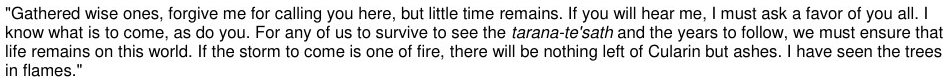

# Owner Material 037 — Star Wars D20 Drive folder (Core, Revised Core and Saga Edition): Living Force Campaign/Articles/Year 4/08:12:04 - Sacrifices.pdf [Star Wars Roleplaying Game Revised Core (d20, 2002)]

- **Source:** Wizards of the Coast Star Wars Roleplaying Game books, web enhancements, Living Force campaign modules and articles (2000–2010), from the owner's "Star Wars D20" Drive folder (only the three edition subfolders; "General" was not read, as instructed). Secondary source (licensed Legends reference). Scan OCR'd on the box; the scan stays box-only and is **not** published.
- **Method:** every scanned page was OCR'd and machine-screened sentence by sentence for power-relevant statements (fights, kills, defeats, Force feats, rankings, superweapons) that name a character on our roster; each kept sentence is quoted verbatim from the OCR text and has a crop of the printed passage directly under it. Pages with nothing power-relevant are still listed with what is on them.
- **Citation:** "*08:12:04 - Sacrifices* (SWRPG d20 Revised Core), p.X" by printed page ("scan p.X" where no printed number applies). **Weight:** Licensed RPG material: a secondary source. Narrative text sums up Legends lore; game statistics are rules for players, not canon power levels, and rank lowest.

## scan p.1 (scan page 1)

Page contents: Vurgat; Dariana and the gathered elders; Kaylanna asks who called them; a cowled stranger says he did (hand-read)

### Stat block notes (game mechanics, not feats)

- Unnamed Jedi calls the Tarasin elders through their dreams: "Are you saying you didn't call us, Great Mother Dariana? That it was not your voice we all heard in our dreams? Not your Calling that brought us from our irstats and our people?" "No," echoed a voice from the dark side of the jungle clearing. "It was mine." (Source: *08:12:04 - Sacrifices* (SWRPG d20 Revised Core), scan p.1)

## scan p.2 (scan page 2)

Page contents: Jedi steps onto the stone of the Voice; tattoo; vision of the trees in flames; offers help for the Force-gifted young at the price of hiilau; asks for the shorda'ki (hand-read)

- **No single roster character (rules/setting/general)** — entry/section: Unnamed Jedi: "Gathered wise ones, forgive me for calling you here, but little time remains. If you will hear me, I must ask a favor of you all. I know what is to come, as do you. For any of us to survive to see the tarana-te'sath and the years to follow, we must ensure that life remains on this world. If the storm to come is one of fire, there will be nothing left of Cularin but ashes. I have seen the trees in flames." Source: *08:12:04 - Sacrifices* (SWRPG d20 Revised Core), scan p.2
  

## scan p.3 (scan page 3)

Page contents: Dariana accepts; Jedi departs; Force Adept game notes; LF ad (hand-read)

