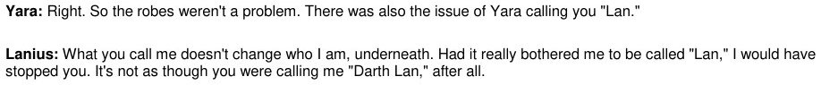
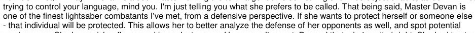
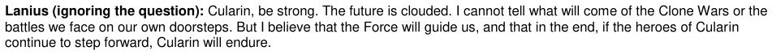

# Owner Material 037 — Star Wars D20 Drive folder (Core, Revised Core and Saga Edition): Living Force Campaign/Articles/Year 4/09:16:04 - Further Conversations with Lanius.pdf [Star Wars Roleplaying Game Revised Core (d20, 2002)]

- **Source:** Wizards of the Coast Star Wars Roleplaying Game books, web enhancements, Living Force campaign modules and articles (2000–2010), from the owner's "Star Wars D20" Drive folder (only the three edition subfolders; "General" was not read, as instructed). Secondary source (licensed Legends reference). Scan OCR'd on the box; the scan stays box-only and is **not** published.
- **Method:** every scanned page was OCR'd and machine-screened sentence by sentence for power-relevant statements (fights, kills, defeats, Force feats, rankings, superweapons) that name a character on our roster; each kept sentence is quoted verbatim from the OCR text and has a crop of the printed passage directly under it. Pages with nothing power-relevant are still listed with what is on them.
- **Citation:** "*09:16:04 - Further Conversations with Lanius* (SWRPG d20 Revised Core), p.X" by printed page ("scan p.X" where no printed number applies). **Weight:** Licensed RPG material: a secondary source. Narrative text sums up Legends lore; game statistics are rules for players, not canon power levels, and rank lowest.

## scan p.1 (scan page 1)

Page contents: Setting; Lanius aged; Yara's apology for the purple robes, 'Lan' and the date (hand-read)

- **No single roster character (rules/setting/general)** — entry/section: Lanius Qel-Bertuk: "What you call me doesn't change who I am, underneath. Had it really bothered me to be called "Lan," I would have stopped you. It's not as though you were calling me "Darth Lan," after all." Source: *09:16:04 - Further Conversations with Lanius* (SWRPG d20 Revised Core), scan p.1
  

## scan p.2 (scan page 2)

Page contents: Lanius accepts; criticism of academy methods; no single right way to train Jedi (hand-read)

## scan p.3 (scan page 3)

Page contents: Departing Padawans; training older students vs Council policy; review board; Master Devan's defensive skill; Felanil Baaks (hand-read)

- **No single roster character (rules/setting/general)** — entry/section: Lanius Qel-Bertuk (on Master Devan): "Master Devan is one of the finest lightsaber combatants I've met, from a defensive perspective. If she wants to protect herself or someone else - - that individual will be protected." Source: *09:16:04 - Further Conversations with Lanius* (SWRPG d20 Revised Core), scan p.3
  

## scan p.4 (scan page 4)

Page contents: On the war; final words to Cularin and to Yara; LF ad (hand-read)

- **No single roster character (rules/setting/general)** — entry/section: Lanius Qel-Bertuk: "Cularin, be strong. The future is clouded. I cannot tell what will come of the Clone Wars or the battles we face on our own doorsteps. But I believe that the Force will guide us, and that in the end, if the heroes of Cularin continue to step forward, Cularin will endure." Source: *09:16:04 - Further Conversations with Lanius* (SWRPG d20 Revised Core), scan p.4
  
