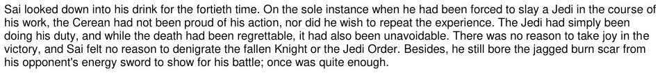

# Owner Material 037 — Star Wars D20 Drive folder (Core, Revised Core and Saga Edition): Living Force Campaign/Articles/Year 4/10:14:04 - Professionals at Work.pdf [Star Wars Roleplaying Game Revised Core (d20, 2002)]

- **Source:** Wizards of the Coast Star Wars Roleplaying Game books, web enhancements, Living Force campaign modules and articles (2000–2010), from the owner's "Star Wars D20" Drive folder (only the three edition subfolders; "General" was not read, as instructed). Secondary source (licensed Legends reference). Scan OCR'd on the box; the scan stays box-only and is **not** published.
- **Method:** every scanned page was OCR'd and machine-screened sentence by sentence for power-relevant statements (fights, kills, defeats, Force feats, rankings, superweapons) that name a character on our roster; each kept sentence is quoted verbatim from the OCR text and has a crop of the printed passage directly under it. Pages with nothing power-relevant are still listed with what is on them.
- **Citation:** "*10:14:04 - Professionals at Work* (SWRPG d20 Revised Core), p.X" by printed page ("scan p.X" where no printed number applies). **Weight:** Licensed RPG material: a secondary source. Narrative text sums up Legends lore; game statistics are rules for players, not canon power levels, and rank lowest.

## scan p.1 (scan page 1)

Page contents: Thriller's Row; the drunk OPS officer; Sai's memory of slaying a Jedi; over a dozen Jedi dead on Cularin; secure back room (hand-read)

- **No single roster character (rules/setting/general)** — entry/section: Sai-Ani Kannu: "On the sole instance when he had been forced to slay a Jedi in the course of his work, the Cerean had not been proud of his action, nor did he wish to repeat the experience. The Jedi had simply been doing his duty, and while the death had been regrettable, it had also been unavoidable. There was no reason to take joy in the victory, and Sai felt no reason to denigrate the fallen Knight or the Jedi Order. Besides, he still bore the jagged burn scar from his opponent's energy sword to show for his battle; once was quite enough." Source: *10:14:04 - Professionals at Work* (SWRPG d20 Revised Core), scan p.1
  

## scan p.2 (scan page 2)

Page contents: Contracts on eleven heroes; Sai hired to protect them in secret; 'balance of power' reasons (hand-read)

## scan p.3 (scan page 3)

Page contents: Secret Benefactor web cert; LF ad (hand-read)

