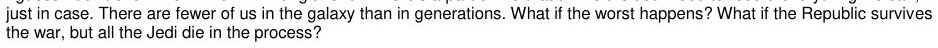
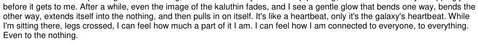

# Owner Material 037 — Star Wars D20 Drive folder (Core, Revised Core and Saga Edition): Living Force Campaign/Articles/Year 4/10:21:04 - View from the Roof.pdf [Star Wars Roleplaying Game Revised Core (d20, 2002)]

- **Source:** Wizards of the Coast Star Wars Roleplaying Game books, web enhancements, Living Force campaign modules and articles (2000–2010), from the owner's "Star Wars D20" Drive folder (only the three edition subfolders; "General" was not read, as instructed). Secondary source (licensed Legends reference). Scan OCR'd on the box; the scan stays box-only and is **not** published.
- **Method:** every scanned page was OCR'd and machine-screened sentence by sentence for power-relevant statements (fights, kills, defeats, Force feats, rankings, superweapons) that name a character on our roster; each kept sentence is quoted verbatim from the OCR text and has a crop of the printed passage directly under it. Pages with nothing power-relevant are still listed with what is on them.
- **Citation:** "*10:21:04 - View from the Roof* (SWRPG d20 Revised Core), p.X" by printed page ("scan p.X" where no printed number applies). **Weight:** Licensed RPG material: a secondary source. Narrative text sums up Legends lore; game statistics are rules for players, not canon power levels, and rank lowest.

## scan p.1 (scan page 1)

Page contents: Lora's path from the dark side; inner peace; fear the Jedi may vanish; places to meditate; the roof and the kaluthin (hand-read)

- **No single roster character (rules/setting/general)** — entry/section: Lora Nadad: "What if the worst happens? What if the Republic survives the war, but all the Jedi die in the process?" Source: *10:21:04 - View from the Roof* (SWRPG d20 Revised Core), scan p.1
  

## scan p.2 (scan page 2)

Page contents: Trance with the Force; returning to sharp focus; ch'hala cutting sways with the kaluthin; the Force is everywhere on Almas; LF ad (hand-read)

- **No single roster character (rules/setting/general)** — entry/section: Lora Nadad: "After a while, even the image of the kaluthin fades, and I see a gentle glow that bends one way, bends the other way, extends itself into the nothing, and then pulls in on itself. It's like a heartbeat, only it's the galaxy's heartbeat. While I'm sitting there, legs crossed, I can feel how much a part of it I am. I can feel how I am connected to everyone, to everything. Even to the nothing." Source: *10:21:04 - View from the Roof* (SWRPG d20 Revised Core), scan p.2
  
