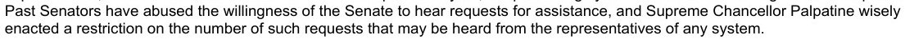
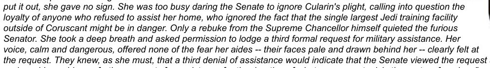
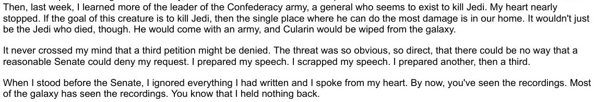

# Owner Material 037 — Star Wars D20 Drive folder (Core, Revised Core and Saga Edition): Living Force Campaign/Articles/Year 4/11:04:04 - Zero Zero Zero.pdf [Star Wars Roleplaying Game Revised Core (d20, 2002)]

- **Source:** Wizards of the Coast Star Wars Roleplaying Game books, web enhancements, Living Force campaign modules and articles (2000–2010), from the owner's "Star Wars D20" Drive folder (only the three edition subfolders; "General" was not read, as instructed). Secondary source (licensed Legends reference). Scan OCR'd on the box; the scan stays box-only and is **not** published.
- **Method:** every scanned page was OCR'd and machine-screened sentence by sentence for power-relevant statements (fights, kills, defeats, Force feats, rankings, superweapons) that name a character on our roster; each kept sentence is quoted verbatim from the OCR text and has a crop of the printed passage directly under it. Pages with nothing power-relevant are still listed with what is on them.
- **Citation:** "*11:04:04 - Zero Zero Zero* (SWRPG d20 Revised Core), p.X" by printed page ("scan p.X" where no printed number applies). **Weight:** Licensed RPG material: a secondary source. Narrative text sums up Legends lore; game statistics are rules for players, not canon power levels, and rank lowest.

## scan p.1 (scan page 1)

Page contents: Holonet account of the Senate speech; Wren's address: first petition as protocol; three-switch analogy and Palpatine's limit; second petition denied (hand-read)

- **Palpatine (Darth Sidious)** — entry/section: Senator Lavina Wren (on Supreme Chancellor Palpatine): "Past Senators have abused the willingness of the Senate to hear requests for assistance, and Supreme Chancellor Palpatine wisely enacted a restriction on the number of such requests that may be heard from the representatives of any system." Source: *11:04:04 - Zero Zero Zero* (SWRPG d20 Revised Core), scan p.1
  
- **Palpatine (Darth Sidious)** — entry/section: Holonet article (on Senator Wren and the Supreme Chancellor): "She was too busy daring the Senate to ignore Cularin's plight, calling into question the loyalty of anyone who refused to assist her home, who ignored the fact that the single largest Jedi training facility outside of Coruscant might be in danger. Only a rebuke from the Supreme Chancellor himself quieted the furious Senator." Source: *11:04:04 - Zero Zero Zero* (SWRPG d20 Revised Core), scan p.1
  

## scan p.2 (scan page 2)

Page contents: Senate's reply; freed from career concerns; the Jedi-killing general; third petition denied; vow to fight beside Cularin (hand-read)

- **General Grievous** — entry/section: Senator Lavina Wren (on the Confederacy's Jedi-killing general): "Then, last week, I learned more of the leader of the Confederacy army, a general who seems to exist to kill Jedi. My heart nearly stopped. If the goal of this creature is to kill Jedi, then the single place where he can do the most damage is in our home. It wouldn't just be the Jedi who died, though. He would come with an army, and Cularin would be wiped from the galaxy." Source: *11:04:04 - Zero Zero Zero* (SWRPG d20 Revised Core), scan p.2
  
