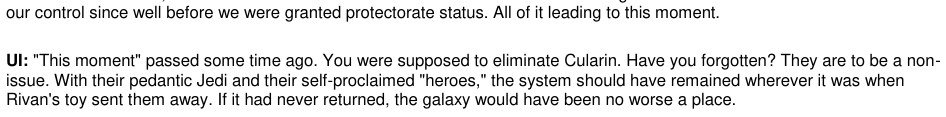
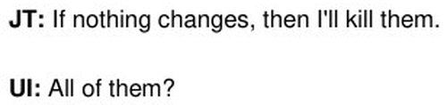
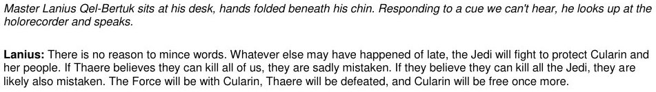

# Owner Material 037 — Star Wars D20 Drive folder (Core, Revised Core and Saga Edition): Living Force Campaign/Articles/Year 4/12:09:04 - Tramsig's Plan.pdf [Star Wars Roleplaying Game Revised Core (d20, 2002)]

- **Source:** Wizards of the Coast Star Wars Roleplaying Game books, web enhancements, Living Force campaign modules and articles (2000–2010), from the owner's "Star Wars D20" Drive folder (only the three edition subfolders; "General" was not read, as instructed). Secondary source (licensed Legends reference). Scan OCR'd on the box; the scan stays box-only and is **not** published.
- **Method:** every scanned page was OCR'd and machine-screened sentence by sentence for power-relevant statements (fights, kills, defeats, Force feats, rankings, superweapons) that name a character on our roster; each kept sentence is quoted verbatim from the OCR text and has a crop of the printed passage directly under it. Pages with nothing power-relevant are still listed with what is on them.
- **Citation:** "*12:09:04 - Tramsig's Plan* (SWRPG d20 Revised Core), p.X" by printed page ("scan p.X" where no printed number applies). **Weight:** Licensed RPG material: a secondary source. Narrative text sums up Legends lore; game statistics are rules for players, not canon power levels, and rank lowest.

## scan p.1 (scan page 1)

Page contents: Background on the earlier Tramsig document; broadcast intro; start of the recording transcript (hand-read)

## scan p.2 (scan page 2)

Page contents: Transcript continues (Rivan's toy; 'All of them'); reactions from Lanius, Chistor and Impeveri (hand-read)

- **Darth Rivan** — entry/section: Unidentified speaker (recording with Admiral Tramsig): ""This moment" passed some time ago. You were supposed to eliminate Cularin. Have you forgotten? They are to be a nonissue. With their pedantic Jedi and their self-proclaimed "heroes," the system should have remained wherever it was when Rivan's toy sent them away. If it had never returned, the galaxy would have been no worse a place." Source: *12:09:04 - Tramsig's Plan* (SWRPG d20 Revised Core), scan p.2
  
- **No single roster character (rules/setting/general)** — entry/section: Admiral Jir Tramsig: "If nothing changes, then I'll kill them." Source: *12:09:04 - Tramsig's Plan* (SWRPG d20 Revised Core), scan p.2
  
- **No single roster character (rules/setting/general)** — entry/section: Master Lanius Qel-Bertuk: "There is no reason to mince words. Whatever else may have happened of late, the Jedi will fight to protect Cularin and her people. If Thaere believes they can kill all of us, they are sadly mistaken. If they believe they can kill all the Jedi, they are likely also mistaken. The Force will be with Cularin, Thaere will be defeated, and Cularin will be free once more." Source: *12:09:04 - Tramsig's Plan* (SWRPG d20 Revised Core), scan p.2
  

## scan p.3 (scan page 3)

Page contents: Reactions from Dal'nay, Broof Yurdel and Senator Wren; Yara's sign-off; LF ad (hand-read)

