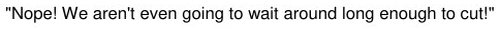

# Owner Material 037 — Star Wars D20 Drive folder (Core, Revised Core and Saga Edition): Living Force Campaign/Articles/Year 4/12:16:04 - Standoffs.pdf [Star Wars Roleplaying Game Revised Core (d20, 2002)]

- **Source:** Wizards of the Coast Star Wars Roleplaying Game books, web enhancements, Living Force campaign modules and articles (2000–2010), from the owner's "Star Wars D20" Drive folder (only the three edition subfolders; "General" was not read, as instructed). Secondary source (licensed Legends reference). Scan OCR'd on the box; the scan stays box-only and is **not** published.
- **Method:** every scanned page was OCR'd and machine-screened sentence by sentence for power-relevant statements (fights, kills, defeats, Force feats, rankings, superweapons) that name a character on our roster; each kept sentence is quoted verbatim from the OCR text and has a crop of the printed passage directly under it. Pages with nothing power-relevant are still listed with what is on them.
- **Citation:** "*12:16:04 - Standoffs* (SWRPG d20 Revised Core), p.X" by printed page ("scan p.X" where no printed number applies). **Weight:** Licensed RPG material: a secondary source. Narrative text sums up Legends lore; game statistics are rules for players, not canon power levels, and rank lowest.

## scan p.1 (scan page 1)

Page contents: Firefight; Darrus covers the twins' retreat, cutting down battle droids; Trandoshans block the ramp (hand-read)

- **No single roster character (rules/setting/general)** — entry/section: Milinae: "Nope! We aren't even going to wait around long enough to cut!" Source: *12:16:04 - Standoffs* (SWRPG d20 Revised Core), scan p.1
  

### Stat block notes (game mechanics, not feats)

- Darrus Jeht vs battle droids: With that, he leapt over the crate, spiraling in midair to bat down two blasts with his violet lightsaber, and landed in front of their attackers. "Get to the ship!" (Source: *12:16:04 - Standoffs* (SWRPG d20 Revised Core), scan p.1)

## scan p.2 (scan page 2)

Page contents: Tril's Force feat; Darrus leads gunners past; Weequay killed; reason for taking a ship from R; Ma'Haffee has no used ships; game notes begin (hand-read)

### Stat block notes (game mechanics, not feats)

- Trilinae drops the girders: Above the heads of the Trandoshans, a hanging platform piled with steel beams began to sway. As Milinae watched in disbelief, the release handle on the platform began to twist and open. One of the alien gunmen had the presence of mind to hear the metallic squeal of the vise as it came open, but that awareness was not enough to save him as tons of construction girders smashed down in a deadly rain of steel and scales. (Source: *12:16:04 - Standoffs* (SWRPG d20 Revised Core), scan p.2)

## scan p.3 (scan page 3)

Page contents: Ship purchase rules and list; new droid rules and price list (hand-read)

## scan p.4 (scan page 4)

Page contents: Rest of the droid list; one droid and one ship limit; LF ad (hand-read)

