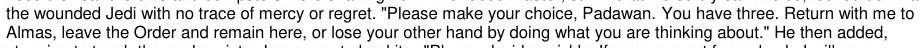
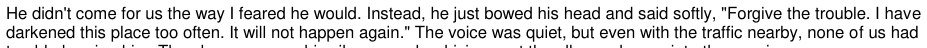

# Owner Material 037 — Star Wars D20 Drive folder (Core, Revised Core and Saga Edition): Living Force Campaign/Articles/Year 4/12:23:04 - Disapproval.pdf [Star Wars Roleplaying Game Revised Core (d20, 2002)]

- **Source:** Wizards of the Coast Star Wars Roleplaying Game books, web enhancements, Living Force campaign modules and articles (2000–2010), from the owner's "Star Wars D20" Drive folder (only the three edition subfolders; "General" was not read, as instructed). Secondary source (licensed Legends reference). Scan OCR'd on the box; the scan stays box-only and is **not** published.
- **Method:** every scanned page was OCR'd and machine-screened sentence by sentence for power-relevant statements (fights, kills, defeats, Force feats, rankings, superweapons) that name a character on our roster; each kept sentence is quoted verbatim from the OCR text and has a crop of the printed passage directly under it. Pages with nothing power-relevant are still listed with what is on them.
- **Citation:** "*12:23:04 - Disapproval* (SWRPG d20 Revised Core), p.X" by printed page ("scan p.X" where no printed number applies). **Weight:** Licensed RPG material: a secondary source. Narrative text sums up Legends lore; game statistics are rules for players, not canon power levels, and rank lowest.

## scan p.1 (scan page 1)

Page contents: Pilots at the Crosstown; Dag's Separatist sympathies; drunk Jedi in a flight suit; robed Master arrives; alley confrontation (hand-read)

## scan p.2 (scan page 2)

Page contents: The hand cut off; three choices; the Master's apology; Battlefield Cerea report; DSP demotion game notes (hand-read)

- **No single roster character (rules/setting/general)** — entry/section: Robed Jedi Master: "Please make your choice, Padawan. You have three. Return with me to Almas, leave the Order and remain here, or lose your other hand by doing what you are thinking about." Source: *12:23:04 - Disapproval* (SWRPG d20 Revised Core), scan p.2
  
- **No single roster character (rules/setting/general)** — entry/section: Robed Jedi Master: "Forgive the trouble. I have darkened this place too often. It will not happen again." Source: *12:23:04 - Disapproval* (SWRPG d20 Revised Core), scan p.2
  

### Stat block notes (game mechanics, not feats)

- Robed Jedi Master disarms a drunken Jedi: Then there was a rustle of robes and a streak of purple light. It happened so fast that I don't think any of us, not even Colnor with that cybernetic eye of his, knew what had happened until we saw a flight suit sleeve cuff hit the ground, the Jedi's hand still in it. His lightsaber, which hadn't even been ignited yet, clattered down beside it. (Source: *12:23:04 - Disapproval* (SWRPG d20 Revised Core), scan p.2)

## scan p.3 (scan page 3)

Page contents: Demotion and redemption rules; LF ad (hand-read)

