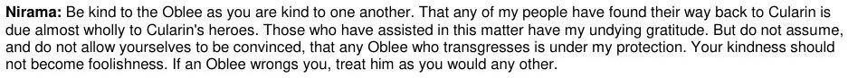
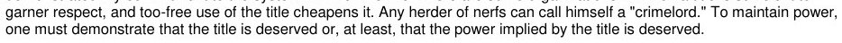

# Owner Material 037 — Star Wars D20 Drive folder (Core, Revised Core and Saga Edition): Living Force Campaign/Articles/Year 5/01:13:05 - The Oblee.pdf [Star Wars Roleplaying Game Revised Core (d20, 2002)]

- **Source:** Wizards of the Coast Star Wars Roleplaying Game books, web enhancements, Living Force campaign modules and articles (2000–2010), from the owner's "Star Wars D20" Drive folder (only the three edition subfolders; "General" was not read, as instructed). Secondary source (licensed Legends reference). Scan OCR'd on the box; the scan stays box-only and is **not** published.
- **Method:** every scanned page was OCR'd and machine-screened sentence by sentence for power-relevant statements (fights, kills, defeats, Force feats, rankings, superweapons) that name a character on our roster; each kept sentence is quoted verbatim from the OCR text and has a crop of the printed passage directly under it. Pages with nothing power-relevant are still listed with what is on them.
- **Citation:** "*01:13:05 - The Oblee* (SWRPG d20 Revised Core), p.X" by printed page ("scan p.X" where no printed number applies). **Weight:** Licensed RPG material: a secondary source. Narrative text sums up Legends lore; game statistics are rules for players, not canon power levels, and rank lowest.

## scan p.1 (scan page 1)

Page contents: Soundstage intro; Yara's apology; Nirama appears onscreen; jabs at Ryk (hand-read)

## scan p.2 (scan page 2)

Page contents: Nicknames ('Nir', 'Lan'); the Oblee return; Nirama's anger and his show of force; his message to Cularin; game notes header (hand-read)

- **No single roster character (rules/setting/general)** — entry/section: Nirama: "Be kind to the Oblee as you are kind to one another. That any of my people have found their way back to Cularin is due almost wholly to Cularin's heroes. Those who have assisted in this matter have my undying gratitude. But do not assume, and do not allow yourselves to be convinced, that any Oblee who transgresses is under my protection. Your kindness should not become foolishness. If an Oblee wrongs you, treat him as you would any other." Source: *01:13:05 - The Oblee* (SWRPG d20 Revised Core), scan p.2
  
- **No single roster character (rules/setting/general)** — entry/section: Nirama: "Any herder of nerfs can call himself a "crimelord." To maintain power, one must demonstrate that the title is deserved or, at least, that the power implied by the title is deserved." Source: *01:13:05 - The Oblee* (SWRPG d20 Revised Core), scan p.2
  

## scan p.3 (scan page 3)

Page contents: Oblee species: description, darkstaff history, Oblis, personality, language, adventurers, traits, commoner stats (hand-read)

