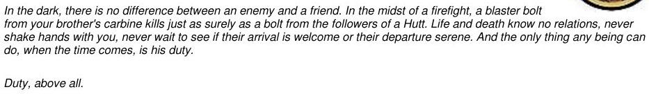

# Owner Material 037 — Star Wars D20 Drive folder (Core, Revised Core and Saga Edition): Living Force Campaign/Articles/Year 5/03:10:05 - 1 - The Best Defense.pdf [Star Wars Roleplaying Game Revised Core (d20, 2002)]

- **Source:** Wizards of the Coast Star Wars Roleplaying Game books, web enhancements, Living Force campaign modules and articles (2000–2010), from the owner's "Star Wars D20" Drive folder (only the three edition subfolders; "General" was not read, as instructed). Secondary source (licensed Legends reference). Scan OCR'd on the box; the scan stays box-only and is **not** published.
- **Method:** every scanned page was OCR'd and machine-screened sentence by sentence for power-relevant statements (fights, kills, defeats, Force feats, rankings, superweapons) that name a character on our roster; each kept sentence is quoted verbatim from the OCR text and has a crop of the printed passage directly under it. Pages with nothing power-relevant are still listed with what is on them.
- **Citation:** "*03:10:05 - 1 - The Best Defense* (SWRPG d20 Revised Core), p.X" by printed page ("scan p.X" where no printed number applies). **Weight:** Licensed RPG material: a secondary source. Narrative text sums up Legends lore; game statistics are rules for players, not canon power levels, and rank lowest.

## scan p.1 (scan page 1)

Page contents: Framing note on authorship; opening on duty; Nightwing's jamming rifle; Commander Kulkis enters (hand-read)

- **No single roster character (rules/setting/general)** — entry/section: Osten Dal'Nay (attributed story): "In the dark, there is no difference between an enemy and a friend. In the midst of a firefight, a blaster bolt from your brother's carbine kills just as surely as a bolt from the followers of a Hutt. Life and death know no relations, never shake hands with you, never wait to see if their arrival is welcome or their departure serene. And the only thing any being can do, when the time comes, is his duty." Source: *03:10:05 - 1 - The Best Defense* (SWRPG d20 Revised Core), scan p.1
  

## scan p.2 (scan page 2)

Page contents: Kulkis introduces himself; reputation as 'Cruel Kiss'; Thaereian oath; how to defend; Kulkis demands the truth (hand-read)

## scan p.3 (scan page 3)

Page contents: Knife attack; Nightwing kills Kulkis; dying words; body sent out an airlock (hand-read)

### Stat block notes (game mechanics, not feats)

- Nightwing turns Kulkis's knife: Nightwing moved without thought as Kulkis's arm came up, driving the point of the knife at the back of his head. He twisted down and away, lashing out with his right hand to catch the Nikto's wrist and twist it, to wrench the knife free. The counterstrike from Kulkis's other hand caught him across the face, opened a gash on the bridge of his nose, but he didn't release the hand that held the knife. Using the momentum of the blow to his face, Nightwing spun back and down, sweeping the Nikto's legs from beneath him and sending the thick-bodied Commander to the floor. (Source: *03:10:05 - 1 - The Best Defense* (SWRPG d20 Revised Core), scan p.3)
