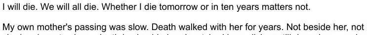
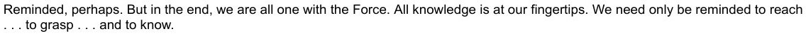

# Owner Material 037 — Star Wars D20 Drive folder (Core, Revised Core and Saga Edition): Living Force Campaign/Articles/Year 5/04:14:05 - A Mother's Memoirs Concluded.pdf [Star Wars Roleplaying Game Revised Core (d20, 2002)]

- **Source:** Wizards of the Coast Star Wars Roleplaying Game books, web enhancements, Living Force campaign modules and articles (2000–2010), from the owner's "Star Wars D20" Drive folder (only the three edition subfolders; "General" was not read, as instructed). Secondary source (licensed Legends reference). Scan OCR'd on the box; the scan stays box-only and is **not** published.
- **Method:** every scanned page was OCR'd and machine-screened sentence by sentence for power-relevant statements (fights, kills, defeats, Force feats, rankings, superweapons) that name a character on our roster; each kept sentence is quoted verbatim from the OCR text and has a crop of the printed passage directly under it. Pages with nothing power-relevant are still listed with what is on them.
- **Citation:** "*04:14:05 - A Mother's Memoirs Concluded* (SWRPG d20 Revised Core), p.X" by printed page ("scan p.X" where no printed number applies). **Weight:** Licensed RPG material: a secondary source. Narrative text sums up Legends lore; game statistics are rules for players, not canon power levels, and rank lowest.

## scan p.1 (scan page 1)

Page contents: Final session; recordings can't truly teach; words beneath the words; stepping back to teach her children; endings; death; her mother's slow death (hand-read)

- **No single roster character (rules/setting/general)** — entry/section: Mother Dariana: "I will die. We will all die. Whether I die tomorrow or in ten years matters not." Source: *04:14:05 - A Mother's Memoirs Concluded* (SWRPG d20 Revised Core), scan p.1
  

## scan p.2 (scan page 2)

Page contents: Her mother's lesson on grief; trees and kilassin don't grieve; all knowledge at our fingertips; Dariana's stat block (hand-read)

- **No single roster character (rules/setting/general)** — entry/section: Mother Dariana: "Reminded, perhaps. But in the end, we are all one with the Force. All knowledge is at our fingertips. We need only be reminded to reach ...to grasp... and to know." Source: *04:14:05 - A Mother's Memoirs Concluded* (SWRPG d20 Revised Core), scan p.2
  
