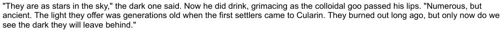
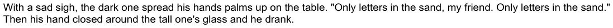
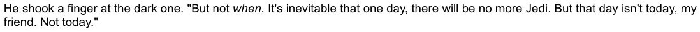

# Owner Material 037 — Star Wars D20 Drive folder (Core, Revised Core and Saga Edition): Living Force Campaign/Articles/Year 5/04:28:05 - Letters in the Sand.pdf [Star Wars Roleplaying Game Revised Core (d20, 2002)]

- **Source:** Wizards of the Coast Star Wars Roleplaying Game books, web enhancements, Living Force campaign modules and articles (2000–2010), from the owner's "Star Wars D20" Drive folder (only the three edition subfolders; "General" was not read, as instructed). Secondary source (licensed Legends reference). Scan OCR'd on the box; the scan stays box-only and is **not** published.
- **Method:** every scanned page was OCR'd and machine-screened sentence by sentence for power-relevant statements (fights, kills, defeats, Force feats, rankings, superweapons) that name a character on our roster; each kept sentence is quoted verbatim from the OCR text and has a crop of the printed passage directly under it. Pages with nothing power-relevant are still listed with what is on them.
- **Citation:** "*04:28:05 - Letters in the Sand* (SWRPG d20 Revised Core), p.X" by printed page ("scan p.X" where no printed number applies). **Weight:** Licensed RPG material: a secondary source. Narrative text sums up Legends lore; game statistics are rules for players, not canon power levels, and rank lowest.

## scan p.1 (scan page 1)

Page contents: Two strangers in the Sophouse draw a crowd; the Jedi hunter's destruction; Jedi afraid and dying across the galaxy; stars exploding metaphor; what is lost if the Jedi die (hand-read)

## scan p.2 (scan page 2)

Page contents: No peace already; Jedi as dead starlight; 'there is no death' versus the bodies in Hedrett; the circular universe; no new Padawans; 'letters in the sand' (hand-read)

- **No single roster character (rules/setting/general)** — entry/section: The dark one (Sophouse stranger): "They are as stars in the sky. Numerous, but ancient. The light they offer was generations old when the first settlers came to Cularin. They burned out long ago, but only now do we see the dark they will leave behind." Source: *04:28:05 - Letters in the Sand* (SWRPG d20 Revised Core), scan p.2
  
- **No single roster character (rules/setting/general)** — entry/section: The dark one (Sophouse stranger): "Only letters in the sand, my friend. Only letters in the sand." Source: *04:28:05 - Letters in the Sand* (SWRPG d20 Revised Core), scan p.2
  
- **No single roster character (rules/setting/general)** — entry/section: The tall one (Sophouse stranger): "It's inevitable that one day, there will be no more Jedi. But that day isn't today, my friend. Not today." Source: *04:28:05 - Letters in the Sand* (SWRPG d20 Revised Core), scan p.2
  
