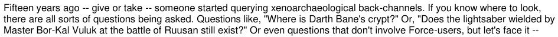
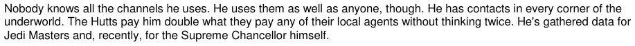

# Owner Material 037 — Star Wars D20 Drive folder (Core, Revised Core and Saga Edition): Living Force Campaign/Articles/Year 5/05:26:05 - Insider.pdf [Star Wars Roleplaying Game Revised Core (d20, 2002)]

- **Source:** Wizards of the Coast Star Wars Roleplaying Game books, web enhancements, Living Force campaign modules and articles (2000–2010), from the owner's "Star Wars D20" Drive folder (only the three edition subfolders; "General" was not read, as instructed). Secondary source (licensed Legends reference). Scan OCR'd on the box; the scan stays box-only and is **not** published.
- **Method:** every scanned page was OCR'd and machine-screened sentence by sentence for power-relevant statements (fights, kills, defeats, Force feats, rankings, superweapons) that name a character on our roster; each kept sentence is quoted verbatim from the OCR text and has a crop of the printed passage directly under it. Pages with nothing power-relevant are still listed with what is on them.
- **Citation:** "*05:26:05 - Insider* (SWRPG d20 Revised Core), p.X" by printed page ("scan p.X" where no printed number applies). **Weight:** Licensed RPG material: a secondary source. Narrative text sums up Legends lore; game statistics are rules for players, not canon power levels, and rank lowest.

## scan p.1 (scan page 1)

Page contents: Sot-sirc is in Cularin; information broker for Hutts, Jedi and the Supreme Chancellor; xenoarchaeology queries (Darth Bane's crypt, Bor-Kal Vuluk's saber); client's search for an artifact in Cularin (hand-read)

- **Darth Bane** — entry/section: Holonet poster (on xenoarchaeological back-channels): "If you know where to look, there are all sorts of questions being asked. Questions like, "Where is Darth Bane's crypt?" Or, "Does the lightsaber wielded by Master Bor-Kal Vuluk at the battle of Ruusan still exist?"" Source: *05:26:05 - Insider* (SWRPG d20 Revised Core), scan p.1
  
- **Palpatine (Darth Sidious)** — entry/section: Holonet poster (on Sot-sirc): "The Hutts pay him double what they pay any of their local agents without thinking twice. He's gathered data for Jedi Masters and, recently, for the Supreme Chancellor himself." Source: *05:26:05 - Insider* (SWRPG d20 Revised Core), scan p.1
  

## scan p.2 (scan page 2)

Page contents: The artifact was the darkstaff, found by Len Markus with his help; GM notes: Cris Tosiren's background, appearance, method; stat block (hand-read)

