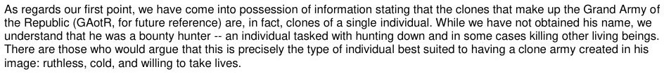
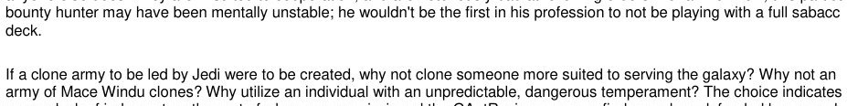
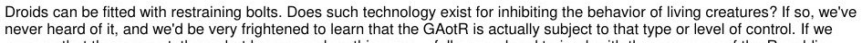

# Owner Material 037 — Star Wars D20 Drive folder (Core, Revised Core and Saga Edition): Living Force Campaign/Articles/Year 5/06:02:05 - Conspiracy.pdf [Star Wars Roleplaying Game Revised Core (d20, 2002)]

- **Source:** Wizards of the Coast Star Wars Roleplaying Game books, web enhancements, Living Force campaign modules and articles (2000–2010), from the owner's "Star Wars D20" Drive folder (only the three edition subfolders; "General" was not read, as instructed). Secondary source (licensed Legends reference). Scan OCR'd on the box; the scan stays box-only and is **not** published.
- **Method:** every scanned page was OCR'd and machine-screened sentence by sentence for power-relevant statements (fights, kills, defeats, Force feats, rankings, superweapons) that name a character on our roster; each kept sentence is quoted verbatim from the OCR text and has a crop of the printed passage directly under it. Pages with nothing power-relevant are still listed with what is on them.
- **Citation:** "*06:02:05 - Conspiracy* (SWRPG d20 Revised Core), p.X" by printed page ("scan p.X" where no printed number applies). **Weight:** Licensed RPG material: a secondary source. Narrative text sums up Legends lore; game statistics are rules for players, not canon power levels, and rank lowest.

## scan p.1 (scan page 1)

Page contents: Framing on Herrera and Reston; essay intro; three points; the bounty hunter template; why not Mace Windu clones; a secondary purpose (hand-read)

- **Jango Fett** — entry/section: San Herrera and Nia Reston (on the clone template): "As regards our first point, we have come into possession of information stating that the clones that make up the Grand Army of the Republic (GAotR, for future reference) are, in fact, clones of a single individual. While we have not obtained his name, we understand that he was a bounty hunter -- an individual tasked with hunting down and in some cases killing other living beings. There are those who would argue that this is precisely the type of individual best suited to having a clone army created in his image: ruthless, cold, and willing to take lives." Source: *06:02:05 - Conspiracy* (SWRPG d20 Revised Core), scan p.1
  
- **Jango Fett; Mace Windu** — entry/section: San Herrera and Nia Reston: "If a clone army to be led by Jedi were to be created, why not clone someone more suited to serving the galaxy? Why not an army of Mace Windu clones? Why utilize an individual with an unpredictable, dangerous temperament?" Source: *06:02:05 - Conspiracy* (SWRPG d20 Revised Core), scan p.1
  

## scan p.2 (scan page 2)

Page contents: Clones and droids as synthetic people; free will and revolt; no restraining bolts for the living; imperfect programming; what becomes of the clones after the war (hand-read)

- **No single roster character (rules/setting/general)** — entry/section: San Herrera and Nia Reston: "Droids can be fitted with restraining bolts. Does such technology exist for inhibiting the behavior of living creatures? If so, we've never heard of it, and we'd be very frightened to learn that the GAotR is actually subject to that type or level of control." Source: *06:02:05 - Conspiracy* (SWRPG d20 Revised Core), scan p.2
  
