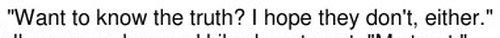
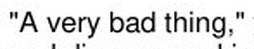

# Owner Material 037 — Star Wars D20 Drive folder (Core, Revised Core and Saga Edition): Living Force Campaign/Articles/Year 5/06:09:05 - Banner Days.pdf [Star Wars Roleplaying Game Revised Core (d20, 2002)]

- **Source:** Wizards of the Coast Star Wars Roleplaying Game books, web enhancements, Living Force campaign modules and articles (2000–2010), from the owner's "Star Wars D20" Drive folder (only the three edition subfolders; "General" was not read, as instructed). Secondary source (licensed Legends reference). Scan OCR'd on the box; the scan stays box-only and is **not** published.
- **Method:** every scanned page was OCR'd and machine-screened sentence by sentence for power-relevant statements (fights, kills, defeats, Force feats, rankings, superweapons) that name a character on our roster; each kept sentence is quoted verbatim from the OCR text and has a crop of the printed passage directly under it. Pages with nothing power-relevant are still listed with what is on them.
- **Citation:** "*06:09:05 - Banner Days* (SWRPG d20 Revised Core), p.X" by printed page ("scan p.X" where no printed number applies). **Weight:** Licensed RPG material: a secondary source. Narrative text sums up Legends lore; game statistics are rules for players, not canon power levels, and rank lowest.

## scan p.1 (scan page 1)

Page contents: Liberation parade; Taan and Dyrla argue about Osten and Joker Squadron; their mother's death; Beta Company's missing members (hand-read)

## scan p.2 (scan page 2)

Page contents: Man's white lie; fighter flyover with the Cularin seal; protest signs; 'A very bad thing'; the man is the new General; game notes on medal and commission (hand-read)

- **No single roster character (rules/setting/general)** — entry/section: Osten Dal'Nay (unrecognized at the parade): "Want to know the truth? I hope they don't, either." Source: *06:09:05 - Banner Days* (SWRPG d20 Revised Core), scan p.2
  
- **No single roster character (rules/setting/general)** — entry/section: Osten Dal'Nay (unrecognized at the parade, on martial law): "A very bad thing." Source: *06:09:05 - Banner Days* (SWRPG d20 Revised Core), scan p.2
  

## scan p.3 (scan page 3)

Page contents: Commission pay; open purchase of heavy blasters and light repeating blaster rifles (hand-read)

