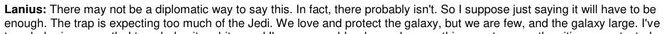
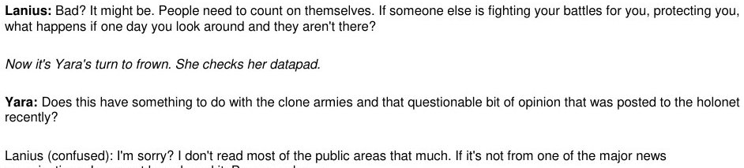
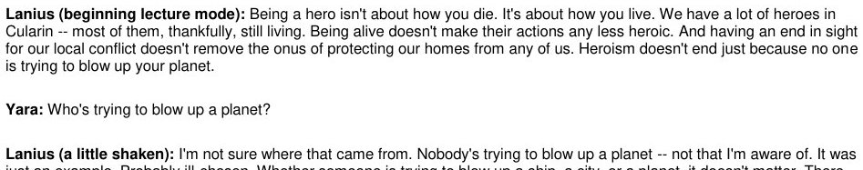

# Owner Material 037 — Star Wars D20 Drive folder (Core, Revised Core and Saga Edition): Living Force Campaign/Articles/Year 5/06:09:05 - Conversations with Lanius.pdf [Star Wars Roleplaying Game Revised Core (d20, 2002)]

- **Source:** Wizards of the Coast Star Wars Roleplaying Game books, web enhancements, Living Force campaign modules and articles (2000–2010), from the owner's "Star Wars D20" Drive folder (only the three edition subfolders; "General" was not read, as instructed). Secondary source (licensed Legends reference). Scan OCR'd on the box; the scan stays box-only and is **not** published.
- **Method:** every scanned page was OCR'd and machine-screened sentence by sentence for power-relevant statements (fights, kills, defeats, Force feats, rankings, superweapons) that name a character on our roster; each kept sentence is quoted verbatim from the OCR text and has a crop of the printed passage directly under it. Pages with nothing power-relevant are still listed with what is on them.
- **Citation:** "*06:09:05 - Conversations with Lanius* (SWRPG d20 Revised Core), p.X" by printed page ("scan p.X" where no printed number applies). **Weight:** Licensed RPG material: a secondary source. Narrative text sums up Legends lore; game statistics are rules for players, not canon power levels, and rank lowest.

## scan p.1 (scan page 1)

Page contents: Framing on Yara's rising fame; Lanius's invitation; apology for the droid hunter; the trap of expecting too much of the Jedi (hand-read)

- **No single roster character (rules/setting/general)** — entry/section: Master Lanius Qel-Bertuk: "There may not be a diplomatic way to say this. In fact, there probably isn't. So I suppose just saying it will have to be enough. The trap is expecting too much of the Jedi. We love and protect the galaxy, but we are few, and the galaxy large." Source: *06:09:05 - Conversations with Lanius* (SWRPG d20 Revised Core), scan p.1
  

## scan p.2 (scan page 2)

Page contents: People must count on themselves; future is clouded; Cularin compared with Kashyyyk; no time for complacency; heroes aren't about how they die; 'blow up a planet' slip (hand-read)

- **No single roster character (rules/setting/general)** — entry/section: Master Lanius Qel-Bertuk: "Bad? It might be. People need to count on themselves. If someone else is fighting your battles for you, protecting you, what happens if one day you look around and they aren't there?" Source: *06:09:05 - Conversations with Lanius* (SWRPG d20 Revised Core), scan p.2
  
- **No single roster character (rules/setting/general)** — entry/section: Master Lanius Qel-Bertuk: "Being a hero isn't about how you die. It's about how you live. We have a lot of heroes in Cularin -- most of them, thankfully, still living. Being alive doesn't make their actions any less heroic. And having an end in sight for our local conflict doesn't remove the onus of protecting our homes from any of us. Heroism doesn't end just because no one is trying to blow up your planet." Source: *06:09:05 - Conversations with Lanius* (SWRPG d20 Revised Core), scan p.2
  

## scan p.3 (scan page 3)

Page contents: Every action for the greater good; 'not the time for that lesson'; Lanius stat block (lightsaber improved by Felanil Baaks) (hand-read)

