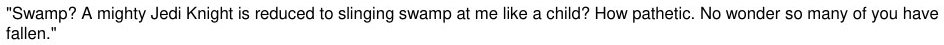
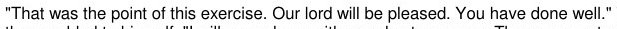

# Owner Material 037 — Star Wars D20 Drive folder (Core, Revised Core and Saga Edition): Living Force Campaign/Articles/Year 5/06:16:05 - Dark Heart.pdf [Star Wars Roleplaying Game Revised Core (d20, 2002)]

- **Source:** Wizards of the Coast Star Wars Roleplaying Game books, web enhancements, Living Force campaign modules and articles (2000–2010), from the owner's "Star Wars D20" Drive folder (only the three edition subfolders; "General" was not read, as instructed). Secondary source (licensed Legends reference). Scan OCR'd on the box; the scan stays box-only and is **not** published.
- **Method:** every scanned page was OCR'd and machine-screened sentence by sentence for power-relevant statements (fights, kills, defeats, Force feats, rankings, superweapons) that name a character on our roster; each kept sentence is quoted verbatim from the OCR text and has a crop of the printed passage directly under it. Pages with nothing power-relevant are still listed with what is on them.
- **Citation:** "*06:16:05 - Dark Heart* (SWRPG d20 Revised Core), p.X" by printed page ("scan p.X" where no printed number applies). **Weight:** Licensed RPG material: a secondary source. Narrative text sums up Legends lore; game statistics are rules for players, not canon power levels, and rank lowest.

## scan p.1 (scan page 1)

Page contents: Darrus flees through the mist; twin sabers through his fighter's hull; he buries her in mud; falling tree; he hurls the trunk at her (hand-read)

- **No single roster character (rules/setting/general)** — entry/section: Dark Jedi huntress: "Swamp? A mighty Jedi Knight is reduced to slinging swamp at me like a child? How pathetic. No wonder so many of you have fallen." Source: *06:16:05 - Dark Heart* (SWRPG d20 Revised Core), scan p.1
  

### Stat block notes (game mechanics, not feats)

- Darrus Jeht hurls the tree: The tree she was on tore free from the ground and hurtled into the air. She leaped free and bore down on him, expecting a similar response from Jeht, but she was completely blindsided when the huge trunk stopped and pivoted in midair without the slightest pause in momentum. It caught her full in the body, sending her sailing with a curse of pain and rage sideways into the misty mire. (Source: *06:16:05 - Dark Heart* (SWRPG d20 Revised Core), scan p.1)

## scan p.2 (scan page 2)

Page contents: Reaches the beacon; she impales him; Force push; dark-side Force storm; gunship interrupts; huntress reports to her master; game notes begin (hand-read)

- **No single roster character (rules/setting/general)** — entry/section: Hologram master (unnamed): "That was the point of this exercise. Our lord will be pleased. You have done well." Source: *06:16:05 - Dark Heart* (SWRPG d20 Revised Core), scan p.2
  

### Stat block notes (game mechanics, not feats)

- Dark Jedi huntress impales Darrus Jeht: With a lunge so blindingly fast that his eyes never tracked it, the Dark Jedi thrust her other lightsaber forward against his side and ignited the blade, impaling him. Jeht felt the shock of a hole drilled straight through his ribs and lung, felt the burning pain of instant cauterization. (Source: *06:16:05 - Dark Heart* (SWRPG d20 Revised Core), scan p.2)
- Darrus Jeht's Force storm: Reaching out with the storm, his own howl of rage lending thunder to the tempest, he sent the full might of his fury crashing down over her. She screamed and turned to run as the maelstrom struck, coursing through her body with electric arcs of agony. Her lightsabers fell, lifeless, from her spasming hands as she flew backward and was pinned to a tree at the edge of the clearing. Buffeted by gale-force winds and racked by lightning, she could only writhe under the onslaught. (Source: *06:16:05 - Dark Heart* (SWRPG d20 Revised Core), scan p.2)

## scan p.3 (scan page 3)

Page contents: Delta-7 Aethersprite rules; extra Dark Side Point for Jedi (hand-read)

